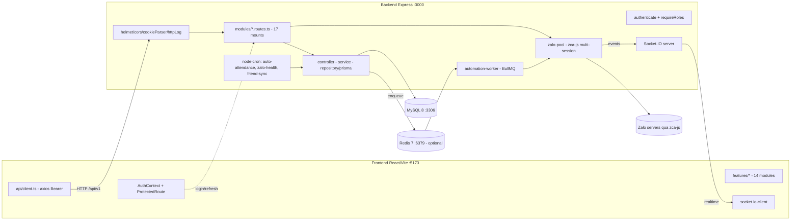

# PROJECT_DOCUMENTATION — automation_cskh

> Tài liệu tổng hợp kiến trúc, nghiệp vụ và hiện trạng dự án, xây dựng từ phân tích source code thực tế (không chỉ dựa trên README).
> Ngày cập nhật: 2026-10-16. Mục tiêu: onboarding developer mới.

---

## 1. Tổng quan dự án

### 1.1 Tên & mục đích
- **Tên:** `automation_cskh` — hệ thống **Quản lý & Chăm sóc học viên (CSKH)** kết hợp **tự động hoá tin nhắn Zalo**.
- **Bài toán giải quyết:**
  - Quản vòng đời học viên: Ghi danh (Enrollment) → xếp lớp (EnrollmentClass) → buổi học (ClassSession) → điểm danh (Attendance) → chăm sóc (CareLog/CareTask).
  - Đối soát điểm danh **2 phía** (Giáo viên ↔ CSKH), có trạng thái CONFLICT + phân xử.
  - Nhập/xuất Excel theo chuẩn "Sheet 1 / Sheet 3" của nghiệp vụ thực tế.
  - Kết nối nhiều tài khoản Zalo (multi-nick) qua SDK `zca-js`, đồng bộ bạn bè/nhóm/chat và **automation gửi tin theo workflow** (trigger = sự kiện điểm danh).
- **Đối tượng sử dụng (roles):** `ADMIN`, `MANAGE`, `CS` (Sale + CSKH gộp một vai trò), `TEACHER` — enforce bằng `requireRoles` ([auth.middleware.ts](file:///e:/automation_cskh/backend/src/middlewares/auth.middleware.ts)).

### 1.2 Công nghệ & vai trò
| Công nghệ | Vai trò | Dẫn chứng |
|---|---|---|
| **TypeScript** | Ngôn ngữ chính cả 2 phía | `backend/package.json`, `frontend/package.json` |
| **Express 4** | HTTP API `/api/v1/*` | [app.ts](file:///e:/automation_cskh/backend/src/app.ts) |
| **Prisma 5 + MySQL 8** | ORM + database | [schema.prisma](file:///e:/automation_cskh/backend/prisma/schema.prisma), [docker-compose.yml](file:///e:/automation_cskh/docker-compose.yml) |
| **Zod** | Validate env + request | [env.ts](file:///e:/automation_cskh/backend/src/config/env.ts) |
| **JWT + httpOnly refresh cookie** | AuthN | [auth.controller.ts](file:///e:/automation_cskh/backend/src/modules/auth/auth.controller.ts) |
| **BullMQ + Redis (ioredis)** | Hàng đợi job automation/Zalo | [redis-connection.ts](file:///e:/automation_cskh/backend/src/shared/queue/redis-connection.ts) |
| **node-cron** | Scheduler trong tiến trình | [auto-attendance-scheduler.ts](file:///e:/automation_cskh/backend/src/modules/auto-attendance/auto-attendance-scheduler.ts) |
| **Socket.IO** | Realtime Zalo events → FE | [zalo-socket.ts](file:///e:/automation_cskh/backend/src/modules/zalo/zalo-socket.ts) |
| **zca-js** | SDK Zalo không chính thức | `backend/package.json`, [zalo-pool.ts](file:///e:/automation_cskh/backend/src/modules/zalo/zalo-pool.ts) |
| **ExcelJS** | Import/export workbook | [attendance-workbook.parser.ts](file:///e:/automation_cskh/backend/src/modules/attendance/attendance-workbook.parser.ts) |
| **AES-256-GCM** | Mã hoá Zalo session data | [aes-gcm.ts](file:///e:/automation_cskh/backend/src/shared/crypto/aes-gcm.ts) |
| **React 18 + Vite 5 + Tailwind 3** | SPA frontend | [App.tsx](file:///e:/automation_cskh/frontend/src/App.tsx) |

### 1.3 Trạng thái hiện tại
Theo [docs/STATUS.md](file:///e:/automation_cskh/docs/STATUS.md) và kiểm chứng code:
- Phase 0–6 (Foundation → Care/Dashboard): **hoàn thành** (module + test chạy được).
- Phase 7–8 (Zalo spike/production): **đã có implementation rất lớn** (module `zalo` ~50 file, `automation` BullMQ worker) — STATUS.md còn ghi NOT_STARTED là **lệch với code thực tế**.
- Phase 9 (hardening): chưa.
- Tính năng mới nhất (working tree, chưa commit): **User Preferences — ẩn/hiện cột bảng theo tài khoản** (`/settings/preferences`), typecheck + 6 unit test pass.

---

## 2. Kiến trúc hệ thống

### 2.1 Sơ đồ tổng thể



### 2.2 Luồng khởi động backend ([server.ts](file:///e:/automation_cskh/backend/src/server.ts))
1. `app.listen` → `setupIo(server)` + `registerZaloSocketHandlers(io)`.
2. `wirePoolEvents()` chạy **trước** `zaloPool.init()` — vì `init()` emit `session:connected` đồng bộ, subscribe muộn sẽ mất event (comment dòng 22–25).
3. `zaloPool.init()` khôi phục phiên Zalo `ACTIVE` từ DB (giải mã AES-GCM).
4. Bật nền (mỗi cái bọc try/catch, **không crash server** nếu fail): zalo-health-check cron (5′), friend-sync cron (15′), automation worker, auto-attendance scheduler (1′).
5. **Graceful shutdown** SIGTERM/SIGINT: HTTP → Zalo pool → worker → scheduler → Socket.IO → Redis → `exit(0)`.

### 2.3 Middleware HTTP ([app.ts](file:///e:/automation_cskh/backend/src/app.ts))
`helmet` → `cors({origin:'http://localhost:5173', credentials:true})` → `express.json` → `urlencoded` → `cookieParser` → HTTP logger tự viết (hrtime, level theo status) → routes → `errorMiddleware`. Healthcheck: `GET /health` (không auth).

### 2.4 AuthN / AuthZ
- **JWT access** (`15m`) qua `Authorization: Bearer`; **refresh** (`7d`) httpOnly cookie + hash trong `auth_sessions`.
- `authenticate`: verify JWT → re-query DB kiểm tra `active` (thu hồi có hiệu lực ngay khi disable).
- `requireRoles(roles[])`: check mảng `roles` (JSON column).
- Tầng 2 cho lớp học: `requireClassAccess(action)` — TEACHER chỉ thao tác lớp được phân công.
- Zalo: `zalo-access-middleware.ts` + bảng `zalo_account_accesses` (per-nick multi-user, permission read/write).
- FE: `ProtectedRoute allowedRoles` theo route group ([App.tsx](file:///e:/automation_cskh/frontend/src/App.tsx)).

### 2.5 Thành phần chạy nền
| Thành phần | Cơ chế | Nguồn |
|---|---|---|
| Auto-attendance | node-cron mỗi phút + guard `isCycleRunning` | [auto-attendance-scheduler.ts](file:///e:/automation_cskh/backend/src/modules/auto-attendance/auto-attendance-scheduler.ts) |
| Zalo health check | cron 5′ reconnect, daily refresh, hourly ghost cleanup | [zalo-health-check.ts](file:///e:/automation_cskh/backend/src/modules/zalo/zalo-health-check.ts) |
| Friend sync | cron 15′ mọi nick ACTIVE | [friend-sync-cron.ts](file:///e:/automation_cskh/backend/src/modules/zalo/friend-sync-cron.ts) |
| Automation delivery | BullMQ worker, re-check invariant trước gửi | [automation-worker.ts](file:///e:/automation_cskh/backend/src/modules/automation/automation-worker.ts) |
| Group scan | queue + worker, `resume_cursor` chịu crash | [group-scan-worker.ts](file:///e:/automation_cskh/backend/src/modules/zalo/group-scan-worker.ts) |
| Outbox | model `OutboxEvent` có trong schema; `src/jobs/outbox/` **trống** (chỉ .gitkeep) | schema + `src/jobs/` |
| Rate limit Zalo | token bucket per nick/category (`SdkLimit`) | [zalo-rate-limiter.ts](file:///e:/automation_cskh/backend/src/modules/zalo/zalo-rate-limiter.ts) |

> [!IMPORTANT]
> Redis **tuỳ chọn**: `REDIS_ENABLED=false` → `getRedisClient()` trả `null`, worker không chạy. STATUS.md ghi Redis local chưa nối được ở môi trường dev.

---

## 3. Cấu trúc source code

### 3.1 Gốc repo
```
automation_cskh/
├── Agent.md              # Quy tắc AI coding
├── .antigravityrules     # Con trỏ -> Agent.md + docs
├── docker-compose.yml    # MySQL 8 + Redis 7 (chỉ hạ tầng)
├── .env.example          # biến compose: DB_*, REDIS_PORT
├── backend/  frontend/  docs/  .agents/skills/
```

### 3.2 Backend (`backend/src/`)
```
├── server.ts             # ENTRY POINT: bootstrap + graceful shutdown
├── app.ts                # Express app, 17 routers /api/v1/*
├── config/env.ts         # Zod env (fail-fast process.exit)
├── prisma/client.ts      # PrismaClient singleton
├── middlewares/          # auth (authenticate+requireRoles), error (AppError)
├── modules/              # feature-first: routes/controller/service/repository/schema
│   ├── attendance/       # + reconciliation + workbook parser (2 phía GV/CS)
│   ├── auth/ users/ packages/ teachers/ students/ classes/
│   ├── class-sessions/ enrollments/ care/ dashboard/ imports/ cs-groups/
│   ├── automation/       # worker, trigger, renderer, repository
│   ├── auto-attendance/  # scheduler + service + AppSetting
│   ├── preferences/      # MỚI: per-user column visibility (scope whitelist)
│   └── zalo/             # ~50 file: pool, listener, sync, chat, friend,
│                         #   group, labels, scan, rate-limit, socket
├── jobs/                 # imports/outbox/zalo — toàn bộ chỉ .gitkeep
└── shared/               # logger, crypto, queue, realtime, errors, utils
```
**Quy ước module** ([code-conventions.md](file:///e:/automation_cskh/docs/architecture/code-conventions.md)): `routes.ts` (mount+guard) → `controller` (HTTP + Zod) → `service` (nghiệp vụ) → `repository`/prisma → `schema.ts`. Module chuẩn mực nhất để soi pattern: `preferences` (5 file + unit test).

### 3.3 Frontend (`frontend/src/`)
```
├── main.tsx / App.tsx     # Router + AuthProvider + ToastProvider + route groups theo role
├── api/client.ts          # axios baseURL VITE_API_URL|:3000/api/v1; interceptor Bearer
│                          #   + auto-refresh 401 (1 retry) -> redirect /login
├── contexts/AuthContext   # user state (login/logout)
├── components/            # ui/ (Button,Modal,Toast,HorizontalTabs,Badge...)
│   common/                # PageContainer, PageHeader, DataTable (Column<T>)
│   auth/ProtectedRoute
├── features/<domain>/     # api/ components/ pages/ types/ hooks/ (mirror backend)
├── layouts/AppLayout, Sidebar   # 5 nav groups + role filter
└── styles/ globals.css + tokens.css (HSL design tokens)
```
**Phụ thuộc module:** FE `features/X` → `/api/v1/X` → backend `modules/X` → prisma → MySQL. `automation` phụ thuộc `zalo` (gửi) + `attendance` (trigger); `auto-attendance` phụ thuộc `class_schedules`; `preferences` được `enrollments` + `students` + `AttendanceMatrix` tiêu thụ.

### 3.4 File nên đọc trước khi phát triển
1. [docs/STATUS.md](file:///e:/automation_cskh/docs/STATUS.md), [docs/product/business-rules.md](file:///e:/automation_cskh/docs/product/business-rules.md)
2. [backend/prisma/schema.prisma](file:///e:/automation_cskh/backend/prisma/schema.prisma), [docs/architecture/data-model-core.md](file:///e:/automation_cskh/docs/architecture/data-model-core.md)
3. [docs/api/openapi.yaml](file:///e:/automation_cskh/docs/api/openapi.yaml) + [conventions.md](file:///e:/automation_cskh/docs/api/conventions.md)
4. [server.ts](file:///e:/automation_cskh/backend/src/server.ts), [app.ts](file:///e:/automation_cskh/backend/src/app.ts), [App.tsx](file:///e:/automation_cskh/frontend/src/App.tsx)

---

## 4. Database & ERD

- **MySQL 8** (`mysql_native_password`), **12 migrations** trong `backend/prisma/migrations/`, cập nhật bằng `npx prisma migrate dev`.
- **~65 models**, phân section bằng comment trong schema.

### 4.1 Auth & tổ chức
`User` (roles JSON, active) — `AuthSession` (refresh hash) — `PasswordResetToken` — `LoginAudit` (SUCCESS/FAILED/LOCKED/DISABLED) — `CSGroup`/`CSGroupMember`/`ManageAssignment` — `AppSetting` (key PK toàn cục) — `UserPreference` (unique `user_id+scope`, `value Json` = delta).

### 4.2 Cốt lõi nghiệp vụ học tập
Chuỗi bất biến: `Student` → `Enrollment` (7 trạng thái enum, `cs_id` FK, field Sheet-1) → `EnrollmentClass` → `ClassSession` → `Attendance`.

```mermaid
erDiagram
    USER ||--o{ ENROLLMENT : "cs_id"
    STUDENT ||--o{ ENROLLMENT : has
    PACKAGE ||--o{ ENROLLMENT : covers
    ENROLLMENT ||--o{ ENROLLMENT_CLASS : joins
    CLASS ||--o{ ENROLLMENT_CLASS : hosts
    CLASS ||--o{ CLASS_SESSION : has
    CLASS_SCHEDULE ||--o{ CLASS_SESSION : generates
    CLASS ||--o{ CLASS_SCHEDULE : plans
    TEACHER ||--o{ CLASS_TEACHER : assigned
    CLASS ||--o{ CLASS_TEACHER : has
    ENROLLMENT_CLASS ||--o{ ATTENDANCE : recorded
    CLASS_SESSION ||--o{ ATTENDANCE : on
    USER ||--o{ USER_PREFERENCE : sets
    USER ||--o{ ZALO_ACCOUNT : owns
    ZALO_ACCOUNT ||--o{ CONVERSATION : syncs
    CONVERSATION ||--o{ MESSAGE : contains
    ATTENDANCE ||--o{ MESSAGE_DELIVERY : triggers
    ENROLLMENT ||--o{ MESSAGE_DELIVERY : receives
    AUTOMATION_WORKFLOW ||--o{ AUTOMATION_STEP : sequences
    AUTOMATION_WORKFLOW ||--o{ AUTOMATION_ENROLLMENT : enrolls
    STUDENT ||--o{ CONTACT : linked
```

### 4.3 Attendance — thiết kế 2 phía
`Attendance` lưu **`teacher_status` + `cs_status`** riêng biệt, `reconciliation_state` (PENDING_CS / PENDING_TEACHER / MATCHED / CONFLICT / RESOLVED), `status` = kết quả chốt, `resolved_by/resolution_note` khi phân xử, soft delete (`deleted_at/by`), `source` (MANUAL/EXCEL_IMPORT/TEACHER_UPLOAD/AUTO_SCHEDULE).
`AttendanceStatus`: ATTENDED, ABSENT_APPROVED_A, LEAVE_B, ABSENT_UNAPPROVED_C, TEACHER_ABSENT_D, TECH_ERROR_E.

### 4.4 Zalo / Automation / Care / Import
`ZaloAccount` (7 status, `encrypted_session_data`, `session_epoch`, `proxy_url`) → `Conversation`/`Message` (unique thread+msg id, JSON reactions/quote/mentions), `Friend`, `Contact` + `ContactAccess` (per-nick), `ZaloGroup`/`ZaloGroupMember`/`GroupScan`/`GroupMember`, `ZaloLabel`, `SdkLimit`, `ZaloAccountStatusLog`, `ZaloAccountAccess`.
`AutomationWorkflow`/`AutomationStep`/`AutomationEnrollment`/`MessageDelivery`/`OutboxEvent`; `CareLog`/`CareTask`/`CareMilestoneConfig`; `ImportBatch`/`ImportRow`/`ImportCreateRequest`; `AuditLog`; `Sale`.

### 4.5 Khoá, index, ràng buộc quan trọng
- `Attendance @@unique([enrollment_class_id, class_session_id])` — chống chấm trùng buổi.
- `ClassSession @@unique([class_id, session_number])`, `@@unique([class_schedule_id, session_date])`.
- `EnrollmentClass @@unique([enrollment_id, class_id, sequence_no])`.
- `Conversation @@unique([zalo_account_id, external_thread_id])`, `Message @@unique([conversation_id, zalo_msg_id])`.
- `UserPreference @@unique([user_id, scope])`.
- `ZaloAccountStatusLog`: invariant "duy nhất 1 record `ended_at=NULL` per account" — MySQL không hỗ trợ partial unique, enforce bằng transaction (comment trong schema).

### 4.6 Rủi ro dữ liệu / hiệu năng
- `User.roles` **MySQL JSON, không index** → filter role phải `JSON_CONTAINS`, không dùng index.
- `ClassSession @@index([session_date, status])` tốt; nhưng query reconciliation join `class_teachers/users` có thể chậm khi dữ liệu lớn (mới chỉ có `@@index([reconciliation_state])`).
- Message backfill khối lượng lớn: upsert per-unique — cần batch/transaction, nguy cơ row lock.
- `AttendanceMatrix` tab detailed render `datesList` theo tháng → số cột lớn, query attendances phải load cả tháng — theo dõi khi học viên nhiều.

---

## 5. API theo module

Mount trong [app.ts](file:///e:/automation_cskh/backend/src/app.ts). Tổng hợp **từ routes thực tế**:

| Prefix `/api/v1` | Guard | Endpoint tiêu biểu |
|---|---|---|
| `/auth` | public (+authenticate logout/me) | POST login, POST refresh, POST logout, GET me |
| `/settings/users` | authenticate + ADMIN/MANAGE | CRUD users, POST `:id/enable|disable|revoke-sessions` |
| `/packages` | đọc: ADMIN/MANAGE/CS; ghi: ADMIN/MANAGE | GET /, GET /:id, POST /, PATCH /:id |
| `/teachers` | đọc: +TEACHER; ghi: ADMIN/MANAGE | CRUD + POST `:id/account` (provision login) |
| `/students` | ADMIN/MANAGE/CS | CRUD |
| `/classes` | đọc +TEACHER (`requireClassAccess`); ghi ADMIN/MANAGE | CRUD + POST `:id/teachers` |
| `/classes/:classId/sessions` | +TEACHER, `requireClassAccess` | POST /, PATCH /:sessionId, POST cancel, DELETE |
| `/classes/:id/sessions/:sid/attendance` | authenticate + `requireClassAccess` | GET list, POST mark, POST bulk, PATCH, DELETE |
| `/attendance-reconciliation` | theo từng endpoint (CS resolve/queue; TEACHER submit/my-*) | ~14 endpoints đối soát 2 phía |
| `/imports` | upload/preview/validate/confirm (mọi role core); approve/reject ADMIN/MANAGE | + template/:type, export/students, export/attendance, create-requests |
| `/` (careRouter) | ADMIN/MANAGE/CS | CareLog, CareTask, milestones, care fields (PUT inline) |
| `/dashboard` | ADMIN/MANAGE/CS | 8 GET analytics |
| `/zalo` | authenticate + ADMIN/MANAGE/CS (router-level) | accounts CRUD, QR login, friends/groups + 16 sub-routers (chat, labels, sync, scan, access, credential…) |
| `/automation` | **chỉ `authenticate`** | CRUD workflows/steps/enrollments, GET deliveries |
| `/settings/auto-attendance` | ADMIN only | GET/PATCH settings, POST run |
| `/me/preferences` | authenticate (mọi user) | GET/PUT `/:scope` — whitelist 5 scope |

**Contract:** [docs/api/openapi.yaml](file:///e:/automation_cskh/docs/api/openapi.yaml) + `docs/api/<module>.md`.

> [!WARNING]
> OpenAPI **chưa có** endpoint `preferences` (grep 0 kết quả). Vi phạm quy ước contract-first nêu ở README.md dòng 28.

### 5.1 Luồng nghiệp vụ chính (theo trình tự)

**A. Login / refresh**
`POST /auth/login` → Zod `loginSchema` → `AuthService.login` (bcrypt + check `active` + ghi `LoginAudit`) → access token (body JSON) + refresh (httpOnly cookie 7d, hash lưu `auth_sessions`). `POST /auth/refresh` verify cookie → rotate → trả access mới. FE interceptor: 401 → gọi refresh 1 lần → retry request; fail → clear token + `window.location=/login`.

**B. Điểm danh & đối soát 2 phía**
`POST .../attendance` (GV **hoặc** CS) → service ghi `teacher_*` hoặc `cs_*` → suy ra `reconciliation_state`: khớp → MATCHED + chốt `status`; 1 phía → PENDING_cs/teacher; lệch → CONFLICT; ADMIN/MANAGE/CS resolve → RESOLVED + `resolved_by/resolution_note`.

**C. Automation Zalo (trigger → queue → send)**
Đổi `Attendance.status` → `automation-trigger.service` tạo `MessageDelivery` (PENDING, `scheduled_at` delay theo step) → enqueue BullMQ (`automation-bullmq-adapter`) → [automation-worker](file:///e:/automation_cskh/backend/src/modules/automation/automation-worker.ts): re-check invariant (delivery status, quan hệ FRIEND, nick ACTIVE, group hợp lệ) → `zaloPool` lấy client → gửi → SENT/FAILED + `provider_message_id` → emit Socket.IO → FE cập nhật realtime.

**D. Import Excel Sheet 1/3**
`POST /imports/upload` (multer) → `:id/preview` (ExcelJS parse) → `:id/mapping` → `:id/validate` (ghi `ImportRow` lỗi/trùng) → `:id/confirm` (transaction: upsert Student/Enrollment/Attendance; dòng chưa có → `ImportCreateRequest` chờ ADMIN/MANAGE approve/reject).

**E. Column preferences (mới)**
FE `useColumnVisibility(scope)` → GET `/me/preferences/:scope` → `{scope,value}` (value = **delta vs default**) → `mergeVisibility(columns, saved)`; save: `computeDelta` chỉ gửi key khác mặc định → PUT → upsert unique `(user_id,scope)`; scope ngoài whitelist → `Error status 400` (`assertScope`). GET fail → fallback default + toast nhẹ.

---

## 6. Frontend

- **Stack:** React 18, React Router v6, Vite 5, Tailwind 3 + `tokens.css` (HSL), axios, socket.io-client, recharts, lucide-react.
- **Tổ chức:** feature-first, 14 `features/*` mirror backend.
- **Routing & phân quyền** ([App.tsx](file:///e:/automation_cskh/frontend/src/App.tsx)): route group lồng `ProtectedRoute allowedRoles`:
  - Mọi user: `/` , `/settings/preferences`.
  - ADMIN: `/settings/users`.
  - ADMIN/MANAGE: `/packages`, `/teachers`.
  - ADMIN/MANAGE/CS: `/dashboard`, `/care`, `/students`, `/enrollments`, `/zalo/*`, `/automation`, `/attendance/reconciliation`.
  - +TEACHER: `/teacher/*`, `/imports`, `/classes*`.
  - Alias tiếng Việt (`/ghi-danh`, `/hoc-vien`…) redirect sang path canonical.
- **Sidebar** [Sidebar.tsx](file:///e:/automation_cskh/frontend/src/layouts/Sidebar.tsx): 6 nhóm — TỔNG QUAN / CHĂM SÓC KHÁCH HÀNG / ĐÀO TẠO & LỚP HỌC / TỰ ĐỘNG HÓA / DỮ LIỆU & HỆ THỐNG / **CÁ NHÂN** (mới).
- **Trang quan trọng:**
  - `/enrollments`: ma trận điểm danh 3 tab qua `AttendanceMatrix` (~2300 dòng), nhận `visibleColumns`.
  - `/students`: 2 tab (Hồ sơ Sheet 1 / Báo cáo & Chăm sóc), inline edit, cảnh báo nợ buổi âm, filter + preferences.
  - `/classes`, `/classes/:id/sessions`, `/classes/:id/attendance`.
  - `/dashboard`, `/care`, `/imports`, `/settings/users`, `/attendance/reconciliation`, `/teacher/my-sessions`, `/teacher/attendance-tracking`.
  - `/zalo/*` (6 trang), `/automation` (workflow designer + detail).
  - `/settings/preferences` (mới, chưa commit).
- **Đã hoàn thành:** toàn bộ core CRUD + attendance matrix + reconciliation UI + Zalo UI rất sâu + automation UI + preferences.
- **Còn thiếu:** **không có test runner FE** (package.json không script test); chưa code-split (bundle 1.3 MB — cảnh báo khi build); realtime chat chưa xác minh end-to-end.

---

## 7. Backend chi tiết

- **Pattern:** `routes` (guard) → `controller` (HTTP + Zod) → `service` → `repository`/prisma. Một số module (`automation.routes.ts`, `zalo` sub-routers) **gộp handler trong router** — không nhất quán pattern.
- **Lỗi:** `AppError(status,message)` + `errorMiddleware` → `{status:'error', message}` (FE lại đọc `error.message` lồng — xem mục 10.1). `preferences.service` throw `Error` gán `.status` tay.
- **Logging:** [logger.ts](file:///e:/automation_cskh/backend/src/shared/logger/logger.ts) tự chế (level filter, JSON prod), HTTP request log trong app.ts; `error.middleware` dùng `console.error` raw. Không correlation id, không file sink/aggregation.
- **AuthZ 3 tầng:** JWT → requireRoles → requireClassAccess (lớp) + zalo_access (nick).
- **Validation:** Zod env fail-fast exit; `loginSchema`; `preferences.schema` (whitelist scope); nhiều handler automation/zalo parse thủ công.
- **Bất đồng bộ:** BullMQ worker (retry default, chính sách FAILED chưa đổi theo STATUS.md), 5 cron, `isCycleRunning` anti-overlap, graceful shutdown tuần tự.
- **Data scope:** Enrollment gắn `cs_id`; list `/enrollments`,`/students` theo role CS tự lọc (xem services + `isCS` phía FE).

---

## 8. Tích hợp bên ngoài

| Dịch | Module | Cơ chế | Ghi chú bảo mật |
|---|---|---|---|
| **Zalo (zca-js)** | `zalo/*` | Pool multi-session; QR login; listener message/friend/group; sync/backfill; chat/reaction/poll ops | Session JSON mã hoá **AES-256-GCM**, key = SHA256(`ZALO_SESSION_SECRET` ⊕ `JWT_SECRET`); không lộ secrets |
| **Redis** | queue, rate-limit, scan | BullMQ + ioredis, lazy singleton, retry ≤5 | env credentials |
| **MySQL** | toàn bộ | Prisma | DATABASE_URL |
| **Zoom / hệ thống học** | `Class.attendance_source` enum LEARNING_SYSTEM/ZOOM | **chỉ có trong schema — không có code tích hợp** | không khẳng định đang làm |
| **Google Docs** | `study_report_url` | FE chỉ lưu/display link | không gọi API |

---

## 9. Cài đặt & chạy (theo cấu hình thực tế)

**Yêu cầu:** Node 20, Docker, MySQL 8 (compose), Redis 7 (tuỳ chọn).

```bash
# 1) Hạ tầng
cp .env.example .env            # DB_PORT/DB_NAME/DB_USER/DB_PASSWORD/REDIS_PORT cho compose
docker compose up -d            # cskh_mysql + cskh_redis

# 2) Backend
cd backend
# backend/.env cần: DATABASE_URL, JWT_SECRET (bắt buộc theo src/config/env.ts);
# optional: PORT, NODE_ENV, REDIS_ENABLED, REDIS_HOST/PORT/USERNAME/PASSWORD,
#           ZALO_SESSION_SECRET, LOG_LEVEL
npm install                     # postinstall = prisma generate
npx prisma migrate dev          # replay 12 migrations
npm run dev                     # ts-node-dev :3000

# 3) Frontend
cd ../frontend
npm install
npm run dev                     # Vite :5173
npm run build                   # tsc -b && vite build -> dist/

# 4) Test backend
cd ../backend
npx jest                        # testMatch: **/__tests__/**/*.test.ts (16 files)
npx jest src/modules/preferences          # module mới: 6/6 pass
npx prisma validate
```

- **Production BE:** `npm run build` → `npm start` (`node dist/server.js`).
- **Seed:** `npx prisma db seed` (`prisma/seed.ts`; có `seed_new_accounts.ts`, `seed_matrix_test_data.ts`).
- **Logs:** stdout (pm2/docker logs nếu deploy); health check `GET /health`.
- **Restart:** SIGINT/SIGTERM → graceful (server.ts shutdown).

**Lỗi khởi động phổ biến:**
| Hiện tượng | Nguyên nhân | Xử lý |
|---|---|---|
| `❌ Invalid environment variables` + exit | thiếu DATABASE_URL/JWT_SECRET | bổ sung `backend/.env` |
| CORS error | FE origin ≠ `localhost:5173` (hardcode app.ts) | đổi origin trong app.ts (tạm) / env hoá (nên) |
| Zalo không kết nối | nick chưa ACTIVE / chưa migrate / secret đổi | migrate + kiểm tra `zalo_accounts` |
| Automation không gửi | `REDIS_ENABLED=false` / Redis lỗi | bật redis compose + env |
| `Cannot find module '.prisma/client'` | chưa generate | `npx prisma generate` |
| Migration replay fail (`20260924043000_add_friend_zalo_uid`) | DB lệch lịch sử (STATUS.md) | **không reset**; cần baseline migrate thủ công |

---

## 10. Đánh giá chất lượng

### 🔴 Critical
1. **Error envelope lệch FE↔BE.** BE trả `{status:'error', message}` ([error.middleware.ts](file:///e:/automation_cskh/backend/src/middlewares/error.middleware.ts)); FE đọc `err.response?.data?.error?.message` ([StudentsPage.tsx](file:///e:/automation_cskh/frontend/src/features/students/pages/StudentsPage.tsx), EnrollmentsPage...) → message nghiệp vụ hầu như không hiển thị, luôn rơi về fallback chung. *Fix: thống nhất một envelope.*
2. **`/api/v1/automation` chỉ `authenticate`, không `requireRoles`** ([automation.routes.ts](file:///e:/automation_cskh/backend/src/modules/automation/automation.routes.ts)) → TEACHER tạo/sửa workflow gửi tin tự động tới học viên. Menu FE đã khoá CS+, nhưng API hở.
3. **OpenAPI thiếu module `preferences`** — phá quy ước contract-first (README.md).

### 🟠 High
4. **CORS hardcode origin FE** ([app.ts](file:///e:/automation_cskh/backend/src/app.ts)) — không deploy được domain khác nếu không sửa code.
5. **Tài khoản test mật khẩu chung `123456` + seed scripts** (`prisma/seed.ts`, `seed_new_accounts.ts`) — cần guard NODE_ENV production.
6. **Docs lệch code:** STATUS.md ghi Phase 7 "NOT_STARTED" trong khi module `zalo` ~50 file + worker BullMQ đã tồn tại → onboarding/plan sai nếu tin docs.
7. **`User.roles` JSON không index** — truy vấn theo role không dùng index; về lâu dài cân nhắc bảng join user_roles.
8. **JWT_SECRET kiêm key mã hoá Zalo session khi thiếu `ZALO_SESSION_SECRET`** ([env.ts](file:///e:/automation_cskh/backend/src/config/env.ts) dòng 37) → đổi JWT làm mất toàn bộ phiên Zalo; cần key rotation độc lập.

### 🟡 Medium
9. **FE không có test** (không vitest/jest); BE integration phụ thuộc `.env.test` DB riêng nhưng **không CI config** trong repo.
10. **Component quá sộ:** `AttendanceMatrix.tsx` ~2300 dòng, `StudentsPage.tsx` ~2440 dòng; cột visibility bọc `isColVisible` thủ công từng thẻ → dễ sót khi thêm cột (nên chuyển sang column-config khai báo).
11. **Logger thiếu transport** file/aggregate; `error.middleware` dùng `console.error` bypass logger.
12. **Retry automation:** chính sách execution FAILED chưa đổi (STATUS.md) → mất tin không DLQ.
13. `src/jobs/**` toàn `.gitkeep` — naming误导; worker nằm trong `modules/`.

### 🟢 Low
14. careRouter mount thẳng `/api/v1` (không prefix riêng) → dễ trùng path module khác.
15. Scope `enrollments.stats` ít cột cấu hình được → giá trị usage thấp (không lỗi).

**Bảo mật đã tốt:** helmet, httpOnly refresh, rotation + revoke, bcrypt, AES-GCM session Zalo, JWT verify + DB re-check, LoginAudit, audit_logs, rate-limit per-nick.

---

## 11. Tiến độ & roadmap

### 11.1 Đã hoàn thành (có bằng chứng code/test)
Auth/RBAC · Users/Packages/Teachers/Students/Classes/Sessions/Enrollments CRUD · Attendance 2 phía + reconciliation · Excel import Sheet1/3 + duyệt tạo mới · Care log/task/milestone · Dashboard · Auto-attendance scheduler · **Zalo pool/friend/group/chat/sync/backfill/labels/scan/rate-limit (code đầy đủ)** · **Automation workflow + BullMQ worker (code đầy đủ)** · **Column preferences per-user (6 unit tests pass, typecheck BE+FE, build FE pass)**.

### 11.2 Triển khai một phần / chưa xác minh
- Zalo & automation **production-ready**: cần Redis + nick thật (Redis local lỗi ở dev).
- Reconciliation integration: 11/12 flow pass, 2 fail do fixture/teardown FK (STATUS.md).
- Migration replay trên DB dev hiện tại lệch lịch sử.

### 11.3 Còn thiếu
OpenAPI cho preferences · CI/CD · Dockerfile app · test FE · monitoring/file log · retry policy automation · code-splitting bundle.

### 11.4 Thứ tự công việc ưu tiên
1. **[P0]** Thống nhất error envelope BE↔FE (đọc đúng `message`).
2. **[P0]** Thêm `requireRoles(['ADMIN','MANAGE','CS'])` cho `/api/v1/automation`.
3. **[P0]** Bổ sung preferences vào `openapi.yaml`.
4. **[P1]** Env hoá CORS origin; Dockerfile app + compose service.
5. **[P1]** Reconcile STATUS.md/phases với code (đánh dấu verified/unverified).
6. **[P1]** Refactor AttendanceMatrix/StudentsPage sang column-config khai báo.
7. **[P2]** Fix baseline migration history; DLQ + retry automation; vitest FE; logger transport.
8. **[P2]** Tách key `ZALO_SESSION_SECRET` bắt buộc + migration re-encrypt.

### 11.5 Rủi ro/phụ thuộc trước khi phát triển tiếp
- **Database dev lệch migration** — chưa giải quyết, mọi migrate mới có thể fail.
- **Redis local lỗi** — không test được automation end-to-end.
- **Docs cũ** — dễ ra quyết định sai phase.
- **zca-js là SDK không chính thức** — rủi ro Zalo đổi API/ban nick (đã giảm bằng rate-limit + status log, nhưng cần theo dõi).

---

## 12. Đầu ra kiểm chứng trong phiên này
- `npx tsc --noEmit` backend: **pass** (2026-10-16).
- `npx jest src/modules/preferences/__tests__/preferences.service.test.ts`: **6/6 pass**.
- `npx prisma validate`: **valid**; `npx prisma migrate status`: **up to date (12 migrations)**.
- Frontend: `tsc --noEmit` pass, `npm run build` pass (bundle 1.3MB — cần code-split).

## 13. Thông tin chưa thể xác minh
- Giá trị thật `backend/.env`, `frontend/.env` (quy tắc: không đọc secrets).
- Luồng Zalo/automation thực thi end-to-end (cần Redis + nick Zalo).
- Toàn bộ 16 test suites backend (chỉ chạy module preferences trong phiên).
- Chất lượng dữ liệu production / hiệu năng thực tế với khối lượng lớn.
- `zoom`/`learning_system`: chỉ enum trong schema, không code — không khẳng định "đang triển khai".

---

## 14. Danh sách file quan trọng (quick index)

| File | Vai trò |
|---|---|
| [backend/src/server.ts](file:///e:/automation_cskh/backend/src/server.ts) | bootstrap + graceful shutdown |
| [backend/src/app.ts](file:///e:/automation_cskh/backend/src/app.ts) | middleware chain + 17 mounts |
| [backend/src/config/env.ts](file:///e:/automation_cskh/backend/src/config/env.ts) | env contract fail-fast |
| [backend/src/middlewares/auth.middleware.ts](file:///e:/automation_cskh/backend/src/middlewares/auth.middleware.ts) | authenticate/requireRoles |
| [backend/src/middlewares/error.middleware.ts](file:///e:/automation_cskh/backend/src/middlewares/error.middleware.ts) | AppError + handler |
| [backend/prisma/schema.prisma](file:///e:/automation_cskh/backend/prisma/schema.prisma) | ~65 models, 4 vùng |
| [backend/src/modules/zalo/zalo-pool.ts](file:///e:/automation_cskh/backend/src/modules/zalo/zalo-pool.ts) | core multi-session Zalo |
| [backend/src/modules/automation/automation-worker.ts](file:///e:/automation_cskh/backend/src/modules/automation/automation-worker.ts) | BullMQ delivery |
| [backend/src/modules/attendance/reconciliation.service.ts](file:///e:/automation_cskh/backend/src/modules/attendance/reconciliation.service.ts) | đối soát 2 phía |
| [backend/src/modules/preferences/preferences.service.ts](file:///e:/automation_cskh/backend/src/modules/preferences/preferences.service.ts) | whitelist scope + upsert delta |
| [backend/src/shared/crypto/aes-gcm.ts](file:///e:/automation_cskh/backend/src/shared/crypto/aes-gcm.ts) | mã hoá Zalo session |
| [frontend/src/App.tsx](file:///e:/automation_cskh/frontend/src/App.tsx) | router + role groups |
| [frontend/src/api/client.ts](file:///e:/automation_cskh/frontend/src/api/client.ts) | axios + refresh interceptor |
| [frontend/src/features/classes/components/AttendanceMatrix.tsx](file:///e:/automation_cskh/frontend/src/features/classes/components/AttendanceMatrix.tsx) | ma trận điểm danh 3 tab |
| [frontend/src/features/preferences/columns.ts](file:///e:/automation_cskh/frontend/src/features/preferences/columns.ts) | column registry + delta |
| [docs/api/openapi.yaml](file:///e:/automation_cskh/docs/api/openapi.yaml) | API contract |
| [docs/product/business-rules.md](file:///e:/automation_cskh/docs/product/business-rules.md) | nghiệp vụ |
| [docs/STATUS.md](file:///e:/automation_cskh/docs/STATUS.md) | tiến độ (cần cập nhật) |
