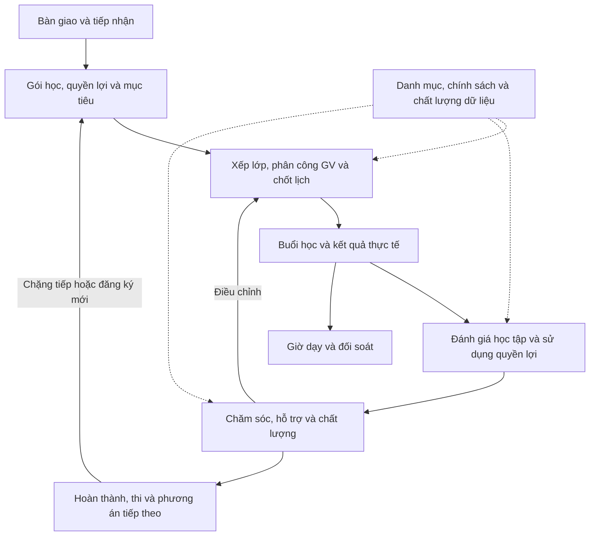
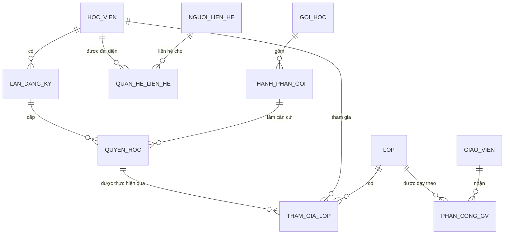
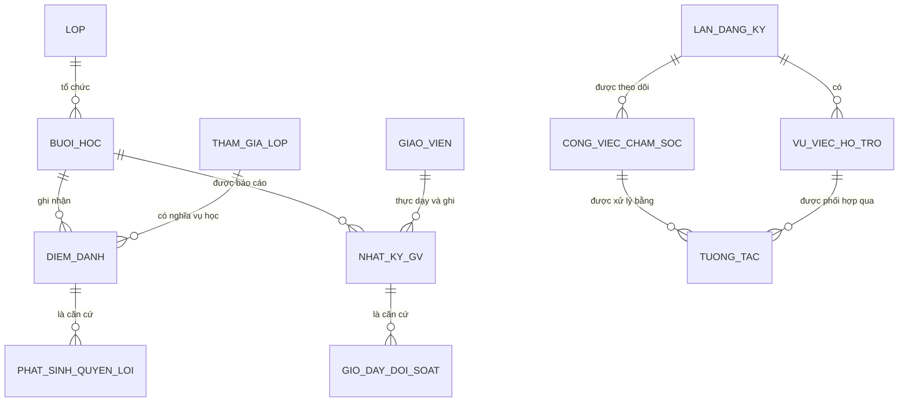
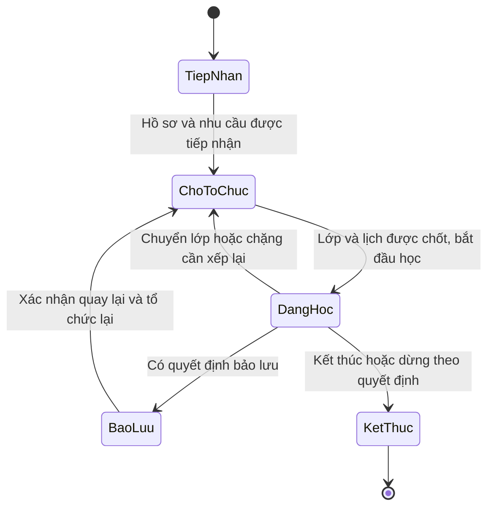
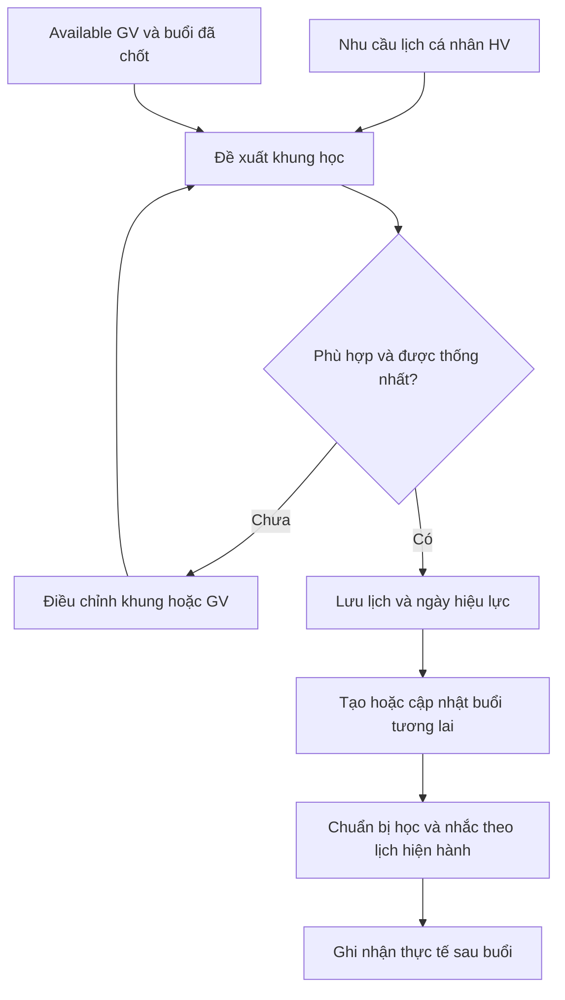
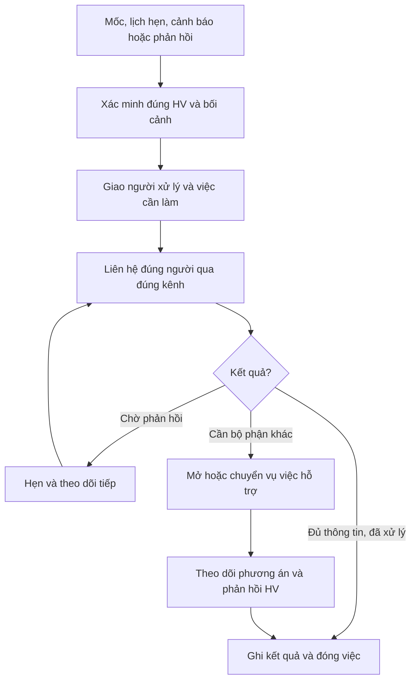
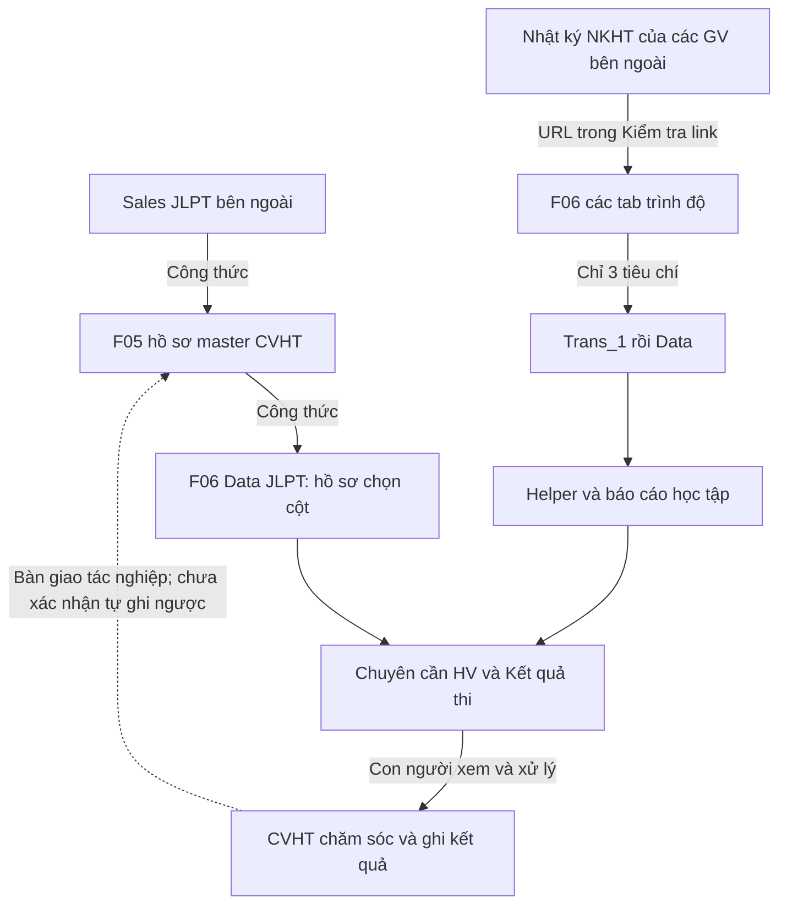
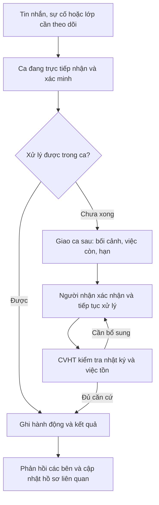
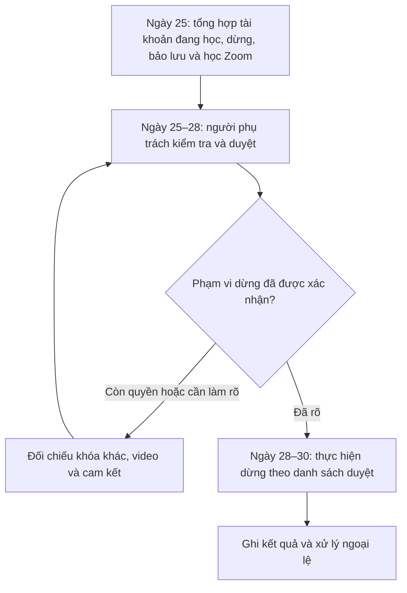

# EDURA — KNOWLEDGE MAP NGHIỆP VỤ TRUNG TÂM

> Bản đã ẩn dữ liệu tài khoản/cá nhân (che by placeholder) — nguồn gốc xem NUOI-NGUON.md

**Bản tổng hợp nghiệp vụ, phiên bản 2.0 — 24/10/2026**

Phạm vi bằng chứng hiện tại: **8 workbook, 88 sheet (76 hiện, 12 ẩn)** trong ZIP `Folder các file của CSHV-20261024T073104Z-1-001.zip`; các lượt đối chiếu hồ sơ, lịch, nhật ký học tập và báo cáo trước đó; các xác nhận của người dùng về hình thức lớp và lịch available. Bản này tổ chức lại tri thức theo cách trung tâm vận hành, để sử dụng khi thảo luận nghiệp vụ, thiết kế chức năng và viết đặc tả. Các bản Excel là ảnh chụp dữ liệu, không xác nhận trạng thái trực tiếp của hệ thống hiện tại.

## Những thay đổi chính của phiên bản 2

| Tri thức trước | Bằng chứng bổ sung | Kết luận cập nhật |
|---|---|---|
| Thiếu cơ sở về thời hạn và công việc theo ca | F07 trách nhiệm/tần suất; F08 Timeline và nhật ký | Đã có workflow con người và mốc xử lý cụ thể, còn cần chọn bản SLA áp dụng |
| Mới có từ điển S0–S5 và cột tái tục | F08 4.Tái tục có hồ sơ/ba lần liên hệ/lý do từ chối | Có sổ quản lý cơ hội; phải tách offer, ý định và giao dịch xác minh |
| Chăm theo mốc chủ yếu tới 30 buổi trong mẫu Kaiwa | F08 chăm tới 35/45/55/59/60/89/90 và sau kết thúc | Cần mốc theo gói/phiên bản và cách tính tổng/năm được chốt |
| Ma trận chấm buổi được hiểu là số đã ghi nhận | F08 có công thức tự tạo 1 theo lịch và ngày đã qua | Phải tách buổi ước tính/mặc định, attendance xác minh, tiêu thụ quyền và giờ GV |
| Chưa đủ bằng chứng quản lý tài khoản | F07 chu kỳ báo cáo–duyệt–deactive; F08 mở lớp/cấp video | Bổ sung miền tài khoản/quyền truy cập và môi trường học |
| Đối tượng phụ huynh là suy luận từ ghi chú | F07 có quy trình Kids/PHHS | Có biến thể phục vụ Kids; không tự coi Kids là sản phẩm thứ ba |
| Quy mô nhóm còn là nhãn cần đối chiếu | F07 giải thích 1-2/45 phút, 1-4/60 phút | Có quy mô nhóm trong phạm vi kịch bản; không áp mọi lớp cùng thời lượng |

Các nội dung V2 đã được cập nhật vào các mục gốc, đồng thời bổ sung mục 27–32 để trình bày luồng trực ca, tài khoản, offer/giới thiệu, các biến thể và kiểm kê đủ 88 sheet. File “Mẫu tin nhắn và quy trình tự động” không được nghiên cứu trong lượt này.

## 0. Cách đọc bản đồ

### 0.1. Mức độ xác nhận

| Nhãn | Ý nghĩa |
|---|---|
| **[E] Bằng chứng nguồn** | Có trường, dữ liệu, hướng dẫn, công thức hoặc ghi chú cụ thể trong file |
| **[U] Người dùng xác nhận** | Quy tắc đã được người dùng nói rõ trong phiên nghiên cứu |
| **[I] Diễn giải / mô hình đề xuất** | Phân tách khái niệm hoặc luồng để thể hiện đủ nghiệp vụ; không khẳng định phần mềm hiện tại đã có chức năng đó |
| **[?] Cần chốt** | Chưa đủ căn cứ để chọn chính sách, quyền duyệt, thời hạn hoặc một cách tính duy nhất |

Một sheet có cấu trúc cho một nghiệp vụ chưa chứng minh nghiệp vụ đã được thực hiện đầy đủ. Có công thức import chưa chứng minh dữ liệu đang cập nhật thành công. Có cảnh báo chưa chứng minh đã gửi thông báo. Có ghi chú chưa chứng minh vấn đề đã được giải quyết.

### 0.2. Nguồn và thứ tự ưu tiên

| Mã | Nguồn | Trọng tâm |
|---|---|---|
| F01 | Chấm điểm buổi học riêng JLPT của giáo viên.xlsx — 9 sheet | Hồ sơ GV/lớp, lịch dạy, NKHT theo trình độ, QC, cấu hình |
| F02 | File điểm danh của Giáo viên.xlsx — 4 sheet | Available GV, roster HV, lịch Kaiwa, hướng dẫn trách nhiệm, QC |
| F03 | Format báo cáo học tập.xlsx — 2 sheet | Báo cáo học tập Kaiwa cá nhân và đánh giá buổi học |
| F04 | File nguồn tổng Kaiwa - Nguồn xuất phát mọi dữ liệu.xlsx — 5 sheet | Master CVHT Kaiwa, lịch hai nhánh, quyền lợi, chăm sóc, S0–S5 |
| F05 | File nguồn tổng JLPT - Nguồn xuất phát mọi dữ liệu.xlsx — 22 sheet | Master JLPT, Sales bàn giao, tổ chức lớp, chăm sóc, thi, đối soát |
| F06 | Bản sao của [Edura] Báo cáo chuyên cần sản phẩm JLPT V2.0.xlsx — 22 sheet | Import NKHT nhiều GV, xử lý dữ liệu, báo cáo học tập, cảnh báo và yêu cầu PDT |
| F07 | Edura_bộ phận vận hành.xlsx — 12 sheet | Quy trình, tần suất, trách nhiệm, onboarding, Kids, lịch tài khoản và báo cáo tuần |
| F08 | File điểm danh và theo dõi học tập của Cố vấn học tập.xlsx — 12 sheet | Không gian làm việc CVHT, chấm buổi, chăm đến 90 buổi, bàn giao ca, sổ tái tục và GV |

Đối chiếu theo giá trị ô và công thức: **F01/F02/F03/F04/F06 giữ nguyên nội dung so với ZIP trước; F05 chỉ đổi giá trị thời gian tính sẵn tại CVHT_ Báo cáo!A2. F07 và F08 là hai workbook bổ sung, thêm 24 sheet.** Việc đổi tên hoặc thay bytes của bản xuất không được đếm thành nghiệp vụ mới. Mã F01–F06 được giữ ổn định để các dẫn chiếu cũ vẫn dùng được.

**Phần loại trừ:** không nghiên cứu nội dung file “Mẫu tin nhắn và quy trình tự động” và không mở đích liên kết có tên đó. Trong ZIP nhận được không có mục độc lập mang đúng tên này. Các sheet quy trình trong F07 được dùng để rút ra thao tác, điều kiện và trách nhiệm, không xây dựng lại bộ mẫu tin nhắn.

Tài liệu nền phiên bản trước (phạm vi cũ 6 workbook/64 sheet; danh mục hiện hành 88 sheet ở mục 32 của bản này):

- [Bản đồ 64 sheet và công việc CVHT/GV](sandbox:/workspace/scratch/51c910380267/outputs/Edura_Knowledge_Map_CVHT_Giao_vien.md).
- [Phân tích sâu JLPT và các tình huống xuyên workbook](sandbox:/workspace/scratch/51c910380267/outputs/Edura_JLPT_Tri_thuc_va_luong_nghiep_vu.md).

### 0.3. Ranh giới tri thức

Tài liệu bao phủ từ tiếp nhận hồ sơ thương mại/bàn giao sang đào tạo, tổ chức học, giảng dạy, chăm sóc, quyền lợi, chất lượng và học tiếp. Nguồn có trường phí/thanh toán và đối soát giờ, nhưng chưa đủ để mô tả toàn bộ kế toán, hoàn tiền, trả lương. Chưa đủ nguồn để mô tả đầy đủ marketing trước bán, tuyển dụng GV, quản lý phòng học hoặc portal HV. F07/F08 bổ sung bằng chứng về quản lý tài khoản học tập, mở/khóa lớp trên nền tảng, trực ca và giới thiệu HV. Các phần tuyển dụng, marketing trước bán, hạch toán/hoàn tiền/trả lương vẫn chỉ được mô tả trong giới hạn nguồn đã có.

## 1. Hình dung trung tâm như một hệ thống nghiệp vụ

**Đối tượng trung tâm là hành trình thực hiện quyền học của từng học viên.** Một người có thể mua nhiều lần, một gói có nhiều chặng, một chặng có thể trải qua nhiều lớp/GV/lịch; mỗi buổi tạo dữ liệu học tập, sử dụng quyền lợi, giờ dạy và tín hiệu chăm sóc. Kết quả học tập và phản hồi quay lại điều chỉnh lịch, lớp, hỗ trợ và phương án học tiếp. [E + I]

Sơ đồ là cấu trúc tổng hợp [I]; từng mũi tên không mặc nhiên là tích hợp tự động. Nhánh Kaiwa còn nhiều bàn giao theo hướng dẫn; nhánh học tập JLPT có nhiều liên kết công thức hơn.

### 1.1. Các miền nghiệp vụ

| Miền | Câu hỏi nghiệp vụ cần trả lời | Đối tượng chủ chốt | Bằng chứng |
|---|---|---|---|
| D01. Con người và liên hệ | Ai học, ai mua, ai được nhận thông tin? | HV, người liên hệ, quan hệ phụ huynh, nhân sự | F04/F05 ID/liên hệ; ghi chú phụ huynh F05 |
| D02. Sản phẩm và lộ trình | Bán gì, học nội dung gì, thứ tự ra sao? | Sản phẩm, cấp độ, gói/combo, chặng, phiên bản lộ trình | F05 gói/Setting/Clean; F01 NKHT; F03 báo cáo Kaiwa |
| D03. Tiếp nhận và bàn giao | Hồ sơ đã đủ để học chưa, ai phụ trách? | Bàn giao, lần đăng ký, checklist tiếp nhận, CVHT | F04 Tái tục S0/S1; F05 import Sales |
| D04. Quyền lợi | HV còn được hưởng gì, điều kiện/thời hạn nào? | Quyền học, buổi/phút, video, quà, điều chỉnh | F04 N/T/AJ; F05 ghi chú và phương án riêng |
| D05. Lớp và phân công | HV thuộc lớp nào, ai dạy/chăm, từ khi nào? | Lớp, ghi danh vào lớp, phân công GV/CVHT | F04/F05 tổ chức học; F01/F02 roster |
| D06. Lịch | Khi nào có thể học và buổi nào đã được chốt? | Available, nhu cầu HV, lịch nền, buổi, đổi/nghỉ/bù | F02 available/lịch; F04 X:AE; xác nhận người dùng |
| D07. Giảng dạy và chuyên cần | Buổi có diễn ra không, ai tham gia thế nào? | Nhật ký GV, kết quả buổi, điểm danh HV | F01/F02 lịch; F01 NKHT; F06 Data |
| D08. Bài tập và kiểm tra | Đã giao/nộp/chấm chưa, kết quả theo thang nào? | Bài tập, bài nộp, bài KT, lần làm, điểm | F01 NKHT; F06 Data/Thang điểm/Lich_Kiem_Tra |
| D09. Chăm sóc và hỗ trợ | Ai cần liên hệ, vì sao, đã giải quyết đến đâu? | Mốc chăm, cảnh báo, tương tác, công việc, vụ việc | F04 AO:AV/S0–S5; F05 Y:AV; F06 Chuyên cần HV |
| D10. Thi và kết quả đầu ra | Đã hoàn thành gì, thi cấp nào, kết quả ra sao? | Xét hoàn thành, kỳ/lần thi, kết quả, hỗ trợ học lại | F05 bảng thi; F06 Kết quả thi/yêu cầu PDT |
| D11. Học tiếp/tái tục | Còn chặng cũ hay có đăng ký mới? | Chuyển chặng, tư vấn học tiếp, lần đăng ký mới | F04 S4.6/S5.6/sắp kết thúc; F05 AV/combo |
| D12. Giáo viên và QC | GV rảnh lúc nào, thực dạy gì, chất lượng ra sao? | Hồ sơ GV, available, phân công, QC, giờ dạy | F01/F02 QC/Info; F05 Check giờ dạy GV |
| D13. Tổng quan điều hành | Tình hình học, chăm, lớp và nguồn dữ liệu thế nào? | KPI, danh sách ưu tiên, phạm vi/thời điểm | F05/F06 các báo cáo |
| D14. Danh mục và dữ liệu | Trường nào chuẩn, ai được thay đổi, nguồn nào đáng tin? | Từ điển, import, ánh xạ ID, lỗi/xung đột, lịch sử | Setting, Buoi_index, Kiểm tra link, lỗi nguồn |
| D15. Môi trường và quyền truy cập học | Đã có tài khoản/khóa/lớp và vào học được chưa; khi nào dừng quyền? | Tài khoản, cấp khóa, cấu hình lớp, record, checklist sử dụng | F07 Vận hành; F08 Timeline; nhật ký lỗi thiếu khóa/app |
| D16. Trực ca và bàn giao | Vấn đề ai đang giữ, ca sau làm gì, hạn nào? | Ca, yêu cầu, bàn giao, nhận việc, kết quả và thời gian xử lý | F08 5. Ca ngày bàn giao/6.Nhật ký ca tối/Timeline |
| D17. Tư vấn và giới thiệu | Đang offer gì, hẹn đóng khi nào, ai giới thiệu ai? | Cơ hội học tiếp, offer, lần liên hệ, giới thiệu và điều kiện ưu đãi | F08 4.Tái tục; F07 kịch bản học tiếp/giới thiệu |

## 2. Vai trò và sự phối hợp

| Vai trò | Trách nhiệm có bằng chứng | Phối hợp/đầu ra cần có [I] | Điều chưa xác nhận |
|---|---|---|---|
| Học viên | Có nhu cầu lịch, tham gia/nghỉ, phản hồi, bài tập, mục tiêu và kết quả thi trong ghi chú | Cung cấp lịch, xác nhận phương án, nộp bài, nhận hỗ trợ | Tài khoản/cổng tự phục vụ và quyền thao tác |
| Phụ huynh/người liên hệ | Có trường hợp phụ huynh mua/nhận nhắc cho HV, một người đại diện hai con | Nhận đúng loại thông tin cho đúng HV; kênh liên hệ phù hợp | Ai được xem điểm/tài chính/lịch của từng HV |
| Sales/bên bàn giao | F05 A:N import nguồn Sales; phí/gói/ghi chú/ngày dự kiến | Bàn giao đúng người, gói, quyền lợi, cam kết và nhu cầu | Quy trình bán hàng trước L8; nguồn giao dịch tiền chuẩn |
| CTV/nhân sự trực ca tối | Có nhật ký trực ca được import, vấn đề/bàn giao và trạng thái xử lý | Tiếp nhận, hỗ trợ trong ca, chuyển việc chưa xong cho CVHT ca ngày | Quyền xử lý độc lập/duyệt ngoại lệ; lịch trực và SLA nào có hiệu lực |
| CVHT/bộ phận hỗ trợ học tập | F02 hướng dẫn giao điền roster; F04/F05 lưu tiếp nhận, tổ chức học, chăm sóc | Điều phối hành trình, xử lý cảnh báo, liên hệ, hẹn, phối hợp đào tạo | Quyền tự duyệt đổi lớp, bảo lưu, bù và điều chỉnh quyền lợi |
| Giáo viên | F02 đăng ký rảnh, cập nhật lịch sau buổi, điền báo cáo HV; F01 NKHT | Dạy, ghi kết quả/nguyên nhân, đánh giá và phát hiện khó khăn sớm | Hạn nhập/sửa; quyền chốt ngoại lệ và sửa dữ liệu đã đối soát |
| PĐT/điều phối đào tạo | Tên bộ phận trong bàn giao, sheet họp, cấu hình và trao đổi yêu cầu | Lộ trình, xếp lớp/GV, quyết định chuyên môn và phối hợp xử lý | Ai là người chốt cuối từng quyết định |
| QC/chuyên môn | Có rubric QC, đánh giá buổi học và link record | Đánh giá có bằng chứng, phản hồi cải thiện, theo dõi kết quả | Người chấm, chu kỳ, tiêu chí đạt và quyền phúc tra |
| Người đối soát giờ/tài chính | Có Check giờ dạy GV, đơn giá/giờ và dữ liệu thanh toán | Đối soát trước khi chốt số giờ/giá trị theo chính sách | Toàn bộ quy trình tính/trả lương, hoàn tiền và hạch toán |
| Admin/quản trị vận hành | Vai trò cần có để duy trì cấu hình/nguồn được suy ra [I] | Danh mục, phân quyền, ánh xạ dữ liệu, lịch sử và quyết định có hiệu lực | Ma trận quyền thực tế và người có thẩm quyền |
| Quản lý trung tâm | Có báo cáo tổng quan và họp PĐT | Xem tình hình theo phạm vi, quyết định hỗ trợ và kiểm soát chất lượng | Mục tiêu/KPI chính thức và lịch chốt báo cáo |

Quyền truy cập không được suy ra chỉ từ tên sheet. Trong mô hình đề xuất, người ghi đề nghị, người xác nhận dữ kiện và người duyệt phương án có thể khác nhau; danh tính cụ thể cần được trung tâm chốt.

### 2.1. Những lần bàn giao quan trọng

| Bàn giao | Gói thông tin tối thiểu [I] | Bên nhận cần xác nhận |
|---|---|---|
| Sales → CVHT/PĐT | ID HV/người liên hệ, lần đăng ký, gói/thanh toán, quyền lợi, cam kết, lịch mong muốn, ngày dự kiến | Hồ sơ đủ/thiếu, người tiếp nhận và việc còn mở |
| CVHT/PĐT → GV | HV/lớp, mô hình, trình độ, lộ trình, buổi đầu, lịch/múi giờ, quyền lợi/thời lượng, lưu ý, link báo cáo | GV biết đúng người/lớp/lịch và cách ghi nhận |
| GV → CVHT | Buổi thực tế, điểm danh, bài/điểm, khó khăn, đề nghị hỗ trợ, thay đổi lịch | Tín hiệu đã được nhận và có người xử lý khi cần |
| CVHT → chuyên môn/kỹ thuật | Vấn đề đã xác minh, tác động, bằng chứng, phương án đang chờ | Có chủ xử lý và hạn/điểm kiểm tra tiếp theo |
| CVHT/GV cũ → người mới | Hiệu lực thay đổi, lịch tương lai, tiến độ, quyền lợi, phản hồi và công việc mở | Không mất việc/học sử khi đổi người phụ trách |
| Cuối chặng → học tiếp | Kết quả, quyền lợi/cam kết còn lại, điều kiện chuyển, lựa chọn HV | Rõ tiếp tục gói cũ hay phát sinh đăng ký mới |

## 3. Từ điển khái niệm bắt buộc phân biệt

### 3.1. Sản phẩm, gói, chặng, lớp và hình thức

| Khái niệm | Nghĩa nghiệp vụ | Minh họa có bằng chứng | Cách hiểu cần giữ |
|---|---|---|---|
| Sản phẩm | Nhánh đào tạo | Kaiwa, JLPT | Độc lập với hình thức lớp |
| Cấp độ/trình độ | Mức học của sản phẩm | F07 có PreKaiwa 1/2 và Kaiwa 1–6; JLPT N5/N4/N3/N2 trong dữ liệu | Phải xác nhận mã/lộ trình và hiệu lực, không suy mọi cấp cùng cấu trúc |
| Nhóm người học | Đặc điểm đối tượng nhận dạy/chăm | Có quy trình riêng Kids và phản hồi phụ huynh trong F07 | Kids là trục đối tượng; chưa đủ căn cứ đặt thành sản phẩm thứ ba độc lập |
| Gói bán | Nội dung thương mại HV đăng ký | Gói lẻ, combo N5+N4, N4+N3, cơ bản+chuyên sâu | Một gói có thể chứa nhiều chặng |
| Chặng/quyền học thành phần | Một phần chương trình trong gói | Học một cấp rồi cấp tiếp; chuyển phần quyền lợi sang sản phẩm khác | Mô hình tách nghĩa [I], không khẳng định nguồn đã có bảng riêng |
| Lộ trình/phiên bản | Nội dung, số buổi, thời lượng, KT áp dụng | Setting và nhiều bộ mốc KT khác nhau | Có hiệu lực; không trộn cấu hình cũ/mới |
| Lớp cụ thể | Đơn vị tổ chức học | Mã lớp JLPT trong W và nhật ký | Không bằng mã gói hoặc tên sản phẩm |
| Hình thức lớp | Cách tổ chức số người | 1-1 linh hoạt; 1-n cố định [U] | Không suy ra chỉ từ tên Kaiwa/JLPT |
| Nhãn nhóm 1-2/1-4/1-10 | Quy mô nhóm được thể hiện trong nguồn | F07 Kịch bản mới D125 giải thích 1-2 là 45 phút, 1-4 là 60 phút; 1-10 xuất hiện ở dữ liệu cũ | Đã có căn cứ cho hai quy mô nhóm; vẫn thuộc 1-n. Thời lượng này có phạm vi kịch bản, không áp cho mọi JLPT |
| Cách tham gia | Live/video/record hoặc một phần buổi | Ghi chú và báo cáo lịch sử | Video tặng kèm không tự đổi lớp chính thành khóa video |
| Lần đăng ký | Một lần phát sinh quan hệ mua/học có phạm vi quyền lợi | ID lặp, gói và lớp khác nhau | Khái niệm đề xuất để không gộp mọi lịch sử vào một hồ sơ |
| Lần tham gia lớp | HV thuộc lớp trong một khoảng hiệu lực | Chuyển lớp, vào sau khai giảng, học lại | Một HV có nhiều lần tham gia; giữ lịch sử |

**Ví dụ:** một HV mua combo N5+N4, đang học lớp N5 với GV A. Học xong N5 và chuyển sang N4 có thể chỉ là thực hiện chặng thứ hai của gói cũ. Chưa đủ căn cứ gọi đó là tái tục tạo doanh thu mới. Nếu mua thêm gói ngoài quyền lợi ban đầu thì cần xác định lần đăng ký/giao dịch mới theo chính sách. [E + I, phần định nghĩa giao dịch mới còn ?]

### 3.2. Những cặp khái niệm không đồng nhất

| Khái niệm thứ nhất | Khái niệm thứ hai | Vì sao phải tách |
|---|---|---|
| Người học | Người thanh toán/người liên hệ | Có phụ huynh và nhiều HV chung một liên hệ |
| Mã HV | Tên HV | Có trùng tên và ID lặp/khác biểu diễn |
| Mã gói | Mã lớp | F02 có mã dùng chung cho người khác trình độ/quyền lợi |
| Available | Buổi đã đặt/chốt | Rảnh chỉ là khả năng nhận lịch |
| Lịch dự kiến | Nhật ký thực tế | Được xếp học chưa chứng minh đã học |
| Buổi lớp | Lượt HV–buổi | Một buổi lớp nhóm có nhiều điểm danh cá nhân |
| Buổi đã tham gia | Buổi đã trừ quyền lợi | Nghỉ không phép/lỗi/bù có thể chịu quy tắc riêng |
| Giờ GV | Số phút HV tham gia | Hệ số giờ dạy và attendance không cùng mục đích |
| Thứ tự buổi lớp | Buổi thứ mấy của HV | Có người vào học sau khai giảng |
| Nội dung/bài đã học | Số buổi đã dùng | Có lộ trình cá nhân bắt đầu từ bài 5 và số buổi riêng |
| Đã nộp BTVN | Điểm BTVN | Có thể nộp bài nhưng được 0 điểm |
| Mốc bài KT | Lần làm bài | Hướng dẫn báo cáo JLPT dùng lần làm đầu, có thể có nhiều lần |
| Thi nội bộ | Thi JLPT bên ngoài | Khác kỳ, cấp độ, điểm và quy trình xác minh |
| Cảnh báo | Vụ việc hỗ trợ | Tín hiệu cần kiểm tra chưa xác định nguyên nhân |
| Đã liên hệ | Đã giải quyết | Có thể đang chờ phản hồi/chờ phương án |
| Kết thúc | Hoàn thành | Kết thúc hành chính không chứng minh đạt điều kiện học tập |
| Hoàn thành một lớp | Hoàn tất cả gói | Có combo, video, quà hoặc quyền lợi còn lại |
| Đang cân nhắc học tiếp | Đã tái tục | Ý định chưa chứng minh giao dịch/quyền học mới |

## 4. Bản đồ thực thể và quan hệ

Các thực thể bên dưới là **mô hình khái niệm [I]** nhằm diễn đạt tri thức trong file. Không phải yêu cầu tạo một bảng dữ liệu hoặc một màn hình cho mỗi dòng. Trường nguồn đã có được nêu riêng; ID, lịch sử và trạng thái bổ sung là đề xuất để giữ đúng nghĩa nghiệp vụ.

### 4.1. Quan hệ con người – quyền học – lớp

Các quan hệ một–nhiều mô tả mô hình cần hỗ trợ [I]. Quan hệ quyền học–tham gia lớp có thể cần bảng phân bổ nếu một lần tham gia sử dụng nhiều nguồn quyền lợi; dữ liệu hiện có chưa đủ để quyết định ngoại lệ này.

### 4.2. Quan hệ buổi học – kết quả – chăm sóc

### 4.3. Danh mục thực thể và trường dữ liệu

| Mã | Thực thể | Trường nghiệp vụ cần biểu diễn [I] | Quan hệ / bằng chứng nguồn |
|---|---|---|---|
| EN01 | Học viên | ID, họ tên gốc/chuẩn, giới tính, năm sinh, email/điện thoại, nghề, liên hệ trực tiếp | F04 Tổng A/E:H/Q:R; F05 A/E:H; không gộp theo tên/điện thoại |
| EN02 | Người liên hệ | ID, tên, kênh, địa chỉ liên hệ, ghi chú liên lạc | F05 ghi chú mẹ/bố/LINE/Zalo; chưa có sổ riêng |
| EN03 | Quan hệ người liên hệ | HV, người liên hệ, vai trò phụ huynh/người mua, loại thông tin nhận, ưu tiên, hiệu lực | Một liên hệ có thể đại diện nhiều HV; quyền nhận cần chốt |
| EN04 | Nhân sự | ID nhân sự, mã nguồn, tên, vai trò CVHT/GV/PĐT/QC, tình trạng phụ trách | Mã CVHT và GV trong roster/master; quyền hệ thống còn ? |
| EN05 | Sản phẩm/cấp độ | Kaiwa/JLPT, cấp độ nguồn, mục tiêu, trạng thái danh mục | F01–F06; không suy từ mã lớp thay danh mục |
| EN06 | Gói và thành phần | Mã/tên gói, khóa lẻ/combo, thành phần/chặng, thứ tự, điều kiện chuyển, bản áp dụng | F05 J/Z trong Clean và ghi chú; không đếm chặng chỉ bằng regex mã |
| EN07 | Lộ trình phiên bản | Mã khóa, phiên bản, bài/buổi, số buổi, thời lượng, bài KT/thang, ngày hiệu lực | F05 Setting; F01 NKHT; F06 các bảng cấu hình khác nhau |
| EN08 | Lần đăng ký/bàn giao | ID đăng ký, HV, gói, nguồn/Sales, ngày nộp phí/bàn giao/tiếp nhận/dự kiến, trạng thái tiếp nhận, CVHT | F04/F05 đang gộp nhiều nghĩa trên một dòng; cần phân biệt các ngày |
| EN09 | Bản ghi thanh toán | Nguồn tham chiếu, đăng ký, ngày, số tiền, loại đợt, trạng thái xác minh | Có phí/trạng thái trong F04/F05; chưa đủ để dựng sổ giao dịch hoàn chỉnh |
| EN10 | Quyền học | Đăng ký/chặng, loại quyền, số buổi/phút/giá trị, cấp ban đầu, thời hạn, phạm vi nội dung | F04 N/T/AJ; F05 ghi chú số buổi riêng/chuyển sản phẩm |
| EN11 | Phát sinh/điều chỉnh quyền lợi | Quyền học, cấp/dùng/chuyển/điều chỉnh, lượng và đơn vị, buổi hoặc quyết định nguồn, hiệu lực, lý do, người duyệt | Nhu cầu từ chuyển khóa/dự thính/trừ buổi; chính sách còn ? |
| EN12 | Cam kết/quà tặng | Nội dung, người hưởng, điều kiện kích hoạt, hạn, người bàn giao, trạng thái, bằng chứng hoàn tất | F05 M15/M22/M52/M81/M83/M436 và các ghi chú video/sách |
| EN13 | Lớp | ID độc lập, mã nguồn/tên, sản phẩm/cấp/lộ trình, hình thức, ngày bắt đầu/kết thúc, trạng thái | F05 W:X; F04 AH; F02 C cần đối chiếu mã sản phẩm |
| EN14 | Lần tham gia lớp | HV, lớp, đăng ký/quyền học, vào/ra hiệu lực, lý do, bài/buổi bắt đầu, trạng thái | Chuyển lớp, vào muộn, học lại; ID lặp có nhiều khả năng |
| EN15 | Phân công GV | Lớp/HV, GV chính/thay, hiệu lực, phạm vi buổi, người xác nhận | F04 AF:AG; F05 V; xung đột nhiều GV trong NKHT |
| EN16 | Phân công CVHT | Đăng ký/HV, CVHT, hiệu lực, lý do chuyển, việc mở bàn giao | F04 S; F05 P; cần lịch sử khi đổi người |
| EN17 | Available GV | GV, thứ/nhóm thứ, giờ bắt đầu/kết thúc, múi giờ, ngày hiệu lực, ngoại lệ, mã nguồn | F02 Info E3:AD5; A=rảnh, P chưa rõ |
| EN18 | Nhu cầu/lịch HV | HV/đăng ký, các nhánh thứ–giờ–thời lượng, chu kỳ, múi giờ, hiệu lực, ghi chú ca làm | F04 X:AE; F05 M/T/U; lịch cá nhân thay đổi [U] |
| EN19 | Lịch nền đã thống nhất | Lớp/lần tham gia, GV, quy tắc lặp hoặc lịch cụ thể, múi giờ, hiệu lực, người xác nhận | Mô hình tách khỏi available và nhật ký; file chưa có đối tượng độc lập rõ |
| EN20 | Buổi học | ID, lớp, ngày/giờ đã chốt, thời lượng, GV dự kiến/thực dạy, bài, thứ tự lớp, trạng thái, phiên bản lịch | Lịch theo ngày F01/F02, lộ trình F01/F06; thiếu ID/ngày ở Data học tập |
| EN21 | Yêu cầu đổi/nghỉ/bù | Đối tượng bị ảnh hưởng, người yêu cầu, thời điểm, buổi cũ/mới, lý do, phạm vi một buổi/chuỗi, quyết định | Ghi chú lịch, A–E và các tình huống; quyền/thời hạn còn ? |
| EN22 | Điểm danh cá nhân | Buổi, HV/lần tham gia, trạng thái, mức/thời lượng tham gia, lý do, bằng chứng, người ghi/sửa | NKHT O/X/0.5X và ghi chú; khác mã nghỉ lịch GV |
| EN23 | Nhật ký thực dạy | Buổi, GV, nội dung, thực tế bắt đầu/kết thúc nếu có, mã nghỉ/lỗi, ghi chú, thời điểm cập nhật | F01/F02 chuỗi mã–bài/mã nghỉ; quy định cập nhật sau buổi |
| EN24 | Giờ dạy đối soát | Buổi/GV, thời lượng căn cứ, loại buổi/mô hình, chính sách hiệu lực, giờ được ghi nhận, kết quả đối soát | F01/F02 thống kê tháng; F05 Chấm buổi/Check giờ |
| EN25 | Bài tập được giao | Bài, lớp/HV, buổi, hình thức, hạn nộp, có bắt buộc/miễn không, thang chấm | Có tiêu chí BTVN; dữ liệu giao bài/hạn/miễn còn thiếu |
| EN26 | Bài nộp và chấm bài | Người nộp, bài, lần nộp, ngày/kênh/file hoặc giấy, trạng thái nộp/chấm, điểm/thang, nhận xét | Có/Không/số/giấy và ghi chú; cần tách điểm 0 khỏi không nộp |
| EN27 | Bài kiểm tra nội bộ | Mã bài, khóa/lộ trình, mốc buổi, nội dung, tổng câu/điểm tối đa, điều kiện đánh giá | F06 Lich_Kiem_Tra/Thang điểm/Buoi_index; mốc lệch cần chuẩn hóa |
| EN28 | Lần làm kiểm tra | HV, bài, lần thứ mấy, ngày, có làm/đã chấm, số đúng/điểm/thang, nguồn và lần dùng báo cáo | F01 hướng dẫn lấy lần đầu/số câu đúng; master AL:AR chỉ trạng thái nhắc |
| EN29 | Báo cáo tiến bộ | HV/lớp, khoảng buổi, GV/người đánh giá, nhận xét theo tiêu chí, điểm, record, ngày hoàn tất | F03 chặng/giữa/cuối kỳ; F01 các tiêu chí NKHT |
| EN30 | Định nghĩa mốc chăm | Sản phẩm/lộ trình, loại đồng hồ, mốc, tập đủ điều kiện, nội dung, hạn, vai trò xử lý | F04 S0–S5/AO:AV; F05 AE:AK và lịch hẹn |
| EN31 | Công việc chăm sóc | HV/đăng ký, trigger/mốc, hạn, chủ xử lý, ưu tiên, trạng thái, kết quả, lần hẹn tiếp | Các cột chăm/hẹn có nền tảng; sổ task riêng là đề xuất |
| EN32 | Tương tác | Ai liên hệ ai, HV liên quan, ngày/giờ/kênh, nội dung, phản hồi, kết quả, việc tiếp | F04 AK/AL; F05 Y/Z và comment; không chỉ ghi đè tóm tắt |
| EN33 | Cảnh báo/rủi ro | HV/lớp, loại, dữ kiện, thời điểm/tập nguồn, mức, hiện tại/lịch sử, người xác minh | F06 chuỗi vắng/không bài, F05 điểm nóng; không mặc định nguyên nhân |
| EN34 | Vụ việc hỗ trợ | Vấn đề, người bị ảnh hưởng, nguyên nhân đã xác minh, bộ phận xử lý, phương án, hạn, kết quả | Hệ thống/lịch/chương trình/GV/kiến thức; đang phân tán ghi chú |
| EN35 | Tư vấn học tiếp | Đăng ký cũ, thời điểm đủ điều kiện, nhu cầu, phương án, phản hồi, việc tiếp, đăng ký mới nếu có | F04 S4.6/S5.6; F05 AV; chưa phải giao dịch tự động |
| EN36 | Kỳ/lần thi JLPT | HV, kỳ/ngày, cấp dự thi, đăng ký/thực dự thi, lần thứ mấy, mục tiêu, trạng thái phản hồi | F05 AY và bảng thi; học N2 có thể thi N3 |
| EN37 | Kết quả thi/xét hoàn thành | Lần thi/bản xét, điểm/thang/kỹ năng, pass/not pass/chưa phản hồi, nguồn xác minh; bản chính sách hoàn thành | F05 AZ/AB/AC, báo cáo kỳ; F06 yêu cầu hoàn thành |
| EN38 | Đánh giá QC | GV, kỳ/buổi/record, sản phẩm/rubric phiên bản, điểm tiêu chí/tổng, kết luận, việc cải thiện | F01 10 và F02 12 tiêu chí; không mặc định cùng chuẩn |
| EN39 | Thông báo/nhắc | Đối tượng nghiệp vụ, người nhận/kênh, nội dung, lịch gửi, phiên bản lịch, kết quả gửi/nhận/hủy | Nhu cầu rút ra; file chỉ có một phần trạng thái/cảnh báo, chưa thấy log gửi |
| EN40 | Bản ghi nguồn/đối chiếu | File/sheet/ô, thời điểm snapshot, giá trị gốc, khóa đích, cách match, lỗi/xung đột và quyết định | QUERY/IMPORTRANGE, ID trùng, O/X trái nhau, lỗi quyền |
| EN41 | Bàn giao/nhận việc theo ca | Ca gửi/nhận, đối tượng HV hoặc GV, vấn đề, kết quả đã làm, việc còn lại, chủ giữ việc, hạn và bằng chứng đóng | F08 5. Ca ngày bàn giao và 6.Nhật ký ca tối; một số trường còn thiếu |
| EN42 | Tài khoản học tập | HV, nền tảng, định danh tài khoản, trạng thái hoạt động, ngày tạo, người duyệt/dừng và hiệu lực | F07 Vận hành hàng 8; F08 1.Chăm sóc BH ngày tạo tài khoản; không lưu mật khẩu mẫu vào knowledge map |
| EN43 | Quyền truy cập khóa/nội dung | HV/đăng ký, khóa/video được cấp, điều kiện/thời hạn, ngày cấp/thu hồi, nguồn cam kết | F08 Timeline C11; F07 hướng dẫn/add video; nhật ký thiếu khóa |
| EN44 | Cấu hình lớp trên nền tảng | Lớp nghiệp vụ, nền tảng, tham chiếu lớp/lệnh, lịch, GV/HV, trạng thái mở/khóa, hiệu lực và quyết định | F07 mở lớp/khóa lớp/xóa lệnh; nghĩa kỹ thuật của lệnh còn cần làm rõ |
| EN45 | Checklist sẵn sàng học | Thiết bị, tài khoản đăng nhập thành công, nhìn thấy đúng khóa, PDF/video theo loại khóa, thao tác vào lớp, nhóm/liên hệ | F07 onboarding có điều kiện tuần tự; không chỉ đánh dấu đã gửi hướng dẫn |
| EN46 | Offer/đề nghị học tiếp | Cơ hội, sản phẩm/phương án, ưu đãi bản nào, giá trị, hiệu lực, người xác nhận, hạn đóng, lần liên hệ, kết quả | F07 ghi ưu đãi cần kiểm tra người phụ trách; F08 sổ tái tục. Không coi ưu đãi mẫu là giá hiện hành |
| EN47 | Giới thiệu học viên | Người giới thiệu, người được giới thiệu, chương trình/bản áp dụng, điều kiện, trạng thái xác minh và bàn giao | F07 có quy trình khơi gợi giới thiệu; chưa có sổ chi thưởng được cấp |
| EN48 | Khảo sát chéo chất lượng | HV, người khảo sát khác người chăm, kỳ/ngày, nội dung, phản hồi và hành động độc lập | F07 Mẫu BC tuần C16; chưa thấy dữ liệu thực hiện của khảo sát |

### 4.4. Quy tắc định danh và thời gian hiệu lực [I]

1. ID HV nhận diện con người; ID đăng ký nhận diện quyền học phát sinh; ID lần tham gia nhận diện quan hệ với lớp; ID buổi nhận diện một sự kiện có lịch. Không dùng một mã cho cả bốn mục đích.
2. Lưu mã/tên nguồn và bảng ánh xạ; không tự bỏ số 0, đổi mã lớp hoặc gộp người để làm cho join khớp.
3. Thay GV, CVHT, lịch, lớp hay quyền lợi cần có thời điểm hiệu lực; dữ liệu cũ vẫn thuộc bối cảnh cũ.
4. Nhận lại cùng một bản ghi nguồn không được tự tạo thêm quyền lợi/buổi/task hoặc ghi đè kết quả đã xác minh. Cách xác định bản ghi nguồn duy nhất cần được chốt khi triển khai.
5. Tiền, buổi, phút, phần trăm và điểm/tổng câu là các đơn vị khác nhau; phép chuyển đổi phải có căn cứ chính sách hoặc cấu hình.

## 5. Vòng đời và các chiều trạng thái

### 5.1. Vòng đời học ở mức khái quát

Đây là vòng đời đề xuất [I], không phải danh sách transition đã được trung tâm phê duyệt. `Hoàn thành`, `đỗ thi`, `hết quyền lợi`, `đã tái tục` phải được xét ở các chiều riêng. Quy trình cho `video`/`tạm nghỉ` cần chuẩn hóa vì danh mục nguồn đang trộn cách tham gia với trạng thái học.

### 5.2. Trạng thái đa chiều

| Chiều trạng thái | Giá trị/bằng chứng hiện có | Cần dùng để trả lời |
|---|---|---|
| Thương mại/bàn giao | HV Mới, Đặt cọc; S0 | Hồ sơ xuất phát từ đâu và đã bàn giao chưa? |
| Tiếp nhận | S1.1 đầy đủ sẵn sàng; S1.2 đầy đủ chưa học ngay; S1.3 chưa đủ | CVHT còn thiếu gì để tổ chức học? |
| Thanh toán | Đặt cọc, thanh toán lần 1/2/3, Full phí | Nguồn đang ghi nhận nghĩa vụ/thanh toán ở mức nào? |
| Hoạt động | Active/Deactive/Deative trong F05 O | Ý nghĩa nghiệp vụ riêng của cột này còn cần xác nhận |
| Học | Chờ lớp, Đang học, Bảo lưu, Kết thúc; một số danh mục có tạm nghỉ/video | Quan hệ học hiện ở giai đoạn nào? |
| Buổi | Có lịch, diễn ra/không diễn ra, đổi/hủy/bù theo mô hình đề xuất | Sự kiện nào có hiệu lực để học/điểm danh/nhắc? |
| Tham gia HV | O/X/0.5X, ghi chú live/record | HV đã tham gia thế nào trong buổi đó? |
| Học tập | Bài nộp/điểm/nhận xét, năng lực | Đã thực hiện việc học và đạt mức nào? |
| Chăm sóc | Hài lòng/cần hỗ trợ/chưa ý kiến/chưa hài lòng/không phản hồi | Trải nghiệm và hành động chăm tiếp theo là gì? |
| Học tiếp | Đã tư vấn/đang cân nhắc/đăng ký theo danh mục nguồn | Đang ở bước tư vấn nào, đã có bằng chứng phát sinh mới chưa? |
| Thi | Kỳ đăng ký, có thi/chưa thi, pass/not pass/không phản hồi | Đăng ký, dự thi và có kết quả là ba bước khác nhau |
| Chất lượng dữ liệu | Đủ/thiếu/xung đột/chờ xác minh là đề xuất | Phép tính/nhắc nào có đủ dữ kiện để chạy? |

Một hồ sơ có thể Full phí nhưng Chờ lớp; Đang học nhưng thiếu ngày bắt đầu ở nguồn; Kết thúc nhưng còn video/quà; chuyên cần tốt nhưng kiến thức yếu. Không ép các chiều này vào một trạng thái duy nhất.

## 6. Luồng 01 — Nhận dữ liệu, bàn giao và tiếp nhận

**Kích hoạt:** nguồn Sales/HV được bàn giao, hồ sơ đặt cọc được cập nhật hoặc phát sinh đăng ký mới. [E]

**Đầu vào đã thấy:** ID, Sales, tình trạng thương mại, ngày nộp phí, tên/liên hệ, mã/gói, phí, trạng thái thanh toán, ghi chú, ngày khai giảng dự kiến; Kaiwa còn có tổng buổi/mô hình, nghề/năm sinh. Cả 1-1 và 1-n đều nhận thông tin thời gian học khi import [U]. Lịch 1-1 là căn cứ thỏa thuận cá nhân; lịch nhóm là khung lớp cố định.

| Bước | Thao tác nghiệp vụ | Ghi nhận và đầu ra | Tác động liên quan |
|---|---|---|---|
| 01.1 | Nhận hồ sơ và giữ bản ghi nguồn | Nguồn, thời điểm, trường gốc, trạng thái import | Truy lại được căn cứ khi có tranh chấp/lệch dữ liệu [I] |
| 01.2 | Đối chiếu người học và đăng ký | HV đã có/chưa có, bản ghi trùng/xung đột, đăng ký cần tạo/cập nhật | Không xóa cùng ID hoặc gộp cùng tên/điện thoại tự động [I] |
| 01.3 | Xác nhận gói/quyền lợi/cam kết | Thành phần gói, số buổi/thời lượng, phần video/quà, điều kiện | Quyền học và việc bàn giao tách khỏi số tiền/trạng thái phí [E + I] |
| 01.4 | Giao CVHT và liên hệ intake | Người phụ trách, người nhận đúng, mục tiêu/lịch, hồ sơ thiếu | S0 → phân loại tiếp nhận S1.1/.2/.3 theo từ điển Kaiwa [E] |
| 01.5 | Xác nhận sẵn sàng tổ chức học | Đủ hồ sơ/sẵn sàng; đủ nhưng muốn chờ; thiếu nội dung | Tạo việc xếp lớp/lịch hoặc việc bổ sung/hẹn lại [I] |

**Điều kiện hoàn tất đề xuất:** biết rõ ai học, ai liên hệ, quyền lợi gì, ai phụ trách, nhu cầu lịch/mục tiêu và việc nào còn mở. Không bắt buộc giả định người đã Full phí phải được xếp lớp ngay.

**Bổ sung V2 [E]:** F08 Timeline C5 quy định tiếp nhận/tạo nhóm trong 24 giờ bàn giao; F07 kịch bản có nhánh xác nhận số buổi quy đổi khi thanh toán từng phần và số buổi sau khi đủ phí. Đây là quyền lợi theo giai đoạn thanh toán, cần đối chiếu nguồn quyết định, không lấy một tổng buổi cố định cho mọi thời điểm. SLA 7 ngày/7 ngày làm việc và ngoại lệ nhóm/Kids được phân tích ở mục 30.

**Ngoại lệ quan trọng:** ID lặp qua nhiều lớp/đợt; phụ huynh có hai con; đặt cọc chuyển thành đăng ký chính thức; combo chưa có danh mục thành phần; giờ Nhật/giờ Việt chưa rõ; dữ liệu phí/tiêu đề cột lệch; ghi chú chứa cam kết không nằm trong cột chuẩn. [E]

**Bản đồ file:** F05 `JLPT_Inhouse_Đặt cọc` và `Data JLPT_Inhouse!A:N`; F04 `Tổng`; từ điển F04 `Tái tục`. A:N ở F05 là vùng import, O:AZ có dữ liệu vận hành cạnh bên; việc nguồn đổi thứ tự tạo nguy cơ gắn lệch dữ liệu nếu không có khóa ngoài cơ chế hàng. Chưa xác nhận đã xảy ra lệch thực tế.

## 7. Luồng 02 — Xếp lớp, phân công và chuẩn bị học

**Đầu vào:** đăng ký/quyền học đã xác định; sản phẩm/cấp độ; hình thức; nhu cầu lịch; available và năng lực/phân công GV; lớp/lộ trình phù hợp. [E + U + I]

| Bước | Quyết định/thao tác | Đầu ra cần lưu [I] | Bằng chứng gốc |
|---|---|---|---|
| 02.1 | Xác định phần quyền học đang thực hiện | Chặng, lộ trình áp dụng, bài bắt đầu, số buổi/thời lượng riêng nếu có | Combo, chuyển Kaiwa/JLPT, M229 bắt đầu N5 từ bài 5 |
| 02.2 | Chọn/tổ chức lớp và GV | Lớp cụ thể, hình thức thực học, GV và hiệu lực | F04 AF:AH; F05 V:W:X; F02 roster |
| 02.3 | Xác nhận lịch | Lịch nền/buổi cụ thể, ngày bắt đầu, múi giờ, thời lượng, chu kỳ | F04 X:AE; F05 R:T:U; F02 M:N |
| 02.4 | Xác định phạm vi tham gia | Ngày vào lớp, nội dung/buổi lớp lúc vào, nghĩa vụ học và hỗ trợ bắt kịp | Ghi chú HV vào sau khi lớp đã học hai buổi |
| 02.5 | Bàn giao thông tin cho GV | Roster, lưu ý, liên hệ CVHT, link báo cáo, lộ trình | F02 hướng dẫn giao bộ phận hỗ trợ điền phần HV |
| 02.6 | Kiểm tra điều kiện học buổi đầu | HV/GV nhận đúng lịch và kênh/tài liệu cần thiết | Ghi chú không vào nhóm, tài khoản/Zoom và lịch dự kiến |

**Khi vào lớp muộn:** giữ ít nhất buổi thứ mấy của lớp và thời điểm HV bắt đầu. Chăm sau buổi đầu cá nhân không tự bằng chăm ở buổi 1 của lớp. Những buổi trước khi gia nhập không được đưa vào nghĩa vụ chuyên cần cá nhân nếu chưa có thỏa thuận khác. Đây là quy tắc mô hình hóa cần chốt khi đặc tả [I/?].

**Khi chuyển lớp/GV/CVHT:** không ghi đè để làm mất bối cảnh. Lưu điểm kết thúc quan hệ cũ, thời điểm bắt đầu quan hệ mới, tiến độ/quyền lợi được chuyển và các công việc chăm/hẹn đang mở. Việc đổi người không tự làm mất cảnh báo hay xóa kết quả cũ.

## 8. Luồng 03 — Toàn bộ vòng đời lịch học

### 8.1. Các tầng thời gian

| Tầng | Ý nghĩa | Nguồn | Không được suy ra |
|---|---|---|---|
| Available GV | Khung có thể nhận dạy | F02 Info E3:AD5; A=rảnh | Một buổi đã được đặt hoặc chưa có xung đột |
| Nhu cầu HV | Khung có thể/mong muốn học, có thể đổi ca | F04 hai nhánh lịch; F05 ghi chú/T/U | Lịch đã thống nhất với GV |
| Lịch nền | Quy tắc lặp/khung đã thỏa thuận và hiệu lực | Diễn giải từ các vùng lịch và xác nhận [I] | Tất cả buổi trong chuỗi đều đã diễn ra |
| Buổi đã chốt | Một ngày/giờ cụ thể với đối tượng và GV | Mô hình đề xuất từ lịch theo ngày | Có điểm danh/hợp lệ để trừ buổi |
| Ngoại lệ lịch | Đổi/nghỉ/hủy/bù hoặc GV thay cho phạm vi cụ thể | A–E và ghi chú; mô hình đề xuất | Tự thay cả chuỗi khi chỉ xin đổi một buổi |
| Thực tế sau buổi | Diễn ra hay không, ai dạy/học, nội dung và lý do | F01/F02 lịch; NKHT | Quy tắc quyền lợi và giờ GV luôn giống nhau |

F02 có 26 slot nửa giờ 08:30–21:30, hai nhóm T246/T357. Có A tại F5 và V5:AC5; P tại E5 chưa được giải nghĩa. Cột giờ của lịch dạy ghi giờ Việt Nam, nhưng lưới available không có giải thích múi giờ riêng. Cần phân biệt trước khi matching.

### 8.2. Luồng chốt lịch 1-1 [U + I]

Các thao tác kiểm tra xung đột, thống nhất và quản lý buổi là mô hình cần có [I], chưa có bằng chứng toàn bộ đã tự động trong file. Thực tế 1-1 có thể vẫn học lặp hằng tuần sau khi chốt: F04 dòng 822 ghi T2 12h/T4 11h, mỗi buổi 60 phút, chu kỳ tuần. Tính linh hoạt nằm ở lịch cá nhân và khả năng thỏa thuận/đổi, không phải luôn đặt từng buổi ngẫu nhiên.

**Đầu vào kiểm tra xung đột đề xuất:** HV, GV, khoảng giờ và múi giờ, ngày hiệu lực, các buổi đã chốt, phạm vi điều chỉnh. Nhãn A của available không thay thế kiểm tra buổi đã có.

### 8.3. Luồng lịch nhóm 1-n [U + I]

1. Xác định lớp và lịch cố định chung, GV, thời lượng, ngày bắt đầu và lộ trình.
2. Gắn HV vào lớp theo hiệu lực; nếu gia nhập muộn, chỉ xác định nghĩa vụ từ thời điểm áp dụng và phương án bổ sung đã thống nhất.
3. Buổi học là sự kiện chung của lớp; điểm danh là kết quả của từng HV.
4. Một HV nghỉ không tự hủy buổi lớp, không đổi trạng thái các HV khác và không tự giảm giờ GV.
5. GV nghỉ/cả lớp nghỉ/lỗi kỹ thuật là phát sinh cấp buổi hoặc cấp lớp. Khi cần học bù/dạy thay phải ghi rõ buổi liên quan và phạm vi người bị ảnh hưởng.
6. Học record/video, dự thính hoặc hỗ trợ cá nhân sau buổi là hoạt động khác; chưa đủ căn cứ để tự quy thành có mặt trực tiếp hay một session mới có tính phí/giờ.

### 8.4. Ma trận thay đổi lịch

| Tình huống | Phạm vi cần xác định | Dữ liệu cần cập nhật cùng nhau [I] | Chính sách cần chốt [?] |
|---|---|---|---|
| HV 1-1 đổi một buổi | Chỉ buổi được yêu cầu | Đề nghị, quyết định, buổi cũ/mới, GV, nhắc và quyền lợi liên quan | Ai xác nhận, hạn báo, buổi cũ bị hủy hay vẫn tính |
| HV 1-1 đổi ca lâu dài | Một nhánh lịch hoặc chuỗi tương lai từ ngày hiệu lực | Lịch nền và các buổi tương lai bị ảnh hưởng | Khoảng thông báo và cách xử lý buổi đã chốt |
| Một HV nhóm xin nghỉ | Attendance của người đó | Lý do, trạng thái nghỉ, hỗ trợ/record/bù nếu có | Có trừ quyền lợi, điều kiện bù, hạn sử dụng |
| Cả lớp đổi giờ | Một buổi hoặc chuỗi của lớp | Lịch lớp, tất cả HV, phân công GV và nhắc | Ai duyệt và mức đồng thuận cần thiết |
| GV xin nghỉ | Các buổi GV được phân công | Dạy thay/đổi/bù, người thực dạy, thông tin cho HV | Hạn báo, quyền duyệt, giờ GV chính/thay |
| GV đổi available | Khung rảnh tương lai | Hiệu lực available; danh sách buổi hiện có cần xem xét | Có được tác động lịch đã chốt hay chỉ lịch mới |
| Bảo lưu | Hiệu lực của HV/đăng ký; buổi tương lai liên quan | Dừng/điều chỉnh nghĩa vụ học, nhắc, quyền lợi, hẹn quay lại | Sử dụng -B hay để trống, thời hạn và điều kiện quay lại |
| Lỗi kỹ thuật | Buổi bị tác động và mức thành công | Kết quả, nguyên nhân, phương án bù, quyền lợi, giờ | Cách xử lý E thống nhất theo tháng/ngày hiệu lực |

**Trạng thái buổi đề xuất:** dự kiến → đã chốt → đã diễn ra/không diễn ra; có các kết quả đổi/hủy/thay thế được liên kết. Chưa coi đây là danh mục trạng thái đã được phê duyệt. Khi đổi lịch thành công, chỉ một phiên bản hiện hành được dùng cho nhắc và điểm danh; lịch cũ được giữ để truy vết, không được tính như một buổi vắng bổ sung.

### 8.5. Phạm vi lịch cố định trong kịch bản mới

F07 hướng dẫn chọn khung cố định T246/T357 và giờ Việt Nam ngay cả khi có lớp 1-1. Điều này làm rõ rằng **1-1 có thể có lịch nền cố định sau khi thỏa thuận**, đồng thời vẫn linh hoạt theo nhu cầu cá nhân đã được người dùng xác nhận. Không dùng chữ cố định trong kịch bản để xóa yêu cầu đổi ca/đổi từng buổi. F07 nêu nhóm 1-2 45 phút và 1-4 60 phút: lưới available 30 phút chỉ là đơn vị đăng ký, kiểm tra lịch phải bao phủ toàn khoảng 45/60 phút [E + I].

### 8.6. Bất nhất ngày và cách đọc lịch

F02 tên tab `2026 スケジュール` nhưng ngày serial trong lịch từ 45658 đến 46022, tương ứng 2025. Không tự sửa bằng cộng một năm; cần đối chiếu ý định chủ file. Ô nhật ký có thể đặt ở hàng khác roster: `LO8` chứa ID của người ở B9. Khi hiểu dữ liệu phải lấy ID từ chuỗi, ngày từ cột và GV từ file; không lấy số hàng làm danh tính.

## 9. Luồng 04 — Dạy học, ghi nhận buổi và điểm danh

### 9.1. Ba bản ghi khác nhau của cùng một buổi

| Bản ghi | Ai/điều gì được mô tả | Nguồn | Đầu ra |
|---|---|---|---|
| Kết quả buổi | Sự kiện lớp có diễn ra không, GV nào thực dạy, bài gì, lý do không thành công | Lịch F01/F02, nhật ký | Cơ sở tiến độ thực dạy, buổi bù, giờ GV |
| Điểm danh cá nhân | Từng HV tham gia/vắng/một phần trong nghĩa vụ học của mình | NKHT và ghi chú | Chuyên cần, tín hiệu chăm, căn cứ xét quyền lợi |
| Đánh giá học tập | Chuẩn bị, tương tác, tiếp thu, BTVN, điểm/nhận xét | NKHT, báo cáo cá nhân F03 | Tiến bộ, hỗ trợ chuyên môn và đánh giá theo chặng |

Trong một buổi nhóm 8 người, có thể có 1 kết quả buổi, 8 điểm danh cá nhân và nhiều dòng đánh giá/bài tập. Số 8 là ví dụ minh họa, không phải sĩ số chuẩn trong file. [I]

### 9.2. Quy ước lịch dạy và quy ước NKHT

| Miền | Giá trị | Ý nghĩa được ghi trong nguồn | Giới hạn |
|---|---|---|---|
| Available | A | Rảnh | Không phải nghỉ có phép |
| Lịch GV Kaiwa | `[mã HV]-[bài]` | Buổi thành công | Khác lịch JLPT dùng mã lớp |
| Lịch GV | Hậu tố -A | HV nghỉ có phép | Chưa có thời hạn để tính quyền lợi |
| Lịch GV | Hậu tố -B | Hướng dẫn cũ ghi bảo lưu | Info mới lại nói không cần ghi lịch khi bảo lưu |
| Lịch GV | Hậu tố -C | HV nghỉ không phép | Một số công thức có hệ số giờ riêng |
| Lịch GV | Hậu tố -D | GV nghỉ | Tách khỏi HV vắng |
| Lịch GV | Hậu tố -E | Lỗi kỹ thuật làm buổi không thành công | Công thức giữa tháng không thống nhất |
| NKHT chuyên cần | O / X | Có mặt / vắng theo cách tính đang dùng | Không biểu diễn đầy đủ nguyên nhân |
| NKHT chuyên cần | 0.5X | Học nửa buổi rồi rời; PDT nói vẫn tính tham gia | Không tự quy thành nửa buổi quyền lợi/giờ GV |
| NKHT BTVN | Có/Không/số/ô trống | Trạng thái và điểm đang bị trộn | Cần tách nộp bài, điểm, chưa đến hạn và thiếu dữ liệu |

Hướng dẫn F02 yêu cầu cập nhật sau mỗi buổi; sai định dạng ảnh hưởng tính giờ. Trích xuất cần chịu được chữ hoa/thường, khoảng trắng, dấu nối và xuống dòng nhưng vẫn giữ raw và ngoại lệ; không tự diễn giải một chuỗi không phân tích được thành “vắng”.

### 9.3. Lớp dữ liệu mặc định theo lịch — phát hiện từ file CVHT

F08 `3.Chấm buổi!LW8` dùng IFS với TODAY và WEEKDAY để tự trả 1 theo thứ T246 sau ngày đó, không đọc bằng chứng tham gia trong chính công thức. Ô `LW245` còn đọc cột ngày LC thay cho LW, và hàng đó có trạng thái Bảo lưu. Vì vậy cần tách **mặc định theo lịch** với **kết quả thực tế đã xác nhận**; chỉ số 1 sinh từ công thức không tự chứng minh buổi học thành công. Điều này cập nhật nhận định trước rằng mọi ma trận chấm buổi chỉ là nhật ký sau học. [E]

### 9.4. Chu trình ghi và sửa [I]

1. Mở đúng buổi/lớp hoặc xác định ngày và đối tượng từ nhật ký nguồn.
2. Xác nhận GV thực dạy và kết quả buổi; nếu có thay/đổi/nghỉ, liên kết quyết định tương ứng.
3. Ghi điểm danh từng HV có nghĩa vụ tham gia; giữ nguyên nhân và mức tham gia khi có.
4. Ghi bài/nội dung, bài tập/kiểm tra/nhận xét hoặc báo cáo cá nhân cần thực hiện.
5. Đối chiếu thiếu/trùng/mâu thuẫn; chuyển phần chưa rõ thành việc xác minh.
6. Khi sửa, giữ kết quả cũ, người sửa, lý do và căn cứ; tính lại các chỉ số/task bị tác động và kiểm tra quyết định đã chốt trước đó.

Có hai nguồn GV cùng khóa nhưng O và X trái nhau trong phân tích trước. Không chọn tùy tiện dòng đầu/cuối hoặc cộng cả hai. Cần xác định nguồn có thẩm quyền theo phân công hiệu lực, người thực dạy và bản sửa được xác nhận. [E + I]

## 10. Luồng 05 — Quyền lợi, buổi còn lại và giờ GV

### 10.1. Bốn số dư cần nhìn độc lập

| Số/khái niệm | Câu hỏi | Căn cứ và giới hạn |
|---|---|---|
| Quyền học được cấp | HV được hưởng bao nhiêu buổi/phút/nội dung? | Gói, điều chỉnh, phần còn lại, thỏa thuận cá nhân |
| Quyền học đã sử dụng | Những buổi/sự kiện nào được tính tiêu thụ? | Kết quả thực tế cộng chính sách nghỉ/bù; chưa có một quy tắc chung được xác nhận |
| Tiến độ nội dung | Đã học đến bài/chặng nào? | Bài/lộ trình và nhận xét, không chỉ số buổi đã trừ |
| Giờ GV được ghi nhận | Người nào được tính bao nhiêu giờ? | Buổi thực dạy/mô hình/mã nghỉ, công thức và chính sách hiệu lực |

**Cân đối quyền học đề xuất [I]:** còn lại = cấp ban đầu + cấp/điều chỉnh tăng + chuyển vào − tiêu thụ hợp lệ − chuyển ra/điều chỉnh giảm. Mỗi phát sinh giữ đơn vị và căn cứ. Công thức này là cấu trúc cân đối, không tự quy định trường hợp A/B/C/D/E nào được trừ.

F04 có tổng N, còn T, đã học AJ và lịch sử AI. View sắp kết thúc thực tế có một hàng T=-2 (tổng 90, đã học 92). Không tự ép âm về 0 để che mất vấn đề; cần phân biệt học vượt được chấp thuận, lỗi ghi và quyền lợi chưa cập nhật.

**Bổ sung F08 [E]:** `3.Chấm buổi!I3=E3-Y3`; Y3 cộng các cột tháng có nhãn Số buổi đã học và cộng X3. Khối tháng ở LH3 dùng SUM(LN3:MQ3)+LK3, trong đó LK đếm C. Như vậy số mang nhãn đã học trong khối này có cộng lượt nghỉ sai quy định. Đây là cơ sở cho số tiêu thụ/quyền còn theo cách tính của vùng đó, không phải bằng chứng tất cả lượt được cộng đều là tham gia học thực tế. Cần đối chiếu với công thức file GV khi chốt buổi/giờ.

### 10.2. Các nghiệp vụ quyền lợi có bằng chứng

| Nghiệp vụ | Bằng chứng | Cách hiểu cần giữ [I] |
|---|---|---|
| Số buổi cá nhân khác khóa chuẩn | F05 M229: N5 từ bài 5, 21 buổi, 60 phút; M230 còn 30 | Không lấy Setting làm quyền lợi duy nhất của mọi HV |
| Chuyển sản phẩm/phí còn lại | M69/M194/M196/M210/M229 | Có quyết định chuyển và phần đã dùng/còn; không tự đặt tỷ giá quy đổi |
| Dự thính và giữ giá trị | Sheet phương án HV-NGOAI-LE-01 | Ngoại lệ riêng, không nâng thành chính sách chung |
| Combo nhiều chặng | N5+N4, N4+N3, cơ bản+chuyên sâu | Chặng chưa thực hiện vẫn là quyền lợi cần theo dõi |
| Video/sách/buổi tặng | M15/M22/M52/M81/M83/M436 | Điều kiện, thời hạn và xác nhận bàn giao là công việc cần theo dõi |
| Hết lớp còn quyền khác | Video một năm, phần gói/quà còn lại | Kết thúc lớp không tự đóng cả gói/tài khoản/video |

### 10.3. Giờ GV và đối soát

F02 `G3` với mô hình 1-1 sử dụng `(H3+M3)*0.5 + K3*0.25`, còn `AS3` dùng `AT3*0.5 + AW3*0.25`; công thức đếm thành công cũng khác xử lý E giữa hai khối. File còn có nhánh hệ số cho 1-2/1-n. Đây là bằng chứng có logic quy đổi nhưng chưa phải chính sách lương thống nhất. Thời lượng roster/lớp và hệ số công thức cần được so với quy định áp dụng.

**Luồng đối soát đề xuất:** nhật ký nguồn → xác nhận buổi/GV/mô hình → tính theo chính sách hiệu lực → so với chấm buổi/quyền lợi → xử lý chênh lệch có lý do → chốt kỳ. Nếu sửa nguồn sau chốt, giữ lịch sử điều chỉnh thay vì âm thầm làm thay đổi số đã chốt.

F05 `Check giờ dạy GV` nối dữ liệu lịch GV ngoài file với `Chấm buổi`/thời lượng theo mã khóa. Các giá trị #REF! và lệch cột ở nhánh cũ cần được đối soát; chưa thể dùng số hiển thị làm kết luận trả lương cuối cùng.

## 11. Luồng 06 — Bài tập, kiểm tra và đánh giá tiến bộ

### 11.1. Bài tập: giao, nộp, chấm và báo cáo

Trong nguồn hiện tại, một ô BTVN có thể là Có/Không, số điểm, dấu trống hoặc cách ghi cho bài giấy. Yêu cầu PDT nói đã làm có thể là có nộp hoặc có điểm/trạng thái, trong khi một trao đổi khác xem điểm 0 là chưa làm. Sự không thống nhất này phải được giữ thành câu hỏi chính sách; không tự chọn một diễn giải cho mọi dữ liệu. [E/?]

| Trạng thái cần phân biệt [I] | Nghĩa | Cách xử lý báo cáo |
|---|---|---|
| Chưa giao/không yêu cầu | Không có nghĩa vụ nộp bài đó | Không đưa vào mẫu số bài bắt buộc |
| Đã giao, chưa đến hạn | Bài đang mở | Không tự cảnh báo quá hạn |
| Đến hạn, chưa có bài nộp | Thiếu bài theo yêu cầu | Có thể tạo tín hiệu nhắc nếu đã xác minh nguồn |
| Đã nộp, chưa chấm | Có bằng chứng nộp | Tính hoàn thành nộp nếu chính sách cho phép; chưa có điểm |
| Đã chấm 0 điểm | Bài có kết quả nhưng sai hết hoặc theo thang | Khác không nộp; giữ cả trạng thái nộp và điểm |
| Bài giấy/kênh khác | Nộp ngoài hệ thống chính | Đối soát bằng chứng, không báo chưa làm chỉ vì thiếu điểm số |
| Được miễn/hỗ trợ riêng | Có quyết định theo HV/bài | Mẫu số và việc nhắc theo quyết định đó |
| Thiếu/lỗi nguồn | Chưa biết trạng thái thực | Báo dữ liệu chưa xác định, không gán Không |

Đây là mô hình trạng thái đề xuất, vì file chưa có đầy đủ giao bài/hạn nộp/miễn. Giá trị 100 tạm cho bài giấy theo ghi chú không tự chứng minh chất lượng bài đạt 100. `Data!G` và `Helper` mới chuẩn hóa một phần; các bảng báo cáo dùng quy tắc khác nhau.

### 11.2. Kiểm tra nội bộ JLPT

| Thành phần | Cần quản lý | Bằng chứng / giới hạn |
|---|---|---|
| Danh mục bài | Mã bài, khóa/phiên bản, nội dung, tổng câu/điểm tối đa | F06 Thang điểm, Buoi_index N:Q |
| Mốc kiểm tra | Thứ tự buổi của đúng lộ trình | Lich_Kiem_Tra; không phải ngày thi cụ thể |
| Lần làm bài | HV, bài, lần thứ mấy, thời điểm, nguồn | F01 hướng dẫn lấy lần đầu; Data hiện chưa có lịch sử đủ |
| Kết quả | Số câu đúng/điểm, thang, trạng thái đã chấm | Không có bản ghi khác 0 điểm; thiếu tổng câu khác 0 câu hợp lệ |
| Trạng thái tác nghiệp | Chưa nhắc/nhắc 1/nhắc 2/đã làm/không làm | F05 AL:AR là công việc theo dõi, không phải điểm |
| Cảnh báo mốc | Sắp KT/vừa KT/thiếu điểm theo khoảng buổi | F06 Chuyên cần HV P:V, cấu hình trước 2/sau 1 buổi |

Thang điểm và mốc đang phân tán ở `Thang điểm`, `Buoi_index` và `Lich_Kiem_Tra`. Có lệch nhãn/thứ tự KT và thiếu lịch N2 trong bảng mốc đã phân tích. Một cảnh báo thiếu điểm có thể do lệch cấu hình hoặc chưa nhập/chấm, không chỉ do HV chưa làm.

### 11.3. Đánh giá Kaiwa

| Nhịp đánh giá | Nội dung | Nơi ghi |
|---|---|---|
| Sau buổi 1 và 3 | Chuẩn bị, tương tác, tiếp thu | F03 hàng 10–20 |
| Chặng 1–10, 11–20, 21–30 | Nghỉ có/không phép, GV nghỉ, chuẩn bị/BTVN, tương tác, tiếp thu, tiến bộ, điểm yếu và ghi chú | F03 hàng 22–62 |
| Giữa/cuối kỳ | Từ vựng, ngữ pháp, ngữ điệu, độ trôi chảy, điểm /100 và nhận xét | F03 hàng 64–78 |
| Đánh giá buổi từ bộ phận hỗ trợ/chuyên môn | Ngày, record, chủ đề, điểm mạnh/cải thiện/nhận xét chung | Sheet thứ hai F03, các khối 3 dòng |

Hướng dẫn F02 nói mỗi HV có link báo cáo học tập hằng tuần và GV phải điền đầy đủ; mẫu F03 chứa các mốc trên. F07 Vận hành F4 bổ sung nhịp kiểm tra BCHT mỗi 10 buổi và nhắc GV hoàn thiện; F3 kiểm tra BTVN/chuẩn bị bài mỗi 3 buổi. Hướng dẫn hằng tuần, cấu trúc 10 buổi và việc kiểm tra mỗi 10 buổi là các nhịp có nguồn khác nhau; cần xác định bản áp dụng thay vì coi chỉ có một lịch deadline chung.

F03 mới có danh tính/khóa, đa số đánh giá còn trống. Không suy ra học viên đã được đánh giá hoặc chưa được chăm từ trạng thái của riêng mẫu này. Không thấy công thức đồng bộ giữa hai sheet hay về master.

### 11.4. Đầu ra đánh giá cần dẫn tới hành động

| Tín hiệu học tập | Hướng xác minh/điều chỉnh [I] |
|---|---|
| Chuyên cần tốt nhưng điểm/tiếp thu thấp | Đánh giá nền tảng, nội dung khó, tốc độ lớp, phương pháp và nhu cầu hỗ trợ |
| Vắng do đổi ca nhưng vẫn học record | Làm rõ lịch/phương thức học và cách ghi nhận đã thống nhất |
| BTVN ít nhưng có nộp giấy/qua LINE | Đối soát kênh nộp và cách cập nhật, tránh nhắc sai |
| Thái độ/tiến bộ không tới dashboard | Mở nhận xét nguồn GV; không chỉ dựa ba tiêu chí được tổng hợp |
| Điểm KT thấp ở một kỹ năng | Hỗ trợ theo kỹ năng, không tự gán nguyên nhân thiếu ý thức |

## 12. Luồng 07 — Chăm sóc học viên, lịch hẹn và xử lý rủi ro

### 12.1. Ba đồng hồ công việc CVHT

| Đồng hồ | Ví dụ bằng chứng | Thông tin cần biết [I] |
|---|---|---|
| Mốc tiến trình học | Sau buổi 1/3/10/15 của Kaiwa; 1/15/25/30/35 JLPT | Mốc dựa trên buổi lớp, buổi cá nhân, buổi đã học hay quyền lợi đã dùng? |
| Ngày giờ hẹn | F04 AL, F05 Z và ghi chú hẹn quay lại | Ngày giờ chuẩn, người nhận, nội dung và người phụ trách |
| Hạn mục tiêu/điều kiện | Thi JLPT, chặng tiếp, gần hết quyền lợi, điều kiện nhận quà | Hạn, tập đủ điều kiện và hành động cần hoàn thành |

Ngoài ba đồng hồ, sự kiện bất thường như nhiều buổi vắng, phản hồi tiêu cực hoặc lỗi kỹ thuật có thể tạo việc ngay. Mốc học không thay lịch hẹn; một người có thể chưa đạt mốc buổi nhưng vẫn tới ngày cần liên hệ.

### 12.2. Mốc Kaiwa và mốc JLPT

| Sản phẩm / nơi ghi | Mốc hiện có [E] | Phản hồi/trạng thái |
|---|---|---|
| Kaiwa Tái tục | S0 bàn giao; S1 tiếp nhận | S1.1 đầy đủ chuẩn bị học; .2 đầy đủ chưa học ngay; .3 chưa hoàn thiện |
| Kaiwa S2 | Sau buổi 1 | .1 hài lòng; .2 cần hỗ trợ; .3 chưa ý kiến; .4 chưa hài lòng; .5 không phản hồi |
| Kaiwa S3 | Sau buổi 3 | Cùng 5 nhánh |
| Kaiwa S4 | Sau buổi 10 | Cùng 5 nhánh; .6 được chăm tái tục |
| Kaiwa S5 | Sau buổi 15 | Cùng 5 nhánh; .6 được chăm tái tục |
| Kaiwa Tổng AO:AV | Sau buổi 1/3/10/15/20/25/27–29 và sau kết thúc | Có cột ghi chăm; từ điển chỉ định nghĩa đến S5 |
| JLPT AE:AK | Sau buổi 1/15/25/30/35, cuối và sau kết thúc | Ghi nội dung/kết quả theo danh mục và giá trị thực tế |
| JLPT AA/AD/AS:AU | Hài lòng buổi 18, điểm nóng, hỗ trợ đặc biệt 1–3 | Các chiều riêng, không thay toàn bộ timeline chăm |
| JLPT AL:AR/AV | Theo dõi test 1–7; tái tục | Trạng thái nhắc/test và phản hồi học tiếp |
| F08 CVHT 1.Chăm sóc AO:BD | 1/3/10/15/20/25/29/30/35/45/55/59/60/89/90 và sau kết thúc | Bổ sung mẫu chăm cho quyền dài hơn 30 buổi; không mặc định phải reset theo năm |

Không tự sinh S6/S7 từ các cột sau buổi 20/25; không áp mốc chăm JLPT cho Kaiwa hoặc ngược lại. F07 Quy trình chăm sóc B4 đã chỉ rõ cách lọc số buổi đã học và trạng thái Đang học để lấy danh sách cần chăm. Tuy nhiên F08 có comment hỏi buổi học năm nay trong khi tổng đang cộng số cũ; cùng với người vào muộn, đây vẫn là điểm cần chốt căn cứ mốc. Không suy mọi mốc trong tất cả nguồn đều đã được thống nhất.

### 12.3. Chu trình xử lý một việc chăm sóc [I]

**Một lần tương tác cần lưu:** người thực hiện, HV/đăng ký liên quan, người nhận, ngày giờ/kênh, mục đích, dữ kiện, phản hồi, kết quả, công việc tiếp, ngày hẹn và bộ phận cần phối hợp. Trường tóm tắt Y/AK có thể vẫn được giữ để đọc nhanh, nhưng không thay lịch sử.

**Trạng thái công việc đề xuất:** mới/đến hạn → đang xử lý → chờ HV hoặc chờ nội bộ → hoàn tất; có kết quả không liên hệ được/hủy do không còn phù hợp. “Không phản hồi” là kết quả của lần liên hệ, chưa mặc nhiên kết thúc vụ việc hay kết thúc quan hệ học.

### 12.4. Cảnh báo, nguyên nhân, hành động và kết quả

| Cảnh báo/biểu hiện [E] | Nguyên nhân có trong ghi chú [E] | Hành động nên xem xét [I] | Bằng chứng đóng việc cần có [I] |
|---|---|---|---|
| Vắng nhiều/liên tiếp | Tăng ca/đổi ca, sức khỏe/gia đình, không vào được live | Chốt lịch khác, xem phương án lớp/record, hỗ trợ phù hợp | Phương án được thống nhất và cập nhật lịch/nghĩa vụ học |
| Không làm bài | Chưa nộp, làm giấy/kênh khác, làm nhưng chưa gửi, lỗi hiển thị | Xác minh bài nộp và hỗ trợ cách làm/nộp | Trạng thái bài đúng; kế hoạch hoặc hỗ trợ đã thực hiện |
| Điểm/tiếp thu thấp | Nền tảng yếu, Kanji/nghe yếu, tốc độ khó theo | GV/chuyên môn đánh giá và hỗ trợ | Nội dung hỗ trợ, người thực hiện, lần kiểm tra lại |
| Phản hồi tiêu cực về GV/chương trình | Cách giải thích, nhịp bài, mong giữ/đổi GV | Làm rõ kỳ vọng, QC và phương án đào tạo | Kết quả chuyên môn, phương án và phản hồi sau xử lý |
| Không liên lạc được | Sai kênh, chưa vào nhóm, liên hệ là phụ huynh | Xác minh người nhận/kênh và hẹn | Kênh đúng hoặc quyết định tiếp theo được ghi rõ |
| Hệ thống/lịch ảnh hưởng học | Zoom/thiết bị/nội dung bài, lệch lịch | Chuyển kỹ thuật/đào tạo, xác định buổi bị tác động | Xác minh khắc phục và xử lý quyền lợi/bù nếu áp dụng |
| Muốn dừng/bảo lưu/chuyển | Điều kiện công việc, chương trình không phù hợp, cam kết khác kỳ vọng | Đối chiếu thỏa thuận và quyền quyết định | Quyết định có hiệu lực, lịch/quyền lợi/công việc được cập nhật |

Không suy “HV thiếu ý thức” chỉ từ X/Không. Không quy mọi tỷ lệ vắng/trượt thành lỗi GV. Cần giữ tín hiệu quan sát được và nguyên nhân đã xác minh là hai trường khác nhau.

### 12.5. Một cảnh báo chưa đủ để gửi nhắc

`Chuyên cần HV` có chuỗi vắng/chưa bài tối đa và cảnh báo ≥2. Chuỗi tối đa lịch sử có thể còn cao sau khi HV đã cải thiện; cần phân biệt rủi ro hiện tại với việc đã được xử lý. Lỗi nguồn, thiếu cấu hình, bảo lưu hoặc đã có lịch hẹn có thể làm thay đổi hành động cần làm. Việc gom/không gom các cảnh báo thành một lần chăm là chính sách cần chốt để tránh liên hệ lặp.

## 13. Luồng 08 — Nhắc lịch và thông báo

**Trạng thái tri thức V2:** F07 đã có hướng dẫn nhắc khai giảng, BTVN, báo cáo, kiểm tra và chốt hẹn; F08 có Timeline chỉ rõ Zalo/LINE, vòng liên hệ và ca bàn giao. Đây là bằng chứng quy trình con người [E]. Chưa có bằng chứng đầy đủ về hàng đợi tự gửi, log gửi/nhận hoặc tự hủy nhắc khi đổi lịch. Bảng dưới phân tách các loại thông báo cần biểu diễn [I]; không xem toàn bộ là tự động đang chạy. File “Mẫu tin nhắn và quy trình tự động” nằm ngoài phạm vi lượt này.

| Loại nhắc/thông báo | Dữ liệu kích hoạt | Người nhận cần xác định | Điều kiện điều chỉnh/dừng |
|---|---|---|---|
| Nhắc buổi học | Buổi đã chốt, lịch hiện hành | HV/phụ huynh/GV theo thỏa thuận | Đổi/hủy/bảo lưu/không còn thuộc buổi |
| Xác nhận đổi/hủy/bù | Quyết định có hiệu lực | Các bên thực sự bị ảnh hưởng | Phương án thay đổi hoặc chưa được chốt |
| Nhắc kiểm tra | Mốc đúng lộ trình và số buổi trước/sau | HV/người liên hệ, CVHT | Đã làm, thiếu cấu hình, sai lộ trình, không còn Đang học |
| Nhắc nộp bài | Bài đã giao, hạn và trạng thái nộp | HV/người liên hệ phù hợp | Đã nộp/miễn/chưa đến hạn/lỗi dữ liệu |
| Hẹn chăm sóc | Ngày giờ hẹn và việc mở | CVHT, bên nhận liên hệ khi phù hợp | Hẹn lại/đã xử lý/đổi người phụ trách |
| Gần hết quyền lợi/học tiếp | Số dư hợp lệ hoặc mốc chăm tái tục | CVHT và HV/người mua theo mục đích | Có chặng sẵn trong gói hoặc đã xử lý tư vấn |
| Cam kết/quà đến điều kiện | Mốc/hạn của quyền lợi | Người thực hiện và người hưởng | Đã bàn giao/được thay đổi theo quyết định |
| Nhắc nội bộ GV | Thiếu nhật ký/báo cáo/QC đến hạn | GV/điều phối | Đã hoàn tất hoặc buổi không yêu cầu |

**Thông tin tối thiểu của một lần nhắc:** nguồn sự kiện, HV/lớp/buổi, lịch/mốc phiên bản nào, người nhận, mục đích/kênh, thời điểm dự kiến, trạng thái xử lý, kết quả gửi và lý do dừng/thay. F07 có nhắc buổi đầu vào sớm 5–10 phút; F08 có follow-up tái tục T+1. Các ví dụ này có phạm vi riêng; chưa đủ để xác định một khoảng nhắc trước giờ học hoặc quy tắc chuyển kênh chung cho toàn trung tâm.

**Luật mô hình hóa đề xuất:** nhắc theo buổi hiện hành; đổi lịch xong phải xử lý nhắc giờ cũ; một phụ huynh có nhiều con vẫn nhận thông tin có định danh rõ từng HV; thông báo trong ô Excel không được coi là đã gửi. Không đưa cảnh báo chưa xác minh thành tin nhắn khẳng định HV vắng/không làm bài.

## 14. Luồng 09 — Bảo lưu, chuyển lớp/sản phẩm, học lại và hỗ trợ riêng

| Tình huống | Nội dung cần quyết định [I] | Các quan hệ chịu tác động | Bằng chứng / điểm còn thiếu |
|---|---|---|---|
| Bảo lưu | Hiệu lực, thời hạn, quyền còn, ngày/điều kiện quay lại | Lần tham gia, buổi tương lai, nhắc, công việc chăm và quyền lợi | Trạng thái nguồn và mã B; hướng dẫn mâu thuẫn |
| Quay lại sau bảo lưu | Lớp/GV/lịch mới hay cũ, nội dung cần ôn, quyền còn | Mở quan hệ hiệu lực mới, kế hoạch chăm | Có trạng thái/hẹn, chưa có quy trình chuẩn đầy đủ |
| Chuyển lớp cùng sản phẩm | Ngày kết thúc/bắt đầu, nội dung đã học, phần cần bắt kịp | Lịch, GV, chuyên cần, tiến độ và ghi chú | Nhiều ID gắn nhiều mã lớp; chưa phân định tất cả lý do |
| Chuyển Kaiwa ↔ JLPT | Giá trị/quyền được chuyển, phần đã dùng, lộ trình/buổi mới | Đăng ký/quyền học, lớp mới, lịch và mục tiêu | Ghi chú M69/M194/M196/M210/M229; chưa có tỷ giá chung |
| Học lại theo hỗ trợ | Điều kiện đủ, phạm vi miễn/giảm, số buổi, lớp/lịch, hạn | Quyền học mới/điều chỉnh và lần tham gia | Bảng thi có phương án hỗ trợ; điều kiện cần chốt |
| Dự thính | Phạm vi học/điểm danh/bài tập/thi, phí hoặc giá trị giữ lại | Lần tham gia, cách tính quyền lợi và giờ | Sheet phương án HV-NGOAI-LE-01, là ngoại lệ cá nhân |
| Chuyển live/video hoặc hỗ trợ bằng record | Cách tham gia, nội dung/thời hạn, cách đánh giá | Quyền truy cập, nghĩa vụ học, nhắc và hoàn thành | Active-live/video, ghi chú xin nghe/học record; chưa có chuẩn chung |
| Vào giữa lộ trình/quyền buổi riêng | Bài bắt đầu, buổi được hưởng, chuẩn hoàn thành | Nghĩa vụ điểm danh, mốc chăm và số dư | M229/M230 và ghi chú vào muộn |

Mỗi quyết định cần giữ đề nghị, người có quyền chốt, lý do, căn cứ quyền lợi, ngày hiệu lực và bên bị ảnh hưởng. Danh tính người duyệt và hạn xử lý là [?]. Không mặc định CVHT có toàn quyền tài chính chỉ vì đang chăm hồ sơ.

## 15. Luồng 10 — Hoàn thành, thi JLPT và học tiếp

### 15.1. Các kết quả cuối khác nhau

| Kết quả | Câu hỏi | Dữ kiện cần có |
|---|---|---|
| Kết thúc lần tham gia lớp | Đã dừng/kết thúc quan hệ với lớp này chưa? | Hiệu lực và lý do kết thúc |
| Hoàn thành học tập | Đạt điều kiện của chương trình/chặng chưa? | Chính sách phiên bản, chuyên cần, điểm, bài bắt buộc, ngoại lệ |
| Thực hiện hết quyền học | Còn buổi/phút/nội dung nào không? | Sổ quyền lợi và quyết định điều chỉnh |
| Hoàn tất cả gói | Còn chặng/quà/cam kết/video nào phải thực hiện không? | Thành phần gói và quyền còn theo loại |
| Đạt mục tiêu thi | Thi đúng kỳ/cấp và đạt kết quả nào? | Đăng ký, thực dự thi, kết quả được xác minh |
| Học tiếp/tái tục | Tiếp tục quyền cũ hay phát sinh quan hệ mua/học mới? | Gói cũ, phương án tư vấn, quyết định HV, bằng chứng đăng ký/giao dịch |

### 15.2. Xét hoàn thành JLPT

F06 `NHAN-VIEN-05_Chiều dữ liệu!E12` nêu yêu cầu có chuyên cần ≥95%, đã kết thúc và không bảo lưu/nghỉ giữa chừng, điểm KT4/cuối khóa >60%. Đây là **yêu cầu được ghi lại [E]**, chưa đủ để khẳng định là chính sách thống nhất đang thực thi tự động cho mọi mã khóa.

Cần chốt [?]: mẫu số 95% là các buổi nào; 0.5X tính ra sao; người vào muộn/buổi bù/video được xét thế nào; bài giữa kỳ đúng của từng lộ trình; dùng lần làm nào và thang 60% nào; học lại/miễn bài có ngoại lệ gì. Mô tả KT4 khác cách đặt mốc giữa kỳ ở một số bảng, nên không áp số KT cứng cho mọi khóa.

### 15.3. Thi JLPT bên ngoài

**Luồng khái niệm [I]:** ghi nhận mục tiêu và kỳ/cấp độ → xác nhận đăng ký → xác nhận thực dự thi → nhận kết quả → xác minh điểm/trạng thái → đánh giá phương án tiếp theo. Một HV có thể nhiều kỳ/lần thi; cấp đang học không luôn bằng cấp dự thi.

F05 có ví dụ học N2 nhưng thi N3, HV đã thi ba lần và cần hỗ trợ lại. AY/AZ hoặc AB/AC hiện chỉ là một phần thông tin trên hồ sơ; cần mô hình lần thi nếu muốn giữ lịch sử. Không phản hồi chưa phải trượt; đăng ký chưa phải đã dự thi; điểm trống chưa phải 0.

**Tỷ lệ đỗ** theo yêu cầu PDT dùng số thực dự thi làm mẫu số. Khi chưa đủ thông tin dự thi/kết quả, báo cáo cần nêu rõ tập đã biết và số chưa xác minh. Không để #DIV/0! hoặc 0/0 mang nghĩa một kết quả kinh doanh hợp lệ.

### 15.4. Học tiếp và tái tục

| Bước | Nghiệp vụ cần làm [I] | Nguồn gợi ý |
|---|---|---|
| 10.1 | Phát hiện thời điểm tư vấn: mốc học, số dư hoặc mục tiêu | Kaiwa S4.6/S5.6; view sắp kết thúc; JLPT AV |
| 10.2 | Rà quyền còn/chặng tiếp/cam kết | Combo, chuyển phí, video/quà |
| 10.3 | Đánh giá kết quả và nhu cầu HV | Báo cáo GV, chuyên cần, điểm, phản hồi, thi |
| 10.4 | Ghi phương án và phản hồi | Đã tư vấn, đang cân nhắc, hẹn lại, cần hỗ trợ |
| 10.5 | Xác minh có thực sự đăng ký mới | Nguồn đăng ký/thanh toán có thẩm quyền; định nghĩa tái tục cần chốt |
| 10.6 | Tổ chức chặng/lớp tiếp và bàn giao | Quyền học, lần tham gia, GV/lịch và công việc mới |

View F04 `Lớp sắp kết thúc` lọc Full phí AND còn <10 AND Đang học. Nó không bao phủ người chưa Full phí, không có cận dưới và không thay toàn bộ quy trình tư vấn. Sheet `Tái tục` ở **F04** vẫn là từ điển S0–S5. **F08 `4.Tái tục `** là sổ tác nghiệp khác: có 137 dòng mang ID, hướng tái tục/upsales/cross-sell, trạng thái/lý do từ chối và cấu trúc ba lần liên hệ. Như vậy đã có bằng chứng sổ theo dõi cơ hội học tiếp; chưa đồng nghĩa mọi phản hồi trong sổ đều là giao dịch đã được xác minh. Mục 29 phân tích riêng phạm vi này.

## 16. Luồng 11 — Quản lý GV, QC và cải thiện chất lượng

| Mảng công việc | Dữ liệu đã có | Quy trình cần biểu diễn [I] |
|---|---|---|
| Hồ sơ/phân công | Mã/tên GV, lớp/HV, CVHT liên quan | Ai đang phụ trách đối tượng nào và hiệu lực |
| Khả năng nhận lịch | Lưới available Kaiwa | Đăng ký rảnh, thay đổi từ thời điểm nào, kiểm tra tác động đến buổi đã chốt |
| Thực hiện giảng dạy | Lịch, nội dung/buổi, mã nghỉ, NKHT/báo cáo | Hoàn tất buổi và ghi nhận sau buổi; phát hiện dữ liệu thiếu |
| Báo cáo HV | Link riêng từng HV Kaiwa; NKHT JLPT | Nhận xét đúng mốc và cung cấp bối cảnh cho CVHT |
| QC | Rubric theo tháng/điểm tổng/ranking, record ở mẫu đánh giá | Chấm có tiêu chí và bằng chứng, phản hồi, kế hoạch cải thiện và kiểm tra lại |
| Giờ/đối soát | Công thức tháng, Check giờ dạy GV | Thống nhất chính sách, giải quyết chênh lệch, chốt kỳ theo thẩm quyền |

**Rubric:** Kaiwa có 12 tiêu chí: chuyên môn 4, phương pháp 4, tác phong 4; JLPT có 10: chuyên môn 3, phương pháp 4, tác phong 3. Cùng xuất hiện ngưỡng ranking 27/24/22 nhưng chưa rõ thang tối đa và mức chuẩn hóa. Không so điểm thô giữa hai rubric hoặc coi ranking là kết luận chất lượng đủ căn cứ khi ô nguồn lỗi/trống.

**Khi có phản hồi về GV:** CVHT ghi đúng phản hồi → xác minh bối cảnh lớp/HV/buổi → QC/chuyên môn đánh giá → quyết định hỗ trợ/điều chỉnh → phản hồi HV/GV → kiểm tra cải thiện. Đây là luồng phối hợp đề xuất, không suy ra quyền đổi GV hoặc chế tài từ bảng điểm QC.

**Chưa đủ nguồn:** tuyển dụng, hợp đồng GV, toàn bộ trả lương/thuế, xử lý vi phạm và phân ca đầy đủ. Dòng Demo/điểm demo không đủ để kết luận đã có toàn bộ luồng tuyển dụng.

## 17. Luồng 12 — Tổng quan và báo cáo điều hành

### 17.1. Báo cáo phải chỉ rõ tập người, đơn vị và thời điểm

| Chỉ số/câu hỏi | Định nghĩa nghiệp vụ cần dùng [I] | Sai lệch phải tránh từ nguồn |
|---|---|---|
| Số HV | Số người duy nhất trong phạm vi được xác định | Đếm mọi dòng ID thành người, gộp trùng tên |
| Số đăng ký mới | Số đăng ký hợp lệ phát sinh trong kỳ | Nhãn HV Mới không chứng minh lần đầu người đó học tại trung tâm |
| Số đang học | Trạng thái tại thời điểm, phạm vi sản phẩm/đăng ký | Dùng trạng thái hiện tại để kể lại lịch sử tháng trước |
| Chờ tổ chức học | Đủ/thiếu intake, chờ lớp/GV/lịch/buổi đầu | Một nhãn Chờ lớp không giải thích đủ nguyên nhân |
| Chuyên cần tới hiện tại | Lượt tham gia / lượt có nghĩa vụ tham gia đã diễn ra, theo quy tắc được chốt | Mẫu hiện đang dùng ô có dấu; dữ liệu thiếu/buổi hủy khác vắng |
| Chuyên cần cả khóa | Lượt tham gia / tổng nghĩa vụ toàn chặng hoặc chương trình | Khác tỷ lệ của các buổi đã diễn ra |
| Tham gia một phần | Số buổi/phút thực tế, quy tắc quy đổi riêng nếu có | Không tự dùng 0.5X làm 50% ở mọi KPI |
| Hoàn thành nộp bài | Bài có nộp hợp lệ / bài được giao đến hạn và không miễn | Trộn điểm 0, bài giấy, tương lai, chưa giao |
| Chất lượng BTVN | Điểm theo đúng thang trên tập bài chấm hợp lệ | 100 tạm của bài giấy không là 100 chất lượng |
| Điểm KT cá nhân | Điểm/thang hoặc số đúng/tổng câu đúng bài/phiên bản | 0/0, thiếu bài, chưa chấm bị coi là điểm 0 |
| TB KT lớp | TB kết quả đã chuẩn hóa trên tập người có bài hợp lệ | Cộng điểm thô khác thang hoặc chia cả người chưa làm |
| Tiến độ lớp | Session duy nhất đã dạy / session lộ trình áp dụng | Bảng Tiến độ hiện đếm lượt HV–buổi |
| Tiến độ cá nhân | Nội dung/quyền đã thực hiện trong phạm vi của HV | Không đồng nhất với phần trăm tiến độ lớp |
| Chăm đúng mốc | Việc đã xử lý đúng hạn / việc thực sự tới mốc trong phạm vi | Đếm ô có nội dung trên toàn bộ HV làm mẫu số |
| Khối lượng chăm trong kỳ | Tương tác/công việc thực hiện có ngày trong kỳ | Lọc theo ngày nộp phí không đo ngày chăm |
| Vụ việc được giải quyết | Vụ có kết quả đóng được xác nhận theo loại | Đã liên hệ/chờ phản hồi chưa phải đã giải quyết |
| Quyền lợi sắp hết/vượt | Số dư theo quyền và đơn vị, tách người đủ/chưa đủ dữ liệu | Ép âm về 0, dùng view Full phí làm toàn bộ tập |
| Tỷ lệ hoàn thành | Người đạt chính sách phiên bản / tập đủ điều kiện xét | Kết thúc hành chính chưa phải hoàn thành |
| Tỷ lệ đỗ | Số đỗ / tập thực dự thi cùng kỳ/cấp theo yêu cầu; hiển thị chưa biết kết quả | Dùng tất cả đăng ký hoặc coi không phản hồi là trượt |
| Tỷ lệ học tiếp/tái tục | Tập đủ điều kiện, cửa sổ thời gian và bằng chứng phát sinh mới đã chốt | Chuyển chặng combo hoặc đang cân nhắc bị tính thành mua mới |
| Chất lượng GV | QC/nhận xét/học tập trong bối cảnh rubric, lớp và mức nền | So điểm thô 10/12 tiêu chí hoặc quy lỗi từ tỷ lệ vắng |
| Độ đầy đủ dữ liệu | Hồ sơ/buổi đủ điều kiện cho từng phép tính và nguồn cập nhật | Có số trên dashboard không chứng minh đủ dữ liệu |

Ví dụ minh họa: tham gia 8 trong 10 buổi đã diễn ra của chặng 40 buổi tương ứng 80% tới hiện tại và 20% so với toàn chặng. Hai tỷ lệ trả lời hai câu hỏi khác nhau. Đây không phải dữ liệu thực của một HV cụ thể.

### 17.2. Ba loại báo cáo thời gian

| Loại | Câu hỏi | Dữ liệu bắt buộc |
|---|---|---|
| Hoạt động phát sinh | Tháng này đã dạy/chăm/thu nhận gì? | Ngày sự kiện thực tế |
| Cohort | Nhóm đăng ký/khai giảng tháng X hiện ra sao? | Mốc tạo nhóm và trạng thái/kết quả ở thời điểm xem |
| Snapshot lịch sử | Cuối tháng X khi đó đang có bao nhiêu người ở mỗi trạng thái? | Lịch sử hiệu lực hoặc snapshot chốt kỳ |

Các báo cáo tháng từ ngày phí nhưng đọc trạng thái hiện tại là góc nhìn cohort, chưa phải snapshot lịch sử. F06 Data học tập thiếu ngày session nên chưa thể lọc khoảng ngày đáng tin cậy từ nhánh đó. F04 vùng tháng 2026 còn phụ thuộc phạm vi/BY chưa đủ dữ liệu; số 0 không tự chứng minh không có hoạt động.

## 18. Bản đồ chức năng theo nhóm nghiệp vụ

Đây là **catalog chức năng logic [I]**, không khẳng định có sẵn những màn hình/nút tương ứng. Mỗi dòng nêu thao tác người dùng cần thực hiện, đầu vào/đầu ra và nơi hiển thị liên quan. Có thể gom nhiều thao tác trên một trang phù hợp vai trò.

### 18.1. Tổng quan

| Mã | Chức năng/thao tác | Đầu vào → đầu ra | Quan hệ hiển thị |
|---|---|---|---|
| OV01 | Xem tình hình HV theo sản phẩm/CVHT/trạng thái | Hồ sơ + thời điểm → số người/đăng ký và danh sách | Từ số tổng mở đúng tập HV |
| OV02 | Xem việc cần làm | Task/mốc/hẹn → đến hạn/quá hạn/chờ bên khác | Mở HV, vụ việc và lịch sử liên hệ |
| OV03 | Xem lịch học và phát sinh | Buổi hiện hành + thay đổi → lịch ngày/tuần, lớp/HV/GV bị ảnh hưởng | Mở buổi và quyết định thay đổi |
| OV04 | Xem học tập/rủi ro | Attendance/bài/điểm/nhận xét → cảnh báo có dữ kiện | Mở nguồn và hành động đã thực hiện |
| OV05 | Xem lớp cần chú ý | KPI đúng định nghĩa → lớp/GV/CVHT liên quan | Đối chiếu sĩ số, lộ trình, nguồn và vấn đề |
| OV06 | Xem quyền lợi/cam kết | Số dư, mốc/hạn → sắp hết/vượt/chưa bàn giao | Mở đăng ký/quyền học và người chịu trách nhiệm |
| OV07 | Xem báo cáo kỳ | Phạm vi/thời gian → hoạt động/cohort/snapshot phù hợp | Hiện định nghĩa, mẫu số và phần chưa đủ dữ liệu |
| OV08 | Xem độ đầy đủ nguồn | Import/ánh xạ/lỗi → thiếu/xung đột/cập nhật gần nhất | Mở việc đối soát nguồn thay vì kết luận lỗi học tập |
| OV09 | Xem bàn giao và việc theo ca | Ca gửi/nhận + việc chưa xong → danh sách ưu tiên | Mở vấn đề, đối tượng HV/GV và người giữ việc |
| OV10 | Xem tài khoản/quyền truy cập đến kỳ | Trạng thái học + kỳ duyệt → danh sách cấp/dừng/chờ | Tách báo cáo, duyệt và thực hiện |

### 18.2. Chăm sóc khách hàng / CVHT

| Mã | Chức năng/thao tác | Đầu vào → đầu ra | Quan hệ hiển thị |
|---|---|---|---|
| CS01 | Nhận/đối chiếu hồ sơ bàn giao | Nguồn Sales/đặt cọc → HV và đăng ký đã xác minh | Nguồn gốc và lịch sử cùng người |
| CS02 | Hoàn thiện intake | Thiếu/đủ + mục tiêu/lịch → trạng thái S1 và việc tiếp | Checklist và điều kiện xếp học |
| CS03 | Quản lý liên hệ/phụ huynh | Quan hệ/kênh → người nhận đúng mục đích | Một người liên hệ nhìn thấy các HV liên quan trong phạm vi được phép |
| CS04 | Xem hành trình HV | Đăng ký/chặng/lớp/quyền học → timeline học và chăm | Mở từ HV đến buổi, điểm, tương tác và quyền còn |
| CS05 | Đề nghị/tổ chức xếp lớp | Quyền học + nhu cầu → yêu cầu lớp/GV/lịch | Đồng bộ thông tin đã chốt sang file/không gian GV |
| CS06 | Theo dõi mốc chăm | Mốc đúng căn cứ → việc cần chăm và trạng thái | Không bỏ qua người vào muộn hoặc đang chờ học |
| CS07 | Ghi một lần liên hệ | Người nhận/kênh/nội dung/kết quả → interaction + việc tiếp | Tóm tắt hồ sơ và lịch hẹn cùng liên kết |
| CS08 | Tạo/đổi lịch hẹn | Việc mở + ngày giờ → công việc hẹn | Hẹn cũ được thay, người phụ trách rõ |
| CS09 | Xác minh cảnh báo | Dữ kiện/nguồn → nguyên nhân hoặc cần kiểm tra | Xem buổi/bài và việc chăm trước đó |
| CS10 | Xử lý/chuyển hỗ trợ | Phản hồi/điểm nóng → vụ việc, người xử lý, phương án | CVHT thấy tiến độ, chuyên môn/kỹ thuật thấy bằng chứng |
| CS11 | Đề nghị bảo lưu/chuyển/học lại | Yêu cầu + quyền lợi → quyết định có hiệu lực | Lớp/lịch/quyền lợi/task bị tác động |
| CS12 | Theo dõi cam kết/quà | Điều kiện/hạn → việc bàn giao và kết quả | Theo đăng ký/HV, còn mở sau cuối lớp nếu cần |
| CS13 | Tư vấn học tiếp | Kết quả + quyền còn + nhu cầu → phương án/phản hồi | Phân biệt chặng cũ và đăng ký mới |
| CS14 | Theo dõi thi/kết quả | Kỳ/cấp/đăng ký/dự thi → kết quả xác minh | Hiện từng lần thi và phương án hỗ trợ |
| CS15 | Bàn giao CVHT mới | Phân công hiệu lực + việc mở → người nhận tiếp | Giữ lịch sử chăm, hẹn và trách nhiệm mới |
| CS16 | Nhận và bàn giao ca | Nhật ký/vấn đề/kết quả → nhận việc và việc tiếp | Bảo toàn chủ xử lý và hạn qua ca |
| CS17 | Tiếp nhận và chuyển xử lý theo thời hạn | Tin nhắn/yêu cầu → xác nhận nhận, phân loại và escalation | Phân biệt hạn tiếp nhận với hạn xử lý |
| CS18 | Kiểm tra sẵn sàng học trên hệ thống | Thiết bị/tài khoản/khóa → đăng nhập và thao tác thử thành công | Điều kiện gửi hướng dẫn chuẩn bị bài |
| CS19 | Chăm trong giai đoạn chờ lớp | Test đầu vào/điểm yếu → bài ôn, video và bàn giao GV | Có nhịp tuần, không xem chờ lớp là không có việc |
| CS20 | Theo dõi offer và lần liên hệ | Phương án/ưu đãi/hạn → đề nghị, phản hồi, lần tiếp | Liên kết sổ tái tục và nguồn xác nhận giao dịch |
| CS21 | Theo dõi giới thiệu HV | Người giới thiệu/chương trình → lead và điều kiện xác minh | Chưa tự tạo thưởng từ ghi chú |
| CS22 | Chăm Kids và phụ huynh | Phản hồi HV/PHHS → đánh giá và phối hợp | Có phân khúc/biến thể quy trình riêng |
| CS23 | Khảo sát chéo chất lượng | HV/người khảo sát → ý kiến và hành động độc lập | Theo yêu cầu báo cáo tuần, chưa có số liệu thực hiện |
| CS24 | Đóng việc cuối ngày và giao ca tối | Tiến độ/người giữ việc → nội dung tồn và việc ca tới | Sáng hôm sau kiểm tra lại kết quả |

### 18.3. Đào tạo và lớp học

| Mã | Chức năng/thao tác | Đầu vào → đầu ra | Quan hệ hiển thị |
|---|---|---|---|
| TR01 | Quản lý sản phẩm/gói/chặng | Danh mục thương mại → thành phần và quyền học | Liên kết gói với lộ trình áp dụng |
| TR02 | Quản lý lộ trình phiên bản | Bài/buổi/thời lượng/KT → cấu hình có hiệu lực | Mỗi lớp biết đang dùng phiên bản nào |
| TR03 | Tạo/cập nhật lớp | Sản phẩm/cấp/mô hình/lịch → lớp cụ thể | Roster, GV, lịch và tiến độ |
| TR04 | Xếp/chuyển HV | Đăng ký/quyền học + hiệu lực → lần tham gia | Giữ lịch sử lớp cũ và nghĩa vụ mới |
| TR05 | Phân công/đổi/dạy thay GV | Lớp/buổi + GV + hiệu lực → phân công hiện hành | Lịch GV và nguồn nhật ký theo đúng người thực dạy |
| TR06 | Chốt lịch 1-1 | Nhu cầu HV/available/GV → lịch được thống nhất | Buổi và nhắc hiện hành |
| TR07 | Chốt lịch lớp nhóm | Khung lớp/GV/HV → lịch chung và nghĩa vụ cá nhân | Một session, nhiều attendance |
| TR08 | Xử lý đổi/nghỉ/bù | Đề nghị/phạm vi → quyết định + buổi liên quan | Hiện lịch cũ/mới, quyền lợi và người nhận tin |
| TR09 | Kiểm tra nhật ký/điểm danh | Buổi/GV/HV → đủ/thiếu/xung đột | Mở nguồn, lý do và bản sửa |
| TR10 | Quản lý bài tập/kiểm tra | Danh mục + giao/nộp/lần làm → kết quả đúng thang | Phân biệt tác nghiệp nhắc với điểm số |
| TR11 | Xem tiến bộ/đánh giá | Kết quả theo chặng → nhận xét và hỗ trợ | Đi từ tỷ lệ đến nội dung/record/bằng chứng |
| TR12 | Xét hoàn thành/học lại | Chính sách + dữ liệu đủ → kết luận có căn cứ | Hiện điều kiện đạt/chưa đạt/chưa đủ dữ liệu |
| TR13 | Điều chỉnh quyền học | Quyết định chuyển/bù/ngoại lệ → phát sinh quyền lợi | Số dư và lớp thực hiện cùng truy vết |
| TR14 | Đối soát buổi/giờ | Nhật ký + chính sách → giờ/buổi chốt và chênh lệch | Theo GV, lớp, kỳ và quyết định sửa |
| TR15 | Mở/khóa lớp trên nền tảng | Lớp nghiệp vụ/lịch/GV/HV → cấu hình lớp thực học | Đối chiếu lệnh và hiệu lực trước khi khóa/xóa |
| TR16 | Cấp/kiểm tra quyền khóa và video | Quyền/cam kết → quyền truy cập được kiểm chứng | Giữ tài khoản và quyền từng nội dung tách biệt |
| TR17 | Lấy và bàn giao record | Buổi/nền tảng/đối tượng → link/video đúng buổi | Phục vụ học lại, đánh giá và chăm |
| TR18 | Xử lý lỗi bài/nội dung và yêu cầu reset | Bài/lần/ảnh hưởng → xác minh, sửa hoặc reset được phép | Giữ kết quả gốc và lần làm dùng báo cáo |

### 18.4. Giáo viên

| Mã | Chức năng/thao tác | Đầu vào → đầu ra | Quan hệ hiển thị |
|---|---|---|---|
| GV01 | Đăng ký/sửa available | Khung rảnh/múi giờ/hiệu lực → khả năng nhận lịch | Phân biệt buổi đã chốt bị ảnh hưởng |
| GV02 | Xem lịch và roster | Phân công hiện hành → HV/lớp/buổi cần dạy | Lịch, lưu ý, CVHT và link báo cáo đúng đối tượng |
| GV03 | Ghi nhận sau buổi | Kết quả thực dạy/bài/mã nghỉ → nhật ký | Tính toán giờ/buổi và thông tin CVHT |
| GV04 | Điểm danh HV | Người có nghĩa vụ tham gia → attendance và lý do | Chuyên cần cá nhân và cảnh báo |
| GV05 | Giao/ghi nhận bài | Bài/kênh/hạn/điểm → trạng thái nộp/chấm | CVHT thấy đúng nộp/chất lượng, không trộn |
| GV06 | Nhập điểm KT/lần làm | Bài/phiên bản/thang/lần → kết quả | Báo cáo đúng lần dùng và dữ liệu raw |
| GV07 | Điền báo cáo tiến bộ | Mốc/tiêu chí/record → báo cáo cá nhân/chặng | CVHT sử dụng để chăm và hỗ trợ |
| GV08 | Báo vấn đề/yêu cầu đổi | Bối cảnh buổi/HV → đề nghị hoặc vụ việc | Bên điều phối/CVHT có dữ kiện để xử lý |
| GV09 | Sửa/đối soát kết quả | Bằng chứng/lý do → bản sửa được ghi nhận | Tính lại ảnh hưởng, giữ lịch sử |
| GV10 | Xem QC/phản hồi | Rubric/kết quả → nội dung cải thiện | Theo dõi việc cải thiện và lần đánh giá tiếp |
| GV11 | Báo/tiếp nhận sự cố vào lớp | Buổi/đối tượng chưa vào → liên hệ và kết quả xác minh | Không tự kết luận vắng trước khi kiểm tra |
| GV12 | Hoàn tất chấm và báo cáo đến nhịp | Bài/BCHT còn thiếu → chấm/nhận xét hoặc phản hồi | CVHT kiểm tra mỗi 3/10 buổi theo tài liệu áp dụng |

### 18.5. Admin, chuyên môn và quản trị dữ liệu

| Mã | Chức năng/thao tác | Đầu vào → đầu ra | Quan hệ hiển thị |
|---|---|---|---|
| AD01 | Duy trì danh mục chuẩn | Giá trị nguồn → sản phẩm/khóa/mô hình/trạng thái/mã bài | Ánh xạ có phiên bản và giữ nhãn gốc |
| AD02 | Duy trì nguồn liên kết | File/GV/tab/range → trạng thái đọc và thời điểm | Lỗi nguồn tới việc đối soát, không thành HV vắng |
| AD03 | Đối chiếu ID/khóa | Bản ghi nguồn → đích/ứng viên/xung đột | Người xác nhận và căn cứ match |
| AD04 | Quản lý chính sách hiệu lực | Quyết định → quy tắc buổi/giờ/quyền lợi/hoàn thành | Kết quả biết đang dùng bản nào |
| AD05 | Phân quyền và phạm vi | Vai trò/người/đối tượng → quyền xem/ghi/duyệt | Kiểm tra phạm vi với GV thay/CVHT đổi |
| AD06 | Phê duyệt ngoại lệ | Đề nghị + căn cứ → quyết định có hiệu lực | Hiện tác động xuống lịch/quyền lợi/báo cáo |
| AD07 | Chấm và theo dõi QC | Rubric/record → điểm, nhận xét, việc cải thiện | Không so thang thô khác sản phẩm |
| AD08 | Kiểm tra lịch sử sửa/chốt | Bản cũ/mới và người làm → dấu vết và điều chỉnh | Từ KPI/giờ/quyền lợi truy về quyết định nguồn |
| AD09 | Duyệt và thực hiện rà soát tài khoản tháng | Danh sách ngày 25 → duyệt 25–28 → xử lý 28–30 | Giữ danh sách, người duyệt, hiệu lực và kết quả thực hiện |
| AD10 | Duy trì biến thể và hiệu lực quy trình | Sản phẩm/phân khúc/nguồn → chính sách áp dụng | Không dùng kịch bản sao chép làm chuẩn chung |

## 19. Sự kiện nghiệp vụ và các nơi phải cập nhật

Các sự kiện dưới đây là quan hệ tác động đề xuất [I]. Mục đích là tránh làm xong một ô nhưng bỏ sót công việc ở nơi khác, không yêu cầu một công nghệ xử lý sự kiện cụ thể.

| Sự kiện | Dữ kiện chính | Tác động cần kiểm tra |
|---|---|---|
| Hồ sơ được bàn giao | HV, đăng ký, nguồn, CVHT | Intake, quyền lợi/cam kết, việc xếp học |
| Hồ sơ tiếp nhận đủ/chưa đủ | Kết quả S1, ngày và việc thiếu | Sẵn sàng xếp học hoặc hẹn bổ sung |
| Quyền học được cấp/điều chỉnh | Loại, lượng, đơn vị, hiệu lực, căn cứ | Số dư, quyền tham gia, chặng và cam kết |
| HV được xếp vào/chuyển khỏi lớp | Lần tham gia, hiệu lực, nội dung bắt đầu | Roster, nghĩa vụ buổi, tiến độ và mốc chăm |
| GV/CVHT thay đổi | Phạm vi, người cũ/mới, hiệu lực | Lịch, quyền xem, nguồn ghi nhận, việc đang mở |
| Lịch được chốt | Buổi/quy tắc, GV, HV, múi giờ | Không gian GV/CVHT, nhắc và chuẩn bị buổi |
| Lịch được đổi/hủy | Phiên bản cũ/mới, phạm vi và quyết định | Buổi hiện hành, nhắc cũ, attendance, buổi bù/quyền lợi |
| Available thay đổi | GV/khung/hiệu lực | Đề xuất lịch mới và danh sách buổi cũ cần xem xét |
| Buổi được ghi nhận | Kết quả, GV thực dạy, nội dung, lý do | Attendance, quyền lợi, giờ, tiến độ và mốc chăm |
| Điểm danh bị sửa | Buổi/HV/kết quả cũ–mới/căn cứ | Tỷ lệ, chuỗi, cảnh báo, quyền lợi và kết luận đã chốt |
| Bài được nộp/chấm | HV/bài/lần/hạn/điểm | Nhắc bài, KPI, hỗ trợ và trạng thái test liên quan |
| Đến mốc chăm/hẹn | Đăng ký/mốc/căn cứ/thời điểm | Task đúng chủ xử lý; kiểm tra việc tương tự đã mở |
| Phản hồi/vấn đề được ghi nhận | Tín hiệu, HV/lớp, nguồn | Xác minh, vụ việc, chuyên môn/kỹ thuật và lần hẹn |
| Bảo lưu/quay lại được chốt | Hiệu lực, quyền còn, lịch mới | Nghĩa vụ buổi, nhắc, lớp/GV và chăm quay lại |
| Điều kiện cam kết được đạt | Đăng ký, quyền lợi và mốc | Việc bàn giao và xác nhận người hưởng |
| Chặng/lớp kết thúc | Kết quả, quyền còn, lý do | Xét hoàn thành, chặng tiếp, quà/video, tư vấn |
| Có kết quả thi | Kỳ/cấp/lần/điểm/trạng thái | Phương án hỗ trợ/học tiếp và KPI đúng kỳ |
| Đăng ký học tiếp được xác minh | Đăng ký cũ/mới và quan hệ | Quyền học mới, tổ chức học; không gộp với chuyển chặng cũ |
| Nguồn lỗi/xung đột | File/tab/khóa, cập nhật cuối, tác động | Chặn kết luận chưa đủ dữ liệu, giao việc xác minh |

## 20. Luồng dữ liệu hiện có và ánh xạ nghiệp vụ

### 20.1. JLPT có hai nhánh dữ liệu hợp lưu

Nhánh nguồn điểm cũ `Setting!K1 → Điểm học tập → Chấm buổi/Check giờ` và nhánh biểu mẫu đại sứ là các nhánh riêng. Không coi chúng đã thống nhất vào Data của F06. F01 là mẫu cấu trúc, không phải bằng chứng F06 đang import chính file mẫu được cấp.

### 20.2. Kaiwa phối hợp qua master, file GV và báo cáo cá nhân

- F04 `Tổng` có hồ sơ/quyền/lịch/chăm; QUERY cấp các view thanh toán từng phần và sắp kết thúc; báo cáo tháng có vùng tính riêng. [E]
- F02 `Infoー情報` có available và roster; hướng dẫn xác định hỗ trợ điền roster, GV ghi lịch và báo cáo. [E]
- F02 O33:O39 có 7 hyperlink ra báo cáo cá nhân. Chưa đọc nội dung bảy file đích; F03 chỉ minh họa loại biểu mẫu. [E]
- F04 AM có tham chiếu/tên báo cáo trong snapshot nhưng không có hyperlink đã xác minh. F08 `1.Chăm sóc!AK` lại có hyperlink báo cáo cá nhân thật; do đó kết luận thiếu link chỉ áp cho vùng F04 đã xem. Vẫn chưa xác nhận công thức nối trọn chuỗi master ↔ GV ↔ báo cáo. [E/?]
- 7 ID trong roster F02 không khớp tập ID số chuẩn hóa của F04 snapshot; ID F03 cũng không nằm trong hai tập tương ứng. Đây là giới hạn đối chiếu snapshot, không phải kết luận người bị thiếu trong hệ thống live. [E]

### 20.3. Ánh xạ trường lõi

| Khái niệm | F04 Kaiwa Tổng | F02 Kaiwa GV | F05 JLPT Data JLPT_Inhouse | F06 báo cáo |
|---|---|---|---|---|
| ID HV | A | Info A; lịch B và chuỗi nhập | A | Data JLPT A; Data học tập chưa có ID |
| Tên | E | Info B | E | Data JLPT B; Data C |
| Phí/trạng thái thanh toán | I/J và các trường gói; nhãn I không khớp giá trị tiền | Không là sổ phí | K/L và gói I/J | Không phải nguồn tài chính |
| Cấp độ/gói | K/M và trường khóa L | Info C/D/E | I/J/Q | Khóa suy từ mã/cấu hình cần đối chiếu |
| Hình thức | O | Lịch A | I có giá trị hình thức nguồn | Data học tập chưa có trường chuẩn |
| Tổng buổi/còn/đã | N/T/AJ | Info F; lịch D/E/thống kê | Setting và Chấm buổi/ngoại lệ | Chỉ số học tập không thay sổ quyền lợi |
| CVHT | S | Info L | P | Data JLPT E → Chuyên cần HV N |
| GV | AF/AG | Theo workbook và roster | V | Data A mã GV |
| Lớp | AH tên lớp | Info C nhưng mã có thể là mã sản phẩm | W/X mã/tên lớp | Data B |
| Ngày bắt đầu | U | Info K | R | Data dòng thiếu ngày session |
| Giờ/thứ/thời lượng | X:AC hai nhánh, AD chu kỳ, AE mô tả | Info M/N, lịch F giờ VN | T/U; thời lượng tra mã khóa | Chưa có giờ/ngày session trong Data |
| Trạng thái học | V | Thể hiện phân tán | S | Data JLPT J → Chuyên cần HV M |
| Trao đổi/hẹn | AK/AL | Ghi chú/báo cáo riêng | Y/Z | Data JLPT F → Chuyên cần HV L |
| Điểm nóng/chăm | AN/AO:AV | GV cung cấp đánh giá | AD/AE:AK/AS:AU | Cảnh báo học tập là nguồn tín hiệu riêng |
| Thi/tái tục | Từ điển chăm, deadline và view gần hết | Báo cáo Kaiwa khác thi JLPT | AV/AY/AZ; AB/AC cũ | Data JLPT G:I import AX:AZ; nhãn còn cũ |

**Mã lớp không có cùng nghĩa ở mọi file.** F02 có C34=C35=CKAI231030VN nhưng trình độ và quyền lợi khác nhau. Không dùng mã này làm khóa lớp nhóm duy nhất nếu chưa đối chiếu. F06 lại đang dùng mã lớp + tên để join kết quả học tập, không đủ xử lý mọi trùng tên/chuyển lớp/nguồn nhiều GV.

### 20.4. Nguyên tắc lấy và sửa dữ liệu [I]

1. View động dùng để xem kết quả; chỉnh dữ liệu ở nơi sở hữu nghiệp vụ và giữ khóa liên kết, không dựa vị trí hàng.
2. Import hồ sơ không tự ghi đè lịch/quyền lợi/chăm đã xác nhận; cần đối chiếu thay đổi và phạm vi tác động.
3. Lỗi quyền/import cần hiển thị trạng thái cập nhật cuối, không làm ra kết luận HV vắng/không nộp.
4. Quyết định sửa có căn cứ phải truy lại được nguồn, bản trước và người thực hiện.
5. Nhiều trường có nội dung ở comment/ghi chú; không lấy ô danh mục trống làm bằng chứng chắc chắn là chưa có nghiệp vụ.
6. Một nhãn giống nhau ở hai bảng chưa chứng minh cùng schema. Kiểm tra tiêu đề, vị trí, giá trị và công thức import cùng nhau.

## 21. Sổ quy tắc nghiệp vụ và mức xác nhận

| Mã | Quy tắc/tri thức | Mức | Căn cứ và giới hạn |
|---|---|---|---|
| BR01 | 1-1 học theo lịch cá nhân linh hoạt; 1-n theo lịch lớp cố định | U | Xác nhận người dùng; ngoại lệ từng buổi vẫn cần xử lý |
| BR02 | Cả hai hình thức nhận thông tin thời gian khi import | U | Import thời gian không tự đồng nghĩa mọi buổi đã chốt |
| BR03 | GV đăng ký available trước; lưới Kaiwa dùng A = rảnh | U + E | F02 Info E3:AD5; P và múi giờ/hiệu lực còn ? |
| BR04 | Bộ phận hỗ trợ điền roster, GV điền báo cáo HV | E | F02 Hướng dẫn sử dụng A7 |
| BR05 | GV cập nhật lịch sau mỗi buổi; đúng định dạng ảnh hưởng tính giờ | E | F02 Hướng dẫn A16:A17 |
| BR06 | Sản phẩm, hình thức, gói và lớp là các chiều khác nhau | E + I | Kaiwa master có cả mô hình; combo; mã F02 dùng lại |
| BR07 | Một người có thể có nhiều bản ghi lớp/đăng ký; không xóa theo ID đơn thuần | E + I | F05/Chấm buổi có ID nhiều mã lớp; ý nghĩa từng dòng cần đối chiếu |
| BR08 | Lần tham gia có ngày hiệu lực để xác định nghĩa vụ và lịch sử | I | Vào lớp muộn/chuyển lớp/GV; chưa có cấu trúc đầy đủ |
| BR09 | Một HV nhóm nghỉ không tự hủy buổi lớp | U + I | Suy ra từ mô hình nhóm và điểm danh cá nhân |
| BR10 | Available, lịch dự kiến, lịch chốt và nhật ký là các lớp dữ liệu riêng | E + I | Các vùng nguồn biểu diễn các mục đích khác nhau |
| BR11 | Thay một buổi khác thay lịch lặp tương lai | I | Giữ đúng phạm vi và bên bị ảnh hưởng; quyền duyệt còn ? |
| BR12 | Kết quả buổi, attendance, trừ quyền và giờ GV cần quy tắc riêng | E + I | A–E, O/X/0.5X và công thức nhiều hệ số |
| BR13 | 0.5X được giải thích là học nửa buổi nhưng vẫn tính tham gia trong báo cáo | E | F06 NHAN-VIEN-05 E2; không tự mở rộng sang quyền lợi/giờ |
| BR14 | Chuỗi vắng/không bài báo ở Chuyên cần HV là tối đa lịch sử | E | MAX từ Helper; không luôn là chuỗi hiện tại |
| BR15 | Cảnh báo vắng/không bài dùng ngưỡng ≥2 trong công thức | E | Có mô tả khác >2; cần chốt cách diễn đạt và phạm vi |
| BR16 | Nhắc KT trước 2 và theo dõi sau 1 buổi là cấu hình hiện có | E | Cau_Hinh C2:C3, P:V của Chuyên cần HV; chỉ trạng thái Đang học |
| BR17 | Ngưỡng chuyên cần 70%/85% có trong cấu hình | E | Chưa thấy được nối đầy đủ vào cảnh báo; không khẳng định đang áp mọi output |
| BR18 | Đã nộp bài và điểm bài là hai sự kiện khác nhau | E + I | Bài giấy/điểm 0/có nộp khác kênh; quy tắc cũ chưa thống nhất |
| BR19 | Điểm KT phải gắn đúng bài/thang/lần làm | E + I | Hướng dẫn lần đầu, tổng câu và mốc nhiều phiên bản |
| BR20 | Mốc chăm tùy sản phẩm, có mốc/hẹn/hạn mục tiêu riêng | E + I | F04 S0–S5/AO:AV; F05 AE:AK/Z; ghi chú thi/quay lại |
| BR21 | Tín hiệu rủi ro chưa phải nguyên nhân hoặc kết quả xử lý | E + I | Ghi chú nhiều nhóm nguyên nhân; cần xác minh |
| BR22 | Kết thúc chưa đồng nghĩa hoàn thành/hết mọi quyền lợi | E + I | Yêu cầu hoàn thành riêng, combo/quà/video còn sau lớp |
| BR23 | Người học hiện tại và cấp dự thi có thể khác nhau | E | F05 bảng thi có học N2 thi N3 và nhiều lần thi |
| BR24 | Tái tục tư vấn và giao dịch học tiếp cần bằng chứng riêng | E + I | AV và S4.6/S5.6 chưa là sổ giao dịch |
| BR25 | Quà/video có điều kiện và thời hạn cần được bàn giao/kiểm tra | E + I | F05 M15/M22/M52/M81/M83/M436 |
| BR26 | Cùng người liên hệ không đồng nghĩa cùng người học | E + I | Phụ huynh nhiều con; cần quan hệ nhận thông tin |
| BR27 | Báo cáo phải xác định mẫu số, thời điểm và phần chưa biết | E + I | Tiến độ lượt HV–buổi, thi đăng ký/dự thi, báo cáo cohort |
| BR28 | Lỗi/mâu thuẫn nguồn được giải quyết riêng với trạng thái học | E + I | #REF!/#NUM!, O/X xung đột, dữ liệu lưu sẵn |
| BR29 | Bảo lưu -B hay không ghi lịch chưa có quy tắc thống nhất | ? | F02 hướng dẫn A12 khác Info A25 |
| BR30 | Tính E, học bù, trừ quyền và chốt giờ cần chính sách hiệu lực | ? | Công thức G3/AS3 và các tháng khác nhau |

Các quy tắc I là đề xuất bảo toàn nghiệp vụ; không tự coi là quyết định đã được trung tâm phê duyệt. Các quy tắc E mô tả bằng chứng, có thể là yêu cầu hoặc công thức đang có, chưa phải quy định áp dụng thống nhất.

## 22. Sổ quyết định nghiệp vụ còn cần chốt

Phần này là danh sách cần thảo luận khi viết đặc tả, không ngăn việc sử dụng bản đồ hiện tại. Người có thẩm quyền dưới đây là vai trò đề xuất, chưa phải phân quyền được xác nhận.

| Mã | Câu hỏi cần quyết định | Vì sao ảnh hưởng xuyên luồng | Bên cần tham gia |
|---|---|---|---|
| OD01 | Thế nào là một lần đăng ký mới và bằng chứng đã tái tục? | Quyền học, thống kê mới/tái tục và chống gộp combo | Sales, CVHT, quản lý, bên quản lý tiền |
| OD02 | Mã nào là sản phẩm/khóa/lớp; có tái sử dụng không? | ID, join roster/học tập và chuyển lớp | PĐT, quản trị dữ liệu |
| OD03 | Một dòng hồ sơ trùng ID đại diện điều gì? | Không xóa nhầm lịch sử hoặc tạo thêm quyền lợi | Chủ nguồn, CVHT/PĐT |
| OD04 | Đã có bước CVHT xác nhận lịch/mở lớp; ai chốt cuối và lưu xác nhận ra sao? | Lịch dự kiến → lịch chốt; tránh nhắc/điểm danh sai | Điều phối, CVHT, GV |
| OD05 | P trong available, múi giờ, chu kỳ/ngoại lệ/hiệu lực nghĩa là gì? | Matching và đổi available | Chủ file GV, điều phối |
| OD06 | Năm đúng của lịch F02 là 2025 hay 2026? | Ngày buổi, đối soát giờ, lịch sử | Chủ file và người tổ chức học |
| OD07 | Đã có trách nhiệm nhận nghỉ và trao đổi bù; hạn báo/quyền duyệt nào áp dụng? | Lịch, thông báo, quyền lợi và giờ GV | PĐT, quản lý, CVHT/GV |
| OD08 | A/B/C/D/E tính quyền lợi, giờ và quyền bù thế nào? | Cùng sự kiện có nhiều kết quả tính toán | PĐT, bên đối soát, quản lý |
| OD09 | Bảo lưu ghi -B hay không ghi, hạn và cách quay lại? | Nghĩa vụ học, nhắc, quyền còn và đếm buổi | Chủ quy định, CVHT/PĐT |
| OD10 | Chuyển buổi/phút/giá trị giữa sản phẩm theo căn cứ nào? | Quyền còn, ngoại lệ tài chính, combo/dự thính | Quản lý, PĐT, bên quản lý tiền |
| OD11 | Đã có lọc số buổi đã học/Đang học; số theo năm, tổng hay tiêu thụ nào là chuẩn mốc? | Onboarding, người vào muộn, bảo lưu và lộ trình ngắn | CVHT, PĐT |
| OD12 | Bài 0 điểm, bài giấy, miễn bài và hạn nộp được tính thế nào? | KPI, cảnh báo và nhắc | Chuyên môn/GV, CVHT |
| OD13 | Danh mục bài KT/mốc/thang nào là nguồn chuẩn theo phiên bản? | Điểm, nhắc, xét hoàn thành | PĐT/chuyên môn |
| OD14 | Điều kiện hoàn thành/học lại cụ thể của từng khóa? | Xét đạt, cam kết, hỗ trợ và học tiếp | PĐT/quản lý |
| OD15 | Đã thấy nhóm Zalo/LINE, nhắc trong quy trình; người nhận, tần suất và tự động hóa nào là chuẩn? | Phụ huynh/HV/GV, lịch đổi và tránh nhắc lặp | CVHT, quản lý, chủ kênh |
| OD16 | Khi nguồn nhiều GV mâu thuẫn, bản nào có thẩm quyền? | Attendance, giờ, quyền lợi và kết quả | Điều phối, GV thực dạy, quản trị dữ liệu |
| OD17 | Ai sửa/duyệt/chốt; sửa sau chốt xử lý thế nào? | Lịch sử, số dư, báo cáo kỳ và trách nhiệm | Quản lý, PĐT, bên đối soát |
| OD18 | Đã có báo cáo ngày/tuần/tháng và chỉ tiêu; mẫu số, SLA và bản hiệu lực nào được chốt? | Báo cáo điều hành và đánh giá nhân sự | Quản lý và chủ nghiệp vụ |

## 23. Các điểm dữ liệu có thể làm sai quyết định nghiệp vụ

| Mã | Phát hiện | Quyết định bị ảnh hưởng | Cách giữ nghĩa nghiệp vụ [I] |
|---|---|---|---|
| DG01 | Tên lịch 2026 nhưng serial ngày 2025 | Buổi/lịch sử/giờ | Xác minh năm, không sửa suy đoán |
| DG02 | Nhãn Mã lớp ở Kaiwa có tính chất mã sản phẩm | Gom lớp/sĩ số/lịch | Ánh xạ theo ngữ cảnh và ID lớp độc lập |
| DG03 | Master A:N import, cột phải nhập tay | Đổi nguồn có thể gắn lệch lớp/chăm | Dữ liệu tác nghiệp giữ khóa HV/đăng ký, không hàng |
| DG04 | Bảng thi FILTER/SORT cạnh điểm/nhận xét tĩnh | Đổi kỳ/bộ lọc có thể lệch người | Điểm/nhận xét/phương án gắn ID + lần thi |
| DG05 | Data học tập chưa mang Student ID/ngày | Trùng tên, chuyển GV/lớp, báo cáo theo ngày | Ánh xạ có kiểm chứng và session/hiệu lực |
| DG06 | Cùng khóa O/X trái nhau từ nhiều GV | Chuyên cần/quyền/giờ | Giữ xung đột và quyết định đối soát |
| DG07 | Vùng công thức hữu hạn so với dữ liệu lớn hơn | Danh sách/chuỗi/KPI bỏ sót | Hiện phạm vi; kiểm chứng độ bao phủ |
| DG08 | Output có cached values khi nguồn #REF!/#NUM! | Nhầm số cũ thành dữ liệu mới | Hiện cập nhật cuối và lỗi nguồn |
| DG09 | Data JLPT G:I có nhãn cũ, import AX:AZ | Kỳ thi/kết quả/đăng ký | Dùng schema hiện hành và kiểm tra refresh |
| DG10 | F04 BY và vùng tháng 2026 chưa có dữ liệu phù hợp | Báo không có HV mới | Xác minh mốc/tháng/phạm vi, phân biệt thiếu với 0 |
| DG11 | Tên Ngày bàn giao lấy từ ngày phí | Đo thời gian intake và cohort | Tách ngày nộp/bàn giao/nhận/bắt đầu |
| DG12 | BTVN và KT trộn nhiều thang/trạng thái | Nhắc sai, điểm sai và so lớp sai | Tách trạng thái nộp, điểm/thang và bài/lần |
| DG13 | Tiến độ đếm lượt HV–buổi | Kết luận lớp dạy đến đâu | Đếm session riêng với attendance |
| DG14 | Nhiều bộ mốc/thang không đồng bộ | Thiếu điểm giả, nhắc KT sai | Cấu hình có phiên bản/lộ trình chuẩn |
| DG15 | Roster và master Kaiwa khác tập HV | Suy sai chuỗi đã nối live | Giữ phạm vi snapshot, cần mẫu cùng HV/cùng kỳ |
| DG16 | Điểm nóng/hỗ trợ chuẩn trống nhưng ghi chú có vấn đề | Bỏ sót nhu cầu hỗ trợ | Kết hợp trường chuẩn và bối cảnh nguồn |
| DG17 | KPI chăm đếm cohort theo phí, không theo ngày tương tác | Đánh giá nhân sự sai kỳ | Tách hoạt động, cohort và lịch sử |
| DG18 | QC 10/12 tiêu chí cùng ngưỡng | Xếp hạng không tương đương | Rubric/đơn vị/phiên bản rõ |

Những phát hiện này không đủ để kết luận hệ thống live đang lỗi hoặc nhân sự chưa thực hiện việc. Chúng cho biết giới hạn của bộ dữ liệu và nơi phải xác minh trước khi dùng kết quả cho quyết định.

## 24. Bộ tình huống đi xuyên bản đồ

Các tình huống là ví dụ nghiên cứu/kiểm chứng đặc tả; không phải bộ test đã chạy trên hệ thống thật. Cột “kết quả cần giữ” là đề xuất [I].

| Mã | Tình huống | Các miền liên quan | Kết quả nghiệp vụ cần giữ |
|---|---|---|---|
| SC01 | Đặt cọc chuyển thành hồ sơ HV Mới | D01/03/04 | Cùng người, đúng đăng ký, giữ lịch sử phí/bàn giao và không cấp quyền hai lần |
| SC02 | Hai con dùng cùng liên hệ phụ huynh | D01/09/13 | Hai hồ sơ/kết quả độc lập; nhận tin đúng HV và đúng mục đích |
| SC03 | Một HV mua combo N5+N4 | D02/04/05/11 | Hai chặng theo danh mục; chuyển chặng không tự thành tái tục mới |
| SC04 | HV vào lớp ở buổi thứ 3 | D05/06/07/09 | Giữ buổi lớp và buổi đầu cá nhân; nghĩa vụ/chăm không sai |
| SC05 | Kaiwa chuyển JLPT từ bài 5, 21 buổi 60 phút | D02/04/05/08 | Quyền riêng, nội dung bắt đầu và căn cứ chuyển được giữ |
| SC06 | 1-1 đổi ca theo tuần/tháng | D05/06/09 | Lịch nền có hiệu lực, buổi tương lai được xử lý và nhắc theo lịch mới |
| SC07 | 1-1 xin đổi một buổi | D06/07/04 | Không tự thay cả chuỗi; buổi cũ/mới liên kết, không điểm danh hai lần |
| SC08 | Một HV nhóm nghỉ có phép | D06/07/04 | Buổi lớp/GV/HV khác không bị hủy; quyền cá nhân theo quy định |
| SC09 | GV nghỉ, GV khác dạy thay | D05/06/07/12 | Một buổi với người thực dạy đúng; không cộng trùng giờ/kết quả |
| SC10 | Available GV thay đổi từ tháng sau | D06/12 | Biết buổi đã chốt nào chịu ảnh hưởng; không âm thầm xóa lịch |
| SC11 | Lỗi kỹ thuật làm buổi không thành công | D06/07/04/12 | Phân biệt kết quả buổi, quyền bù, trừ quyền và giờ theo chính sách |
| SC12 | Bảo lưu rồi quay lại | D04/05/06/09 | Giữ quyền/lịch sử; không sinh vắng/nhắc trong phạm vi được dừng |
| SC13 | Đã làm bài giấy/qua LINE nhưng báo Không | D08/09/14 | Xác minh bằng chứng, sửa đúng nguồn và cập nhật cảnh báo |
| SC14 | Bài đã nộp được 0 điểm | D08/09/13 | Không đồng nhất chưa nộp; hỗ trợ kiến thức thay vì nhắc nộp sai |
| SC15 | Có attendance nhưng bài chưa đến hạn | D08/09 | Chưa tự coi không làm/quá hạn |
| SC16 | Hai nguồn GV ghi O và X cùng đối tượng/buổi | D07/12/14 | Không cộng/chọn tùy ý; quyết định đối soát có nguồn/căn cứ |
| SC17 | Hai người cùng tên trong cùng hoặc khác lớp | D01/05/08/14 | Kết quả/care không bị gộp; dùng định danh đúng |
| SC18 | HV chuyên cần tốt nhưng không theo kịp | D08/09/12 | Xử lý chuyên môn/nhịp bài có đánh giá, không chỉ nhìn tỷ lệ |
| SC19 | Phản hồi về GV nhưng ô điểm nóng trống | D09/12/14 | Thông tin ghi chú vẫn được xem và chuyển xử lý phù hợp |
| SC20 | Đến mốc KT nhưng thiếu điểm do danh mục lệch | D02/08/09/14 | Phân biệt thiếu cấu hình với chưa thi; không nhắc sai |
| SC21 | Học N2 nhưng thi N3, đã thi nhiều lần | D08/10/11 | Kỳ/cấp/lần đúng; hỗ trợ/học tiếp theo kết quả và mục tiêu |
| SC22 | Hết lớp nhưng còn video/quà/chặng tiếp | D04/10/11 | Đóng lần tham gia phù hợp, không đóng cả gói/quyền còn |
| SC23 | Gần hết buổi nhưng chưa Full phí | D03/04/09/11 | Không bị bỏ sót chỉ vì view sắp kết thúc lọc Full phí |
| SC24 | Quyền còn -2 | D04/07/12 | Giữ cảnh báo vượt; xác minh học vượt/điều chỉnh/ghi sai |
| SC25 | Đổi CVHT khi có việc/hẹn đang mở | D01/05/09 | Người mới nhận đủ việc/hạn/bối cảnh, người cũ còn lịch sử |
| SC26 | Kết quả thi/lịch/nguồn được sửa sau chốt | D06/10/13/14 | Có bản sửa và tác động được rà soát; không thay lịch sử âm thầm |
| SC27 | QUERY đổi thứ tự hoặc đổi kỳ thi | D08/09/10/14 | Điểm/nhận xét/phương án vẫn gắn đúng ID/đăng ký/lần thi |
| SC28 | Import lại cùng nguồn | D03/04/14 | Không tạo người/quyền/buổi/việc trùng chỉ vì đọc lại |
| SC29 | Link GV lỗi quyền nhưng dashboard còn số | D07/13/14 | Hiện dữ liệu cũ/chưa đủ, mở việc nguồn, tránh kết luận HV |
| SC30 | Quản lý xem tình hình tháng trước | D09/13/14 | Phân biệt hoạt động/cohort/snapshot và ghi rõ dữ liệu có thể tái dựng |

## 25. Ví dụ một hành trình đầy đủ

**Ví dụ tổng hợp [I], các tên và con số trong ví dụ này không phải một hồ sơ thật:**

1. Một phụ huynh đăng ký cho HV A một combo JLPT có hai chặng, kèm video/quà có điều kiện. Hồ sơ bàn giao xác định đúng người học/người liên hệ, thành phần gói, thanh toán, quyền lợi và lịch mong muốn.
2. CVHT tiếp nhận đầy đủ nhưng HV chưa học ngay. Đây là tình trạng intake và kế hoạch bắt đầu, không phải đã dùng quyền học hay đã hoàn thành onboarding học buổi đầu.
3. PĐT/CVHT xếp HV vào một lớp nhóm đã học hai buổi. Lần tham gia bắt đầu từ ngày riêng; giữ bài đầu của HV và buổi hiện tại của lớp, cùng phương án hỗ trợ bắt kịp.
4. GV được bàn giao roster/lịch/lưu ý. Một buổi lớp diễn ra; HV A học nửa buổi rồi ra vì tăng ca. Nhật ký lớp, attendance A, quyền lợi bị trừ và giờ GV được ghi/tính theo các quy tắc riêng.
5. Bài tập A làm trên giấy và được ghi nhận nộp. Chưa có điểm số không tự thành Không làm. CVHT xem cả nhận xét GV và lịch sử thay vì chỉ tỷ lệ tổng hợp.
6. Khi tới mốc chăm, CVHT liên hệ phụ huynh/HV đúng loại thông tin, ghi nguyên nhân thời gian và hẹn tiếp. Nếu cần chuyển lịch/lớp, có đề nghị và quyết định hiệu lực; lịch sử lớp cũ vẫn được giữ.
7. Học xong chặng thứ nhất, trung tâm xét kết quả theo chính sách đúng lộ trình, kiểm tra quà/video đã tới điều kiện và tổ chức chặng thứ hai của combo. Chưa gọi chuyển chặng này là giao dịch tái tục mới.
8. Kỳ thi JLPT được lưu riêng theo cấp HV dự thi. Khi có kết quả, CVHT/PĐT xác minh và ghi phương án tiếp; không phản hồi chưa bị coi là trượt.
9. Sau khi thực hiện hết phần học, vẫn còn quyền video trong thời hạn đã cam kết. Kết thúc lớp không tự kết thúc quyền đó. Nếu HV mua thêm gói, đăng ký mới được liên kết hành trình cũ để tính học tiếp đúng nghĩa.

Một hành trình 1-1 dùng cùng các khái niệm người/quyền/chăm nhưng bước xếp lịch phải phối hợp nhu cầu cá nhân và available GV; thay một buổi không gây tác động như đổi lịch cả lớp nhóm.

## 26. Cách sử dụng và phạm vi hoàn thiện

### 26.1. Tra cứu theo nhu cầu

| Người sử dụng | Đọc trước | Dùng để làm gì |
|---|---|---|
| Quản lý/chủ nghiệp vụ | 1–3, 17, 21–22 | Thống nhất phạm vi, định nghĩa và các quyết định chính sách |
| CVHT | 6–8, 12–15, CS01–CS15 | Tiếp nhận, lịch, chăm sóc, hỗ trợ, học tiếp và bàn giao |
| GV | 8–11, 16, GV01–GV10 | Available, lịch hiện hành, ghi buổi, điểm danh, bài và báo cáo |
| PĐT/QC/điều phối | 7–11, 14–16, TR/AD | Tổ chức học, ngoại lệ, chất lượng và đối soát |
| Người viết đặc tả/thiết kế | 3–5, 18–24 | Thực thể/trường/quan hệ, thao tác, tác động dữ liệu và tình huống |
| Người đối chiếu file | 0, 20, 23, 31–32 và tài liệu nền 64 sheet | Truy ngược tri thức đến file, cột, công thức và giới hạn nguồn |

### 26.2. Phần có thể dùng làm nền đặc tả ngay

- Các miền nghiệp vụ và khái niệm cần tách; quan hệ người học–đăng ký–quyền học–lớp–buổi–kết quả–chăm sóc.
- Hình thức 1-1/1-n, ý nghĩa thời gian import và việc GV đăng ký available.
- Những trường nguồn đã có; nơi CVHT/GV đang làm việc; pipeline học tập JLPT và bàn giao Kaiwa.
- Luồng nhận hồ sơ, tổ chức học, ghi nhận sau buổi, theo dõi học tập và chăm sóc; danh mục thao tác/đầu ra.
- Cách giữ lịch sử và các tình huống ngoại lệ đã rút ra; danh sách điểm phải xác minh trước khi tự động hóa quyết định.

### 26.3. Phần chưa được nâng thành quy định chính thức

V2 đã có bằng chứng về trách nhiệm trực ca, thời hạn tiếp nhận/phản hồi/khai giảng, nhịp kiểm tra BTVN/BCHT, quy trình offer và chu kỳ tài khoản. Phần cần chốt là bản chính sách có hiệu lực và phạm vi của từng mốc, quyền duyệt; đổi/hủy/bù và trừ quyền/giờ; quy đổi sản phẩm; căn cứ mốc chăm; lộ trình/thang/hoàn thành; giao dịch tái tục và referral; phạm vi dừng tài khoản; người nhận/tự động hóa nhắc; sửa/chốt kỳ. Các quyết định giữ ID OD01–OD18 và bổ sung OD19–OD23 ở mục 31, không coi những bằng chứng mới là chưa tồn tại.

### 26.4. Mức bao phủ của bản đồ

| Thành phần | Quy mô |
|---|---:|
| Workbook / sheet nguồn | 8 / 88 |
| Miền nghiệp vụ | 17 |
| Thực thể khái niệm | 48 |
| Luồng nghiệp vụ chính | 15 |
| Chức năng/thao tác logic | 74 |
| Quy tắc/tri thức có mức xác nhận | 48 |
| Quyết định cần chốt hoặc đã có một phần bằng chứng | 23 |
| Điểm dữ liệu có thể ảnh hưởng quyết định | 28 |
| Tình huống đi xuyên nghiệp vụ | 45 |

Phân rã này phục vụ hiểu nghiệp vụ; không phải 48 bảng hoặc 74 màn hình cần xây. Bằng chứng nguồn được giữ cùng diễn giải để người đọc biết đâu là hiện trạng đã quan sát, đâu là mô hình bảo toàn nghĩa, và đâu là chính sách cần quyết định.

## 27. Luồng 13 — Trực ca, tiếp nhận yêu cầu và bàn giao ngày–tối

### 27.1. Phần đã có bằng chứng, cập nhật so với V1

F08 không chỉ là file điểm danh. Đây là một không gian làm việc của CVHT, kết hợp hồ sơ, công việc theo giờ, ghi nhận buổi, liên hệ học tiếp, danh sách GV và nhật ký bàn giao. F07 mô tả công việc và tần suất. **Quy trình phối hợp con người đã được ghi cụ thể**, trong khi khả năng đo SLA/tự chuyển việc bằng dữ liệu hiện có vẫn chưa đủ.

| Thành phần | Bằng chứng nguồn | Ý nghĩa nghiệp vụ |
|---|---|---|
| Ca ngày gửi việc | F08 `5. Ca ngày bàn giao`: ngày, ID HV, tên, vấn đề, CVHT | Có sổ giao việc cụ thể; nhiều hàng nhắc giờ khai giảng |
| Nhật ký ca tối | F08 `6.Nhật ký ca tối!A2` QUERY IMPORTRANGE từ `Nhật ký trực ca tối!A:F`, lọc CVHT01 | Đây là một view nguồn ngoài, không phải mọi nội dung nhập mới trực tiếp tại đây |
| Kết quả xử lý | G có dropdown Đã xử lý/Đang xử lý | Có trạng thái tác nghiệp thật, cập nhật nhận định V1 mới suy ra cần có vụ việc |
| Nội dung xử lý/thời gian dự kiến | H/I có tiêu đề nhưng không thấy giá trị thực dưới vùng tiêu đề trong snapshot | Chưa đủ để kiểm tra nguyên nhân/kết quả/hạn trên mọi bản ghi |
| Sáng nhận lại | F08 Timeline 08:30–08:45: kiểm tra nhật ký tối, ưu tiên vấn đề tồn, phản hồi CTV khi xử lý thiếu | Có chu trình bàn giao ngược về ngày |
| Cuối ngày giao đi | Timeline 17:30–18:00: tổng hợp tiến độ và note vấn đề tồn | Việc chưa giải quyết đi tiếp qua ca, không đóng theo ngày làm việc |

Trong snapshot, 447 ô kết quả có chữ Đã xử lý. Đây là giá trị trạng thái trong file, **không đủ để kết luận 447 vụ việc đã hoàn tất đúng SLA hoặc HV đã xác nhận hài lòng**. Cần biết từng dòng là yêu cầu hay cập nhật, người giữ việc, thời điểm nhận/đóng và nội dung xử lý. Nhật ký có cả mã GV trong cột tên ID HV, nên đối tượng của vấn đề thực tế có thể là học viên, giáo viên hoặc lớp/bài/hệ thống.

### 27.2. Dòng công việc xuyên ca

Các thao tác nhận/giao/kiểm tra có bằng chứng [E]; việc bắt buộc ghi người nhận, hạn, xác nhận đóng là mô hình đề xuất [I] để đo và giữ trách nhiệm xuyên ca.

### 27.3. Tần suất, mục tiêu thời gian và sự khác biệt giữa tài liệu

| Công việc | Mốc có trong tài liệu | Nguồn | Cách áp dụng trong knowledge map |
|---|---|---|---|
| Xác nhận tiếp nhận tin | Trong 15 phút | F08 Timeline C4/C10 | Là mục tiêu tiếp nhận, không tự đồng nghĩa xử lý xong |
| Phản hồi tin đến | Muộn nhất 1 giờ | F07 Cố Vấn Học Tập G3 (sheet ẩn) | Có thể là bản/định nghĩa khác; cần chốt hiệu lực và phạm vi |
| Xử lý yêu cầu | Ngày T hoặc T+1 tùy vấn đề; ca khó hỏi trainer | F08 Timeline C4 | Chưa có danh mục mức độ và đồng hồ tính hạn đầy đủ |
| Tiếp nhận HV mới/tạo nhóm | Trong 24 giờ bàn giao | F08 Timeline C5 | Cần lưu ngày giờ bàn giao/hoàn tất, không dùng ngày phí thay thế |
| Khung tiếp nhận theo ca | 09:30 và 14:30 hằng ngày | F07 Vận hành F7 | Là nhịp công việc, chưa phải lý do bỏ mọi yêu cầu ngoài hai khung |
| Chuẩn bị khai giảng | Tối đa 7 ngày sau tiếp nhận | F08 Timeline C6 | Chưa nói rõ ngày làm việc; khác cách viết kịch bản |
| Khai giảng theo kịch bản thường | 7 ngày làm việc | F07 Kịch bản mới D9 / ca tối D9 | Lớp nhóm ở D10 còn đang tuyển sinh và báo lịch chính thức sau |
| Khai giảng Kids | 10 ngày làm việc | F07 Kịch bản Chăm sóc lớp Kids D9 | Biến thể riêng trong tài liệu; cần xác nhận bản áp dụng |
| Nghỉ không phép | Trao đổi ngay hôm sau | F07 Cố Vấn Học Tập C6/G6 | Đây là tác vụ theo sự kiện, không chờ mốc chăm định kỳ |
| Kiểm tra BTVN/chuẩn bị bài | 3 buổi/lần | F07 Vận hành F3 | Tách nhịp kiểm tra việc học với thời hạn bài riêng |
| Kiểm tra BCHT | 10 buổi/lần | F07 Vận hành F4 | CVHT kiểm tra GV đã làm báo cáo, không chỉ tự ghi đánh giá |
| Follow-up tái tục | Vòng 2 ngày T+1; tối thiểu 2 HV/ngày cho CVHT chính thức | F08 Timeline C15 | Chỉ tiêu và nhịp được ghi; không phải kết quả đã đạt |
| Nhắc lại offer chưa chốt | Sau 2 ngày trong kịch bản | F07 Kịch bản mới E108 | Một biến thể tác nghiệp, không tự thay toàn bộ quy tắc T+1 |

Các mốc này được nâng từ chưa rõ thành **có tài liệu [E]**, nhưng chưa được nâng thành **một bộ SLA đã thống nhất**. Cần cấu hình theo loại việc/sản phẩm/phân khúc, thời điểm có hiệu lực và người quyết định. Không dùng đồng thời các mốc khác nghĩa để kết luận nhân sự trễ hạn.

### 27.4. Các loại yêu cầu thực sự có trong nhật ký

| Nhóm yêu cầu | Ví dụ đã quan sát (diễn giải, không chép dữ liệu cá nhân) | Đối tượng cần liên kết [I] |
|---|---|---|
| Lịch và buổi | Hẹn quay lại học, GV chưa sẵn sàng, đổi thứ/giờ, bảo lưu | HV/đăng ký, buổi hoặc lịch nền, GV và hiệu lực |
| Lớp/quyền truy cập | Không thấy khóa, cần thêm khóa/video, mở lớp trên nền tảng khác | Tài khoản, quyền nội dung, cấu hình lớp |
| Học liệu/bài tập | Sai từ trên slide/SGK, đề không hiện câu, không ghi âm/nộp bài, yêu cầu reset bài | Bài/phiên bản/lần làm và bằng chứng |
| GV/chấm công | Hỏi công thức, giờ phát sinh 0.25, sửa lịch/chấm công | GV, buổi, công thức/chính sách và bản sửa |
| Record | Xin video buổi học, lớp nhóm muốn học lại record | Buổi, nội dung, nơi lưu, người nhận |
| Thương mại/quyền lợi | Hỏi học phí, hẹn hoàn thiện phí, quà video chưa có, không học tiếp | Đăng ký, cam kết, offer/hẹn |
| Kênh liên lạc | Nhờ kết bạn bằng QR, người học chưa vào được kênh | Người liên hệ, kênh và trạng thái xác minh |

### 27.5. Trường cần bổ sung để vận hành/đo được [I]

Một bản ghi yêu cầu cần có: loại đối tượng (HV/GV/lớp/bài), ID đích, thời điểm nhận, ca/người nhận, phản hồi đầu tiên, hành động đã làm, chủ giữ việc, trạng thái, hạn, bàn giao cho ai, lúc nhận lại và kết quả đóng. F08 đã có một phần (ngày, đối tượng, vấn đề, CVHT, kết quả); các trường còn lại là đề xuất, không khẳng định đều đã được lưu.

## 28. Luồng 14 — Sẵn sàng học, tài khoản, quyền truy cập và môi trường lớp

### 28.1. Onboarding có điều kiện tuần tự

F07 không chỉ ghi gửi lời chào. Quy trình yêu cầu xác nhận hồ sơ/phí/buổi/lịch, xác định thiết bị, hướng dẫn app/web, thử đăng nhập, thử thấy học liệu và chuẩn bị cách vào lớp. `Kịch bản tiếp nhận ca tối!E16` yêu cầu đăng nhập thành công rồi mới hướng dẫn chuẩn bị bài; E21 yêu cầu kiểm tra xem được PDF/video theo khóa. Đây là bằng chứng một **checklist sẵn sàng học [E]**, dù chưa có bảng checklist riêng trong nguồn.

| Bước | Đầu vào / xác nhận | Đầu ra nghiệp vụ cần giữ |
|---|---|---|
| 14.1 | Đúng HV và đăng ký; người liên hệ; phí/buổi hiện được hưởng | Nội dung xác nhận được cá nhân hóa đúng hồ sơ |
| 14.2 | Thiết bị điện thoại/tablet/máy tính, phiên bản app/web | Hướng dẫn theo môi trường thực tế |
| 14.3 | Tài khoản được cấp; HV đăng nhập thử | Xác nhận đăng nhập thành công, khác đã gửi thông tin |
| 14.4 | Nhìn thấy khóa/quyền học và tài liệu đúng | Cấp/kiểm tra thiếu khóa/video nếu cần |
| 14.5 | Thao tác chuẩn bị bài và vào lớp | HV làm thử, được hướng dẫn lại khi chưa biết |
| 14.6 | Nhóm/liên hệ, lịch khai giảng, GV và nội quy | Các bên nhận đúng thông tin và biết nơi cần hỗ trợ |
| 14.7 | Buổi đầu vào sớm 5–10 phút theo kịch bản | Kiểm tra thiết bị/kết nối và xử lý trước giờ học |

**Ngoại lệ nội dung:** F07 ghi Kaiwa 6 không có video chuẩn bị bài, chỉ PDF; PreKaiwa có tài liệu/nhịp chuẩn bị khác. Không bắt mọi HV phải thấy cả video và PDF để được tính sẵn sàng. Điều kiện checklist phải theo phiên bản khóa. F07 cũng có app cũ/app đỏ/web; không mặc định mọi hướng dẫn giao diện có cùng hiệu lực hiện tại.

### 28.2. Mở lớp, cấp khóa, lấy record là các việc khác nhau

F08 Timeline C11 nêu mở lớp, thêm khóa video nếu có, kết bạn/tạo nhóm và tạo BCHT. C13 nêu lấy record lớp nhóm/1-1 khi cần. Nhật ký có các trường hợp không thấy khóa, cần cấp video, reset bài, chuyển môi trường học và xin record. Vì vậy một trạng thái Đang học hoặc một mã lớp chưa chứng minh tất cả điều kiện kỹ thuật đã được đáp ứng.

| Đối tượng | Quản lý điều gì | Sự kiện cần theo dõi [I] |
|---|---|---|
| Tài khoản | Người đăng nhập và trạng thái hoạt động | Tạo, kiểm tra đăng nhập, kích hoạt/dừng theo quyết định |
| Quyền khóa/video | Nội dung cụ thể được phép dùng và thời hạn | Cấp theo gói/cam kết, kiểm tra hiển thị, dừng/hết hạn |
| Lớp trên nền tảng | Lịch/nhóm người/GV/môi trường thực học | Mở, đổi lịch/đối tượng, khóa, tác động của lệnh được xác minh |
| Link buổi/record | Đường vào buổi và nội dung ghi lại đúng session | Gửi, lấy record, kiểm tra người nhận và thời hạn nếu có |
| Bài/lần làm | Nội dung và lịch sử bài nộp/KT | Sửa lỗi, mở lại/reset theo thẩm quyền, giữ bản kết quả dùng báo cáo |

Nguồn có chữ “xóa lệnh”, “khóa lớp”, “mở lớp”, tên Zoom và một số ghi chú về nền tảng khác. Chưa có đủ tài liệu kỹ thuật để coi các thao tác này là một API hoặc cùng một object hệ thống. Bản đồ chỉ giữ nghiệp vụ và đối tượng bị ảnh hưởng.

### 28.3. Chu kỳ tài khoản hằng tháng [E]

F07 `Vận hành!C8:D8` ghi rõ các mốc 25 / 25–28 / 28–30, lý do tài khoản chưa deactive còn phát sinh phí hệ thống và yêu cầu dừng tài khoản dừng học/bảo lưu. Nhánh kiểm tra còn quyền/ghi kết quả trong sơ đồ là đề xuất [I] để bảo toàn cam kết, không phải bước được ghi đầy đủ trong C8.

**Điểm chính sách cần chốt:** F05 có quyền video kéo dài sau khóa, một HV có thể có nhiều chặng/đăng ký. Vì vậy cần xác định “deactive tài khoản” tác động toàn bộ đăng nhập hay chỉ quyền/lớp đã dừng. Không thực hiện dừng toàn tài khoản chỉ vì một lớp kết thúc khi chưa đối chiếu quyền còn. Kết luận này là yêu cầu mô hình hóa [I/?], không phải xác nhận hệ thống đang dừng sai.

### 28.4. Các mốc số dư trong tài liệu vận hành

| Phạm vi nguồn | Số dư/mốc | Việc được ghi |
|---|---:|---|
| F07 Vận hành A9 | Còn 60 | Xem có cần lên khóa mới |
| F07 Vận hành A9 | Còn 30 | Xem tiếp tục GV cũ hay đổi GV/GV Nhật và mở lớp mới |
| F07 Các đầu việc lớp Kids A8 | Còn 40 / còn 20 | Lần lượt xem lên khóa và tiếp tục/đổi GV |
| Cả hai nguồn | Còn 3 | Nhắc HV và GV số buổi còn lại |
| Cả hai nguồn | Còn 0 | Xóa lệnh, đổi Kết thúc, khóa lớp, gửi BCHT |

Đây là các mốc được ghi trong tài liệu, có khả năng gắn gói dài/nhóm đối tượng. Không áp các mốc 60/30 cho mọi khóa 30 buổi; cần xác định từ tổng quyền, chặng và bản quy trình. Khi hết một phần quyền, đối chiếu phần còn lại trước khi khóa lớp/tài khoản.

## 29. Luồng 15 — Cơ hội học tiếp, offer, theo đuổi và giới thiệu

### 29.1. Đã có sổ tác nghiệp tái tục, khác từ điển ở master

| Nguồn | Cấu trúc và dữ liệu | Kết luận |
|---|---|---|
| F04 Tái tục | Từ điển S0–S5 | Không phải sổ cơ hội/giao dịch |
| F08 `4.Tái tục ` | 137 dòng B có ID, trình độ/quyền còn, hướng tư vấn, phản hồi, lý do từ chối; cấu trúc lần 1/2/3 và ngày | Có sử dụng để theo dõi cơ hội và bối cảnh, không chỉ khung trống |
| F08 `Tái tục V2.0 T12` | Hướng dẫn copy A:O từ chăm sóc sau lọc Đang học/số dư; khung P:U theo lần và tháng; chỉ có hàng hướng dẫn/tiêu đề | Mẫu xử lý thủ công, chưa có dữ liệu cơ hội thực trong sheet này |
| F08 Báo cáo tháng | Đếm Upsales/đúng sản phẩm/chéo sản phẩm và thực tế/dự kiến | Có ý định báo cáo phễu, nhưng lỗi schema/phạm vi làm kết quả chưa đủ tin cậy |

K:P của sổ cũ có tiêu đề ba vòng nội dung/ngày nhưng rất ít giá trị thực (quan sát có hai ô ngày ở cùng dòng, không thấy nội dung K/M/O dưới tiêu đề). Do đó có khung nhiều lần liên hệ và dữ liệu phản hồi ở H:I:J, nhưng chưa đủ để xác minh lịch sử đầy đủ của từng lần offer.

### 29.2. Phân loại học tiếp và dữ liệu cần giữ

| Loại | Bằng chứng | Ý nghĩa cần chốt |
|---|---|---|
| Tái tục đúng sản phẩm | Dropdown F08 F3:F...; nhiều giá trị thực | Mua/tiếp tục cùng nhánh theo định nghĩa trung tâm |
| Upsales | Có trong dropdown và báo cáo | Nâng gói/cấp/giá trị; tiêu chí chính xác cần xác nhận |
| Tái tục chéo sản phẩm | Có trong dropdown và báo cáo | Chuyển sang sản phẩm khác theo phương án |
| Chuyển chặng gói cũ | Combo/phần quyền còn từ nguồn cũ và comment F08 | Chưa tự tính thành đăng ký mới hoặc doanh thu tái tục |
| Đăng ký một phần gói | Ghi chú đã tái tục 1/2 Kaiwa; comment combo nửa cấp | Cần cấu trúc thành phần/quyền riêng, không dùng chỉ tên khóa |

**Luồng theo dõi đề xuất [I]:** xác định cơ hội → rà quyền cũ/mục tiêu/tiến bộ → đề xuất phương án/offer đã kiểm tra → ghi phản hồi → hẹn và lần theo đuổi tiếp → xác minh đăng ký/thanh toán/quyền mới → bàn giao tổ chức học hoặc ghi lý do không tiếp tục. Nguồn đã có nhiều bước con người, mô hình đề xuất liên kết chúng bằng ID và ngày thay vì các cột ghi đè.

### 29.3. Ưu đãi và thanh toán trong kịch bản có phạm vi lịch sử

F07 có ví dụ ưu đãi 10%/voucher 15%, quà giới thiệu 500 nghìn–1,5 triệu, thời hạn/hẹn đóng và phương án 60% trước + 40% sau 10 buổi. Kịch bản còn nhắc phải kiểm tra với người phụ trách. Các con số là **nội dung có trong file**, không đủ căn cứ coi là chính sách đang có hiệu lực hôm nay, không được mặc định gán cho mọi HV.

Từ các ví dụ có thể rút ra các trường offer cần quản lý [I]: chương trình/bản, điều kiện người nhận, giá trị/ưu đãi, hạn, người xác nhận, gói/quyền nhận theo từng giai đoạn, mốc phải hoàn thiện phí và kết quả. Một ghi chú “đợi hết khóa chuyển khoản” chưa phải bằng chứng đã thanh toán.

### 29.4. Giới thiệu HV và khảo sát chất lượng

F07 Kịch bản mới E91 và các bước cuối khóa có khơi gợi giới thiệu khi HV tiến bộ/phản hồi tốt; Mẫu BC tuần C6/C16 yêu cầu kế hoạch tái tục/giới thiệu và gọi khảo sát chéo. Do đó có thêm vòng: trải nghiệm tích cực → phản hồi/đánh giá → giới thiệu → người mới được bàn giao. Chưa có sổ người giới thiệu, lead được xác minh, điều kiện trả thưởng hoặc dữ liệu chi thưởng; không coi một lời mời là giao dịch giới thiệu thành công.

Khảo sát chéo do người khác liên hệ là một hoạt động kiểm tra chất lượng riêng với chăm thường kỳ. Cần giữ người khảo sát/ngày và phản hồi độc lập nếu triển khai; không tự suy đã có số liệu khảo sát từ một dòng yêu cầu trong mẫu báo cáo.

## 30. Các biến thể sản phẩm, đối tượng và lộ trình được mở rộng

### 30.1. Kids là biến thể đối tượng và cách phối hợp

F07 có `Các đầu việc lớp Kids` và ` Kịch bản Chăm sóc lớp Kids`. Khác biệt rõ: xin cảm nhận cả học viên và phụ huynh sau buổi đầu; thời gian xếp lớp ghi 10 ngày làm việc; mốc số dư 40/20/3/0. Các thao tác BTVN, BCHT, nhận nghỉ, kiểm buổi và tiếp nhận theo ca vẫn có nhiều điểm chung.

Mô hình cập nhật [I]: sản phẩm × trình độ × hình thức × quy mô nhóm × nhóm người học × lộ trình/bản × phân đoạn GV. Kids không tự trở thành một sản phẩm ngang Kaiwa/JLPT chỉ vì có tên sheet; nhiều nội dung trong kịch bản Kids vẫn sao chép từ Kaiwa và cần xác nhận phạm vi áp dụng.

### 30.2. PreKaiwa/Kaiwa 1–6, giáo viên Việt/Nhật và gói theo phần

F07 Kịch bản mới E114 nêu mục tiêu PreKaiwa 1/2 và Kaiwa 1–6; ca tối E17 nêu riêng Kaiwa 6 chỉ PDF. Bản đồ V1 chỉ nhìn thấy một số cấp ở roster; V2 đã có thêm bằng chứng cấp và biến thể học liệu. Không suy cấp độ JLPT tương đương trong mô tả mục tiêu là chứng chỉ HV đã đạt.

Comment F08 `3.Chấm buổi!W734` ghi 15 buổi GV Việt + 15 buổi GV Nhật; W751 ghi 25 Việt + 5 Nhật; W730 ghi nửa Kaiwa 3 + Kaiwa 4 GV Nhật 45 buổi. Đây là bằng chứng một quyền học có thể chia theo **cấp/chặng và nhóm GV**, không chỉ có một quốc tịch GV gắn suốt khóa. Phân công GV và quyền lợi cần biểu diễn theo phạm vi buổi/chặng.

### 30.3. JLPT có giai đoạn chờ khai giảng và chuẩn bị khác nhau

| Giai đoạn | Bằng chứng F07 Kịch bản JLPT CS | Ý nghĩa |
|---|---|---|
| Nhận hồ sơ | B18/C18/E18: dùng kết quả test Sales và hỏi nền tảng/điểm yếu | Test đầu vào và nhu cầu là đầu vào bàn giao chuyên môn |
| Chờ lớp đang tuyển sinh | B20/E20: khoảng 10 câu/tuần, HV vào sau có thể 2 bài/tuần; bổ sung video/tài liệu phần hổng | Chờ lớp vẫn có việc học và chăm cần theo dõi |
| Trước/sau buổi | D16/E16 và Kịch bản mới D22: chuẩn bị/luyện đề trước, BTVN sau | Tách nghĩa vụ chuẩn bị khỏi bài sau buổi |
| Lớp nhóm | D23: học Zoom, gửi link khai giảng | Môi trường học cần được gắn lớp/buổi |
| Phản hồi bài | D35:D37: một số bài hệ thống trả điểm/đáp án ngay | Có thể có bài tự chấm và bài GV chấm; không áp một quy trình duy nhất |
| Từ buổi 16 | D78: đề mô phỏng khoảng 120 phút | Khác mốc/bài 30 buổi Kaiwa; cần phiên bản lộ trình |
| Cuối khóa kịch bản này | A116/D117: sau buổi 24, ôn/luyện đề kết thúc, hướng kỳ thi tháng 7 | Đây là kịch bản cụ thể, không định nghĩa mọi JLPT 24 buổi hoặc chỉ thi tháng 7 |

**Dấu hiệu sao chép:** trong Kịch bản JLPT CS, D21 vẫn gọi lớp Kaiwa; một số đoạn sau còn ưu đãi và mục tiêu Kaiwa. Vì vậy phân loại từng đoạn có căn cứ, không coi toàn sheet được đặt tên JLPT là chính sách đã chuẩn cho tất cả JLPT. Đây cũng là lý do giữ nguyên cấu hình khác nhau trong Setting/NKHT thay vì ghi đè bằng một mốc trong kịch bản.

## 31. Kiểm chứng bổ sung, quy tắc và quyết định V2

### 31.1. Ma trận trường ở file CVHT và khác biệt với master

| Khái niệm | F04 Tổng Kaiwa | F08 1.Chăm sóc | Điều cần giữ |
|---|---|---|---|
| CVHT/mô hình | S = CVHT | S = Mô hình; O cũng Mô hình lớp | Không join hai cột S theo tên/vị trí tương tự |
| Tổng buổi đã học | AJ | AJ nhãn tổng đã học 2026 | Năm/tổng/offset cần chốt với 3.Chấm buổi |
| Báo cáo HV | AM là tham chiếu/tên | AK có hyperlink thật | Link tồn tại ở file làm việc, không mâu thuẫn kết luận AM của master |
| Trao đổi | AK | AL | Schema dịch vị trí; không import mù theo chữ cột |
| Hẹn gọi | AL | AM có validation ngày ở một số vùng | Có cấu trúc ngày, nhưng phải kiểm tra từng giá trị thực |
| Mốc chăm | AO:AV, tới 27–29/sau kết thúc | AO:BD, tới 90 và sau kết thúc | Lộ trình dài và chuẩn trigger cần mở rộng |
| Ngày bàn giao | BC công thức từ B | BF công thức từ B | Cả hai chưa chứng minh là ngày tiếp nhận thật |
| Tạo tài khoản | Chưa thấy trường chuẩn tương ứng | BH tiêu đề ngày tạo tài khoản | Có schema nhưng chưa đủ bằng chứng trường được dùng đầy đủ |

F08 1.Chăm sóc A15 query `Tổng!A4502:Z10000` bên ngoài, lọc cột 19=CVHT01 rồi chọn cột 1–18. S15 lại import `3.Chấm buổi!H14:Y` từ một URL khác. `3.Chấm buổi!A3` QUERY `1.Chăm sóc!A4:AG14` chọn tám cột. Đây là liên kết công thức theo từng vùng [E], nhưng **chưa xác nhận URL đích là chính bản Excel master được cấp hoặc cùng tập dữ liệu hiện thời**. Vùng 1.Chăm sóc đang thấy 11 ID số và một anchor #REF!, trong khi có hyperlink/comment ở hàng rất xa không có đủ hồ sơ tương ứng. Không dựng người học bằng cách tự ghép comment/hyperlink theo số hàng khi thiếu định danh.

### 31.2. Công thức chấm buổi phải được hiểu theo mục đích

| Ô/vùng F08 | Điều quan sát được | Hệ quả |
|---|---|---|
| 3.Chấm buổi LW8 | TODAY/WEEKDAY tự sinh 0/1 theo T246 | Số 1 là mặc định lịch, chưa là xác nhận tham gia |
| LW245 | Công thức tham chiếu ngày LC, không phải LW; trạng thái cùng hàng Bảo lưu | Có lệch tham chiếu và thiếu điều kiện trạng thái ngay trong công thức |
| LH3 | SUM(LN3:MQ3)+LK3; LK đếm C | Nhãn đã học có cộng nghỉ sai quy định, gần nghĩa tiêu thụ quyền hơn attendance thuần |
| LJ3 | COUNTIF(LN3:MRQ3,"B") trong khi vùng tháng thông thường dừng MQ | Phạm vi đếm bảo lưu có thể lấn rất xa, cần kiểm tra tác động |
| I3 / Y3 / X3 | Còn = tổng − tổng tháng/offset; offset X có giá trị nhập | Phải giữ số dư đầu kỳ, không reset theo nhãn năm |
| CVHT01.Báo cáo D22... | Đếm phản hồi chăm theo ngày phí B | Không đo ngày thực hiện chăm; vẫn là góc cohort |
| Báo cáo tháng B4:B10 | Dùng CO làm ngày; U làm trạng thái trong khi U hiện là ngày bắt đầu | Báo cáo có #VALUE! và dấu hiệu schema cũ |
| Tái tục V2.0 A1 và N2 | Hướng dẫn copy A:O, nhưng N đích ghi tổng đã học; N nguồn là tổng số buổi | Copy giá trị theo vị trí có thể đổi nghĩa trường |

Những phát hiện là review bản xuất. Không sửa workbook nguồn và không khẳng định ảnh hưởng live đã được xác minh.

### 31.3. Quy tắc bổ sung

| Mã | Tri thức/quy tắc | Mức | Nguồn và phạm vi |
|---|---|---|---|
| BR31 | Có bàn giao ca ngày–tối và kiểm tra nhật ký tối vào sáng hôm sau | E | F08 Timeline, 5. Ca ngày bàn giao, 6.Nhật ký ca tối |
| BR32 | Tiếp nhận tin 15 phút và xử lý T/T+1 được ghi trong Timeline | E | Phân biệt tiếp nhận/xử lý; còn bản 1 giờ ở F07 |
| BR33 | Tạo nhóm/tiếp nhận HV mới trong 24 giờ là mục tiêu được ghi | E | F08 Timeline C5; không chứng minh mọi hồ sơ đạt |
| BR34 | 7 ngày/7 ngày làm việc/10 ngày làm việc là các biến thể nguồn | E / ? | Thường/Kids/nhóm; chưa có một SLA khai giảng chung |
| BR35 | Kiểm tra BTVN mỗi 3 buổi, BCHT mỗi 10 buổi | E | F07 Vận hành; đối chiếu nhịp khác trong hướng dẫn GV |
| BR36 | Onboarding cần kiểm tra đăng nhập và thao tác thành công | E | F07 ca tối E16/E21; điều kiện học liệu theo khóa |
| BR37 | Có chu kỳ ngày 25 báo cáo, 25–28 duyệt, 28–30 dừng tài khoản | E | F07 C8; quyền còn và tác động dừng cần chốt |
| BR38 | Kids có bước lấy phản hồi PHHS và các mốc riêng | E | Hai sheet Kids; không tự xác định là sản phẩm độc lập |
| BR39 | Đã có mô tả nhóm 1-2/45 phút và 1-4/60 phút | E | F07 D125; không áp mọi JLPT |
| BR40 | Sổ tái tục F08 phân đúng sản phẩm/upsales/chéo sản phẩm | E | Dropdown và dữ liệu thực; khác từ điển F04 |
| BR41 | Có follow-up T+1 và chỉ tiêu hook tối thiểu 2 HV/ngày được ghi | E | F08 Timeline C15; hiệu lực/KPI chính thức cần xác nhận |
| BR42 | Có quy trình offer/đóng từng phần/giới thiệu nhưng ưu đãi chưa xác nhận hiện hành | E / ? | F07 kịch bản; không dùng số mẫu như giá chuẩn |
| BR43 | JLPT chờ khai giảng có bài ôn/test và hỗ trợ điểm yếu | E | F07 JLPT CS B18/B20/E20 |
| BR44 | Có gói chia theo nửa cấp và phân đoạn GV Việt/Nhật | E | Comment F08 Chấm buổi W734/W751/W730 |
| BR45 | Số sinh theo lịch không tự chứng minh attendance thực tế | E + I | F08 LW8/LW245; cần tầng xác minh |
| BR46 | Công việc có thể liên quan HV hoặc GV dù cột ghi ID HV | E | Nhật ký ca tối có mã GV và vấn đề công thức/giờ |
| BR47 | Có yêu cầu khảo sát chéo và báo cáo tiến bộ/việc cần chăm | E | F07 Mẫu BC tuần; chưa có số liệu khảo sát được cấp |
| BR48 | Kịch bản có đoạn sao chép sai sản phẩm/ngày/mốc; cần chọn theo phạm vi | E + I | JLPT CS D21 và các đoạn Kaiwa còn lại; các SLA khác nhau |

### 31.4. Quyết định cần chốt thêm

| Mã | Quyết định | Bằng chứng đã có / phần cần làm rõ |
|---|---|---|
| OD19 | Dừng tài khoản hay dừng quyền một khóa, xử lý nhiều quyền/video còn hạn thế nào? | Có lịch duyệt–dừng tháng; còn xung đột phạm vi với quyền sau khóa |
| OD20 | SLA nào áp theo ca/sản phẩm/Kids/nhóm, ngày làm việc và thời điểm bắt đầu tính? | Có nhiều mốc rõ nhưng khác nhau; cần người chọn bản hiệu lực |
| OD21 | Chương trình offer/referral, quyền duyệt ưu đãi và bằng chứng thành công là gì? | Có ví dụ và sổ cơ hội; chưa đủ nguồn xác nhận giao dịch/chi thưởng |
| OD22 | Danh mục PreKaiwa/Kaiwa 1–6/Kids, quy mô nhóm và phân đoạn GV áp bản nào? | Có mô tả cấp, thời lượng, giáo viên hỗn hợp; chưa có một danh mục chuẩn thống nhất |
| OD23 | Buổi mặc định theo lịch được xác minh/sửa/chốt thế nào trước khi trừ quyền/chốt giờ? | Công thức TODAY/WEEKDAY và cộng C có bằng chứng; cần chính sách và trách nhiệm đối soát |

### 31.5. Rủi ro dữ liệu bổ sung

| Mã | Phát hiện | Điều cần bảo toàn |
|---|---|---|
| DG19 | Chấm buổi mặc định theo lịch/TODAY | Tách lịch dự kiến, attendance xác minh và tiêu thụ quyền |
| DG20 | Công thức lệch cột LC/LW và COUNTIF tới MRQ | Kiểm tra phạm vi theo tháng trước khi chốt |
| DG21 | Báo cáo CVHT dùng CO/U theo schema cũ | Không diễn giải #VALUE!/0 thành tình hình thực |
| DG22 | 1.Chăm sóc ít ID nhưng còn nhiều link/comment xa | Giữ nguồn và phạm vi định danh; không ghép theo hàng trống |
| DG23 | Import nhật ký A:F bên cạnh kết quả G nhập theo hàng | Kết quả có nguy cơ lệch khi nguồn đổi thứ tự; chưa xác minh đã xảy ra |
| DG24 | Tái tục V2 copy N nhưng tiêu đề N khác nguồn | Ánh xạ theo nghĩa thay vì copy vị trí |
| DG25 | SLA 15 phút/1 giờ và 7/10 ngày khác phạm vi | Phiên bản chính sách, loại việc và đồng hồ phải rõ |
| DG26 | Kịch bản JLPT còn nội dung Kaiwa/ưu đãi lịch sử | Không gán nguyên sheet làm chuẩn hiện hành |
| DG27 | Dừng toàn tài khoản có thể ảnh hưởng quyền khác | Đối chiếu phạm vi và cam kết trước khi dừng |
| DG28 | Đã xử lý có trạng thái nhưng thiếu hành động/hạn/người nhận | Không đồng nhất cột kết quả với bằng chứng đóng vụ việc đúng SLA |

### 31.6. Tình huống đi xuyên luồng bổ sung

| Mã | Tình huống | Kết quả cần giữ [I] |
|---|---|---|
| SC31 | Ca tối nhận HV/GV không vào được lớp, xử lý chưa xong | Bàn giao bối cảnh, chủ xử lý, hạn và kiểm tra sáng hôm sau |
| SC32 | Yêu cầu được xác nhận trong 15 phút nhưng cần T+1 | Ghi hai đồng hồ tiếp nhận và xử lý; không đóng vì đã rep |
| SC33 | Kids có PHHS và thời gian xếp lớp riêng | Đúng người nhận/biến thể, không áp SLA thường suy đoán |
| SC34 | HV JLPT còn chờ tuyển đủ lớp | Có bài ôn/test/video và bàn giao điểm yếu; lịch chưa chốt được biểu diễn rõ |
| SC35 | HV đăng nhập được nhưng thiếu khóa/video | Checklist chưa hoàn tất, có việc cấp quyền và xác minh lại |
| SC36 | Kaiwa 6 chỉ có PDF | Không báo thiếu video nếu khóa không cấp loại học liệu đó |
| SC37 | Có nhóm 1-2 45 phút trên lưới rảnh nửa giờ | Kiểm tra đủ 45 phút và xung đột, không chỉ ô bắt đầu |
| SC38 | Combo 15 buổi GV Việt + 15 buổi GV Nhật | Quyền/tiến độ/phân công theo chặng, không đổi toàn bộ lịch sử GV |
| SC39 | TODAY/WEEKDAY sinh 1 trong thời gian đang bảo lưu | Chờ xác minh, không tự trừ quyền hoặc phát sinh đánh giá sai |
| SC40 | Tháng mới nhưng số đã học có offset năm trước | Không mất số dư hoặc reset mốc chăm ngoài chính sách |
| SC41 | Một lớp kết thúc nhưng còn video hoặc khóa khác | Chọn dừng đúng phạm vi, không khóa toàn tài khoản vô điều kiện |
| SC42 | Offer ghi đồng ý/hẹn chuyển khoản nhưng chưa có nguồn tiền | Giữ cơ hội/hẹn, chưa tính thành tái tục xác minh |
| SC43 | Lọc/sort nguồn nhật ký trực ca | Kết quả theo đúng yêu cầu, không theo số hàng cũ |
| SC44 | Yêu cầu reset bài để làm lại | Giữ kết quả/lần đầu dùng báo cáo và người có quyền reset |
| SC45 | HV giới thiệu bạn và khảo sát chéo phản hồi tốt | Liên kết người giới thiệu/được giới thiệu; chưa tự xác nhận thưởng hay thành công chỉ từ lời mời |

### 31.7. Các liên kết đã xác nhận và giới hạn

- **Công thức:** F08 hồ sơ nhận nguồn Tổng bên ngoài; Chấm buổi nhận tám cột từ 1.Chăm sóc; một vùng tổ chức học nhập Chấm buổi ngoài file; nhật ký tối nhập nguồn trực ca; danh sách GV lọc nguồn tổng GV và lấy ranking qua Info; báo cáo đọc các vùng chăm/tái tục/chấm buổi. Đây là liên kết theo từng vùng, chưa phải đồng bộ hai chiều đã chốt.
- **Hyperlink:** F08 AK có báo cáo HV; 9.Link Báo Cáo có test đầu vào, lộ trình, chấm BTVN, báo cáo tuần, bàn giao chuyển nhượng, submit hoàn thiện phí và test Kanji. Chưa đọc nội dung các đích; riêng tên chuyển nhượng chỉ xác nhận có một đầu mối quy trình, chưa đủ mô tả điều kiện/chuyển quyền cho người khác.
- **Tài liệu:** F07 mô tả vai trò, tần suất, thao tác và KPI; không có công thức thực thi tự động. Các link hướng dẫn kỹ thuật/video là đầu mối tham khảo, chưa được dùng để khẳng định nội dung ngoài folder.
- **Đối chiếu snapshot:** 11 ID số đang hiện ở vùng chăm F08 không giao với tập master Kaiwa/roster GV được cấp. Comment/link và bảng chấm có dữ liệu ở các hàng khác. Cần một bộ cùng kỳ/cùng ID khi kiểm chứng end-to-end; không kết luận người học đang thiếu trên hệ thống thật.

V2 giữ nguyên mô hình học viên–đăng ký–quyền học–lớp–buổi, đồng thời bổ sung **lớp công việc theo ca** và **lớp tài khoản/quyền truy cập**. Đây là hai quan hệ trước đây chưa đủ bằng chứng, nay có thể đưa vào đặc tả bằng các trường và thao tác cụ thể.

## 32. Kiểm kê hiện hành: 8 workbook, 88 sheet

Đổi tên workbook không làm đổi mã nguồn F01–F06. Hai file F07/F08 được bổ sung, không cộng lại các bản ZIP cũ. Tên tab giữ nguyên; tên có khoảng trắng đầu/cuối được chú thích. Số ô công thức là đặc điểm bản xuất, không phải số phép tính nghiệp vụ độc lập.

### F01. Chấm điểm buổi học riêng JLPT của giáo viên.xlsx

| STT | Sheet | Vai trò nghiệp vụ | Trạng thái | Ô công thức |
|---|---|---|---|---:|
| 1 | `Info` | Hỗn hợp: hướng dẫn, hồ sơ, kết quả QC; Thông tin GV/lớp và quy ước ghi lịch; một số ô nhận kết quả QC → Lịch dạy, NKHT và đối soát hồ sơ; không thấy khối đăng ký available giống file Kaiwa | Hiện | 14 |
| 2 | `2026 スケジュール` | Nhập nhật ký + tính giờ; Thông tin lớp, mô hình, lịch; ô ngày ghi mã lớp–nội dung hoặc mã nghỉ → Tổng buổi, mã nghỉ, giờ dạy và số buổi còn lại theo công thức tháng | Hiện | 815 |
| 3 | `NKHT N2` | Nhập nhật ký học tập; N2: từng học viên trong lớp, sáu dòng tiêu chí, các buổi và bài KT → Cấu trúc nguồn cho báo cáo JLPT; file mẫu không đồng nghĩa một nguồn GV đang kết nối | Hiện | 6 |
| 4 | `NKHT N3` | Nhập nhật ký học tập; N3: chuyên cần, BTVN, điểm KT và nhận xét theo buổi → Được collector N3 của hệ thống báo cáo gọi theo cùng tên tab | Hiện | 6 |
| 5 | `NKHT N4` | Nhập nhật ký học tập; N4: chuyên cần, bài tập, kiểm tra và đánh giá khác → Được collector N4 gọi; số cột/lộ trình khác N2/N3 | Hiện | 6 |
| 6 | `NKHT N3&N4 NC` | Nhập nhật ký học tập; Nhóm N3&N4 nâng cao, cấu trúc ma trận học tập → Collector đích tên N3&4 NC; tên tab đích không trùng hoàn toàn tên nguồn | Hiện | 6 |
| 7 | `NKHT N5` | Nhập nhật ký học tập; N5: đánh dấu học tập theo học viên và buổi → Collector N5 → Trans_1 → Data; cần giữ riêng thứ tự buổi và tên bài KT | Hiện | 6 |
| 8 | `QC 2026` | Nhập đánh giá + tổng hợp; Rubric JLPT 10 tiêu chí theo tháng, nhóm chuyên môn/phương pháp/tác phong → Điểm nhóm và tổng QC; kết quả hiển thị ở Info qua công thức | Hiện | 48 |
| 9 | `Setting` | Cấu hình; Danh mục hỗ trợ mẫu và quy ước tham chiếu → Phục vụ các vùng tra cứu/validation; không phải danh sách buổi học thực tế | Hiện | 1 |

### F02. File điểm danh của Giáo viên.xlsx

| STT | Sheet | Vai trò nghiệp vụ | Trạng thái | Ô công thức |
|---|---|---|---|---:|
| 1 | `Hướng dẫn sử dụng` | Tài liệu quy trình; Vai trò nhập hồ sơ, cách ghi mã HV và A–E, cập nhật sau mỗi buổi → Bằng chứng bàn giao thủ công; có đoạn hướng dẫn cũ mâu thuẫn Info | Hiện | 0 |
| 2 | `Infoー情報` | Nhập available/hồ sơ + kết quả QC; Lưới available; roster A32:O; đường dẫn báo cáo từng HV; quy định → Cấp thông tin để tổ chức lịch và mở báo cáo; có 7 hyperlink báo cáo HV ngoài folder | Hiện | 14 |
| 3 | `2026 スケジュール` | Nhập nhật ký + tính giờ; Mã HV–bài hoặc A/C/D/E; mô hình 1-1/1-2/1-n; thống kê tháng → Tính buổi/giờ/còn lại; ngày serial trong lịch thuộc 2025 dù tên tab 2026 | Hiện | 1,371 |
| 4 | `QC 2026` | Nhập đánh giá + tổng hợp; Rubric Kaiwa 12 tiêu chí, điểm theo tháng → Cộng nhóm/tổng; Info tham chiếu nhưng có ô #REF! trong bản xuất | Hiện | 48 |

### F03. Format báo cáo học tập.xlsx

| STT | Sheet | Vai trò nghiệp vụ | Trạng thái | Ô công thức |
|---|---|---|---|---:|
| 1 | `会話 3 - 学習レポート` | Nhập báo cáo cá nhân; Định danh HV/khóa; sau buổi 1/3, khối 1–10/11–20/21–30, giữa/cuối kỳ → Hồ sơ tiến bộ và nội dung chăm sóc; mẫu này phần lớn trống; không có công thức đồng bộ | Hiện | 0 |
| 2 | `Đánh giá buổi học từ Bộ phận Ch` | Nhập nhận xét buổi học; Buổi, ngày, link record, chủ đề, điểm mạnh/cần cải thiện/nhận xét chung → Bằng chứng đánh giá độc lập; không có công thức liên kết về sheet báo cáo thứ nhất | Hiện | 0 |

### F04. File nguồn tổng Kaiwa - Nguồn xuất phát mọi dữ liệu.xlsx

| STT | Sheet | Vai trò nghiệp vụ | Trạng thái | Ô công thức |
|---|---|---|---|---:|
| 1 | `Tổng` | Sổ vận hành hỗn hợp; ID, phí/gói, mô hình, tổng quyền lợi; CVHT/GV; hai nhánh lịch; trạng thái/chăm sóc → Nguồn cho 3 danh sách/báo cáo còn lại; phần lớn dữ liệu nhập/tĩnh, nhiều cột phụ công thức | Hiện | 11,834 |
| 2 | `HV đóng tiền nhiều lần` | Danh sách lọc; QUERY Tổng!A:AU theo J = Thanh toán lần 1 hoặc Thanh toán lần 2, 3 → Danh sách cần theo dõi; không phải sổ từng giao dịch; một số tiêu đề cột lệch schema nguồn | Hiện | 2,229 |
| 3 | `BC Tháng.HV mới.Kaiwa` | Báo cáo tháng; Số HV mới theo tháng/CVHT; vùng lịch sử và vùng COUNTIFS 2026 → 2026 phụ thuộc BY và hàng 3619/3620 trở đi: dữ liệu nguồn đang thiếu trong snapshot | Hiện | 504 |
| 4 | `Lớp sắp kết thúc` | Danh sách ưu tiên; QUERY Tổng!A:AU: Full phí AND còn <10 AND Đang học → Một hàng có còn -2; không lọc cận dưới và bỏ qua người chưa Full phí | Hiện | 29 |
| 5 | `Tái tục` | Từ điển nghiệp vụ; S0 bàn giao; S1 tiếp nhận; S2/S3/S4/S5 sau buổi 1/3/10/15 → Định nghĩa trạng thái chăm sóc; không phải sổ giao dịch tái tục hoặc máy tự chuyển trạng thái | Hiện | 0 |

### F05. File nguồn tổng JLPT - Nguồn xuất phát mọi dữ liệu.xlsx

| STT | Sheet | Vai trò nghiệp vụ | Trạng thái | Ô công thức |
|---|---|---|---|---:|
| 1 | `Checklist file` | Danh mục tài liệu — ẩn; Liệt kê vận hành, tài liệu, học phí, quy trình chăm sóc; một hyperlink thật → Trỏ tài liệu bên ngoài; tên tài liệu chưa có link không chứng minh đã nhận đủ nội dung | Ẩn | 0 |
| 2 | `Data JLPT_Inhouse` | Import + nhập vận hành/chăm sóc; A:N từ Sales; O:X tổ chức lớp; Y:AZ trao đổi, chăm sóc, test, hỗ trợ, tái tục, thi → Nguồn sổ JLPT; cấp Data JLPT của báo cáo, các báo cáo tháng/kỳ thi và Clean.Data JLPT | Hiện | 18,111 |
| 3 | `Báo cáo JLPT T7.2026` | Báo cáo kỳ thi hỗn hợp; Mã lớp/ID, tình trạng hoàn thành/thi, chuyên cần, thái độ, BTVN, phương án → Bảng ghi kết quả theo đợt và công thức tổng hợp; có nhiều kỳ thi, không chỉ tên tab T7.2026 | Hiện | 181 |
| 4 | `Danh sách HV thi JLPT các năm` (có khoảng trắng đầu/cuối trong tên gốc) | Lọc theo kỳ + nhập bổ sung; B1 chọn kỳ; A:F FILTER từ master; G:L điểm, học tập và phương án tiếp theo → Danh sách kỳ thi; ghi chú cạnh vùng động cần khóa theo ID/lớp/kỳ khi nguồn thay đổi | Hiện | 474 |
| 5 | `F` | Khung báo cáo; Chỉ tiêu đề tổng thi, đỗ/chưa đỗ/chưa phản hồi và chi tiết lớp → Chưa có dữ liệu/công thức tạo báo cáo hoàn chỉnh trong snapshot | Hiện | 0 |
| 6 | `CVHT_ Báo cáo` | Báo cáo CVHT; Tổng trạng thái HV, chăm sóc và các bộ lọc/người phụ trách → COUNT/COUNTIFS từ master; phạm vi hữu hạn khác nhau, không đồng nhất với toàn bộ dữ liệu | Hiện | 291 |
| 7 | `Nội dung họp tuần` (có khoảng trắng đầu/cuối trong tên gốc) | Trống; Không có ô chứa giá trị/công thức → Chưa có nghiệp vụ thực thi để suy ra từ tên họp tuần | Hiện | 0 |
| 8 | `Index` | Khung danh mục; Hai tiêu đề tình trạng thi thật và điểm nóng → Chưa là từ điển hoàn chỉnh hay dashboard hoạt động | Hiện | 0 |
| 9 | `JLPT 2025` | Báo cáo lịch sử; Thông tin lớp, đầu/cuối khóa, thi, đỗ/trượt, điều kiện học lại → Số liệu đợt 2025; một số tỷ lệ công thức, phần lớn giá trị tĩnh | Hiện | 8 |
| 10 | `BC Tháng. JLPT.Học viên` | Báo cáo tháng; COUNTIFS HV mới theo tháng nộp phí, CVHT, trạng thái và chương trình → Nguồn Data JLPT_Inhouse; cần kiểm tra kiểu ngày so với chuỗi tháng AX | Hiện | 1,672 |
| 11 | `JLPT_Inhouse_Đặt cọc` | Import danh sách đặt cọc; QUERY IMPORTRANGE cùng Sales, lọc Đặt cọc; các cột CVHT/lớp bổ sung → Danh sách trước bàn giao/học chính thức; không đồng nghĩa đang học | Hiện | 2,127 |
| 12 | `Clean.Data JLPT` | Biến đổi + phân loại; QUERY Data JLPT_Inhouse A29:X2002; phân loại video/combo/khóa lẻ, tháng, trình độ → Phục vụ phân tích; phạm vi không bao trùm mọi hàng của master | Hiện | 33,649 |
| 13 | `HV-NGOAI-LE-01` | Hồ sơ ngoại lệ; Phân bổ học phí, dự thính, giữ phần phí còn lại cho một HV → Minh họa quyền lợi và phương án riêng; không phải chính sách áp dụng mọi học viên | Hiện | 3 |
| 14 | `Setting` | Cấu hình + import nguồn điểm cũ; Mã khóa, thời lượng, buổi, kỳ thi; K1 IMPORTRANGE Điểm HV ngoài file → Dropdown/tra cứu; nguồn của luồng Điểm học tập cũ, K1 hiện #REF! | Hiện | 1 |
| 15 | `Báo cáo JLPT` (có khoảng trắng đầu/cuối trong tên gốc) | Báo cáo lịch sử tĩnh; Số HV/thi/đỗ/trượt và tỷ lệ lớp T12.2024 → Không có công thức trong bản xuất; không phải dashboard tự cập nhật | Hiện | 0 |
| 16 | `Điểm học tập` | Tổng hợp học tập luồng cũ; Hồ sơ và dữ liệu điểm từ Setting; buổi/BTVN/KT, công thức tra cứu → Liên quan Chấm buổi; đã thấy dấu hiệu lệch cột nên cần đối soát trước dùng | Hiện | 7,984 |
| 17 | `Data.Đại sứ` | Import biểu mẫu; IMPORTRANGE Câu trả lời biểu mẫu 1; cột sản phẩm LEFT → Nguồn Data.Đại sứ JLPT; bản xuất có #REF! ở anchor | Hiện | 2 |
| 18 | `Meeting PDT` | Ghi chú điều hành; Nội dung họp, mục tiêu hoặc tỷ lệ thảo luận cho JLPT/Kaiwa → Bối cảnh quyết định; số thảo luận không mặc nhiên là KPI đã chuẩn hóa | Hiện | 0 |
| 19 | `Data.Đại sứ JLPT` | Lọc đại sứ + bổ sung vận hành; QUERY Data.Đại sứ lọc JLPT và trường tổ chức/chăm sóc ở bên phải → Luồng đầu vào riêng cần đối chiếu ID, tránh tạo người hoặc enrollment trùng | Hiện | 1 |
| 20 | `Check BTVN JLPT` | Khung theo dõi BTVN; ID/tên, B1–B60; COUNTA đếm ô có dữ liệu → Đếm có giá trị không đồng nghĩa đã làm đúng/đã nộp; chưa chứng minh luồng nhập tự động | Hiện | 999 |
| 21 | `Chấm buổi` | Chấm buổi/đối soát; Ma trận theo ngày 2025–2026, lớp/HV, lịch, thời lượng, tổng và đã học → Một số tra cứu Điểm học tập/Setting; đầu vào đối soát Check giờ dạy GV | Hiện | 121,954 |
| 22 | `Check giờ dạy GV` | Đối soát giờ dạy; Import lịch GV bên ngoài, thống kê mã lớp/nghỉ, đối chiếu Chấm buổi → Sai lệch số buổi/giờ; có #REF!; đơn giá trong sheet không tự xác lập toàn bộ chính sách lương | Hiện | 8,182 |

### F06. Bản sao của [Edura] Báo cáo chuyên cần sản phẩm JLPT V2.0.xlsx

| STT | Sheet | Vai trò nghiệp vụ | Trạng thái | Ô công thức |
|---|---|---|---|---:|
| 1 | `Map` | Khung mô tả — ẩn; Chỉ có tiêu đề Sheet name/Nội dung report → Không phải knowledge map đã hoàn thiện trong file | Ẩn | 0 |
| 2 | `Dashboard` | Báo cáo tổng hợp; Chuyên cần/BTVN/điểm theo lớp và buổi, chỉ tiêu tổng → Công thức đọc Data/Buoi_index; tổng cần xét mẫu số, không lấy trung bình tỷ lệ tùy ý | Hiện | 12,951 |
| 3 | `Buoi_index` | Chỉ mục động + cấu hình hỗn hợp; A/C:D danh sách lớp/HV từ Data; F:H thứ tự buổi; N:Q thang bài KT → Cấp roster báo cáo, thứ tự Data và lookup thang; chưa thấy link tự động từ Thang điểm | Hiện | 206 |
| 4 | `Kiểm tra link` | Nhập nguồn + kiểm tra kết nối; ID/tên GV, URL nhật ký, phép thử IMPORTRANGE NKHT N3!A1 → Nguồn danh sách link cho collectors; kết quả thử không bảo đảm mọi tab/ô đều đọc được | Hiện | 206 |
| 5 | `Lich_Kiem_Tra` | Cấu hình mốc kiểm tra; Khóa, KT, số buổi, mô tả, khóa tra cứu → Chuyên cần HV P:V; mốc theo thứ tự buổi, chưa có ngày giờ thi thật | Hiện | 0 |
| 6 | `N4` | Import nhiều GV — ẩn; NKHT N4 từ các URL Kiểm tra link qua REDUCE/IMPORTRANGE → Nguồn Trans_1; lỗi quyền/range có thể làm thiếu nguồn | Ẩn | 31,631 |
| 7 | `N3` | Import nhiều GV — ẩn; NKHT N3 từ danh sách nguồn GV → Trans_1; không sửa trực tiếp kết quả tràn thay cho nguồn | Ẩn | 18,781 |
| 8 | `N3&4 NC` | Import nhiều GV — ẩn; NKHT N3&N4 NC, tên tab nguồn và đích khác nhau → Trans_1; cần giữ đúng tên tab/range trong cấu hình nhập | Ẩn | 2,399 |
| 9 | `N5` | Import nhiều GV — ẩn; NKHT N5 từ danh sách URL GV → Trans_1; lần xuất mới có thêm một số dấu chuyên cần/BTVN | Ẩn | 14,628 |
| 10 | `Data JLPT` | Import hồ sơ CVHT; IMPORTRANGE các cột Data JLPT_Inhouse: ID/tên/email/lớp/CVHT/trao đổi/tháng/kỳ thi/kết quả/trạng thái → Bổ sung hồ sơ vào báo cáo; G:I tiêu đề cũ không khớp cột nguồn hiện tại | Hiện | 33,953 |
| 11 | `Cau_Hinh` | Tham số cảnh báo — ẩn; Nhắc trước KT 2 buổi, sau KT 1 buổi, ngưỡng chuyên cần 0.70/0.85 → Được công thức liên quan tham chiếu; chưa thể suy ra mọi ngưỡng mô tả đều đã được dùng | Ẩn | 0 |
| 12 | `N2` | Import nhiều GV — ẩn; NKHT N2 từ các URL GV → Trans_1; anchor bản xuất có #NUM!/#N/A, trong khi tầng sau vẫn còn cached values | Ẩn | 3,659 |
| 13 | `Trans_1` | Biến đổi ma trận thành dòng; Gộp N2/N3/N4/N5/NC, chỉ Chuyên cần/Điểm BTVN/Điểm kiểm tra → Data; không mang toàn bộ thái độ/nhận xét của sáu tiêu chí nguồn | Hiện | 414,931 |
| 14 | `Chuyên cần HV` | Báo cáo cá nhân + cảnh báo; Tham gia, bài, chuỗi vắng/không bài, ghi chú, trạng thái/CVHT, mốc KT → Danh sách ưu tiên can thiệp; L:N lấy hồ sơ; cảnh báo KT có điều kiện Đang học | Hiện | 18,179 |
| 15 | `Data` | Chuẩn hóa dữ liệu; Trans_1 A:F, TRIM, chuẩn BTVN, thứ tự buổi và khóa tra cứu → Helper và báo cáo; khóa hiện dựa mã lớp+tên, chưa có Student ID/ngày học | Hiện | 402,169 |
| 16 | `Helper` | Tính chuỗi — ẩn; Điểm danh, thứ tự, nhận diện chưa làm BTVN và điểm KT → Chuyên cần HV và cảnh báo; phân biệt ô trống, X, Không, Có, số 0 | Ẩn | 200,488 |
| 17 | `Top lớp` | Xếp hạng lớp; Tỷ lệ chuyên cần, bài tập, TB KT và danh sách lớp thấp → Ưu tiên làm việc với GV/CVHT; cần chuẩn mẫu số và giới hạn phạm vi | Hiện | 2,277 |
| 18 | `Điểm KT` | Báo cáo kiểm tra; Điểm kiểm tra theo HV/lớp, tổng số câu từ Buoi_index → Tách điểm đúng/tổng câu; mô tả A2 nói BTVN nhưng công thức lấy Điểm kiểm tra | Hiện | 16,076 |
| 19 | `Thang điểm` | Danh mục tham khảo; Trình độ, loại bài, tên bài, tổng số câu → Không thấy công thức tự đẩy sang Buoi_index; hai nơi cần được đối chiếu phiên bản | Hiện | 0 |
| 20 | `Tiến độ` | Báo cáo tiến độ; Đếm ô chuyên cần có dữ liệu và tổng dòng dự kiến → Đơn vị thực tế là lượt HV–buổi trong công thức, không tự tương đương số buổi lớp đã dạy | Hiện | 1,996 |
| 21 | `Kết quả thi` | Báo cáo thi; Lọc kỳ thi từ Data JLPT và tính đăng ký/đỗ/tỷ lệ → Có #N/A và #DIV/0! trong snapshot; lỗi G:I schema ảnh hưởng diễn giải | Hiện | 4 |
| 22 | `NHAN-VIEN-05_Chiều dữ liệu` | Từ điển/trao đổi yêu cầu; Giải nghĩa chuyên cần 0.5, BTVN giấy, yêu cầu báo cáo và trạng thái xử lý → Bằng chứng ý nghĩa nghiệp vụ; Done trong ghi chú không thay kiểm chứng công thức | Hiện | 0 |

### F07. Edura_bộ phận vận hành.xlsx

| STT | Sheet | Vai trò nghiệp vụ | Trạng thái | Ô công thức |
|---|---|---|---|---:|
| 1 | `Vận hành` | Bảng công việc hỗ trợ: BTVN/chuẩn bị 3 buổi, BCHT 10 buổi, nhận nghỉ, check buổi, intake theo ca và tài khoản theo tháng | Hiện | 0 |
| 2 | `Hướng dẫn xử lý lỗi kỹ thuật` | Một tình huống lỗi DNS và hyperlink hướng dẫn bên ngoài; chưa đọc nội dung đích | Hiện | 0 |
| 3 | `Kịch bản mới` | Onboarding/chăm Kaiwa theo mốc, điều kiện học liệu, BTVN/test, học tiếp/giới thiệu; quy mô nhóm 1-2/1-4 | Hiện | 0 |
| 4 | `Kịch bản tiếp nhận ca tối` | Tiếp nhận ca tối: xác nhận hồ sơ/lịch, thiết bị, đăng nhập, PDF/video theo khóa và thử vào lớp | Hiện | 0 |
| 5 | `Kịch bản JLPT CS` | JLPT CS: test đầu vào, ôn trong lúc chờ lớp, chuẩn bị/luyện đề, nhóm Zoom, bài tự chấm và cuối lộ trình cụ thể; có đoạn sao chép Kaiwa | Hiện | 0 |
| 6 | `Các đầu việc lớp Kids` | Vận hành Kids: BTVN/BCHT/nhận nghỉ/kiểm buổi, tiếp nhận và mốc số dư 40/20/3/0 | Hiện | 0 |
| 7 | `Kịch bản Chăm sóc lớp Kids` (có khoảng trắng đầu/cuối trong tên gốc) | Chăm Kids: có PHHS, 10 ngày làm việc xếp lớp trong kịch bản, nhịp chăm/bài và học tiếp; nhiều đoạn dùng chung Kaiwa | Hiện | 0 |
| 8 | `Cố Vấn Học Tập` | Trách nhiệm CVHT, phản hồi tối đa 1 giờ, xử lý không vào lớp, nghỉ/bù, ngày sau nghỉ không phép và chăm chủ động | Ẩn | 0 |
| 9 | `Quy trình chăm sóc` | Quy trình lọc số buổi đã học + Đang học → kiểm bối cảnh/GV/record → liên hệ → báo cáo ngày/BTVN/phản hồi/phương án | Hiện | 0 |
| 10 | `Link youtube tổng hợp JLPT` | Danh mục ba video YouTube JLPT; chỉ nhận diện nội dung/link, chưa đọc đích | Hiện | 0 |
| 11 | `Sheet6` | Bảng tính giảng phí theo nhóm GV/mô hình, có đơn vị VND/JPY và giả định; là snapshot kế hoạch, chưa là chính sách lương hiện hành | Ẩn | 22 |
| 12 | `Mẫu BC tuần` | Khung báo cáo tuần: chăm cần/thực đạt, phản hồi/vấn đề, kế hoạch học tiếp/giới thiệu, tiến bộ và khảo sát chéo | Ẩn | 0 |

### F08. File điểm danh và theo dõi học tập của Cố vấn học tập.xlsx

| STT | Sheet | Vai trò nghiệp vụ | Trạng thái | Ô công thức |
|---|---|---|---|---:|
| 1 | `CVHT01.Báo cáo` | Tổng quan CVHT01: trạng thái/cohort theo ngày phí, phản hồi các mốc tới 90; công thức đọc 1.Chăm sóc | Hiện | 283 |
| 2 | `1.Chăm sóc` | Hồ sơ chăm/học: A:R nguồn hồ sơ, S:AJ tổ chức học và số buổi, AK link BCHT, AL trao đổi, AM hẹn, AN rủi ro, AO:BD chăm, BE:BH cột phụ | Hiện | 4,647 |
| 3 | `3.Chấm buổi` | Ma trận buổi ngày/tháng, số dư và offset; có mặc định 0/1 theo TODAY/WEEKDAY và A–E; cần đối soát thực tế | Hiện | 13,837 |
| 4 | `5. Ca ngày bàn giao` | Bàn giao ca ngày: ngày, đối tượng HV, vấn đề/giờ khai giảng, CVHT; dữ liệu tĩnh | Hiện | 0 |
| 5 | `4.Tái tục` (có khoảng trắng đầu/cuối trong tên gốc) | Sổ cơ hội học tiếp: đúng sản phẩm/upsales/chéo, phản hồi/từ chối; khung ba lần liên hệ; có hồ sơ thực, không là sổ tiền | Hiện | 0 |
| 6 | `6.Nhật ký ca tối` | QUERY nguồn trực ca tối lọc CVHT01; kết quả Đã/Đang xử lý ở G, H/I chưa thấy dữ liệu; có cả yêu cầu GV | Hiện | 3,266 |
| 7 | `Timeline công việc` | Lịch công việc ngày 08:30–18:00, mục tiêu tiếp nhận/xử lý/onboard, lấy record/QC và hook tái tục/bàn giao | Hiện | 0 |
| 8 | `Setting` | Danh mục trạng thái học, thứ, nhóm GV, tình trạng GV và phản hồi chăm; làm dropdown cho các vùng | Hiện | 0 |
| 9 | `7.Báo cáo tháng.CVHT01` | Báo cáo tháng về trạng thái/offer/thực tế/dự kiến và buổi theo GV; đang dùng vùng/cột schema cũ, có #VALUE! | Hiện | 56 |
| 10 | `Danh sách GV` | Import danh sách GV theo CVHT; tình trạng làm việc, ngày bắt đầu/kết thúc, ranking từ lịch GV, rank lương và theo dõi nội quy | Hiện | 453 |
| 11 | `9.Link Báo Cáo` | 16 liên kết tới báo cáo, test đầu vào, lộ trình, chấm BTVN, chuyển nhượng, hoàn thiện phí, test Kanji; chưa đọc nội dung đích | Hiện | 0 |
| 12 | `Tái tục V2.0 T12` | Mẫu copy từ chăm sau lọc Đang học/số dư, khung ba lần tái tục; chưa có hồ sơ thực, tiêu đề N có nguy cơ lệch nghĩa | Hiện | 0 |

**Đối chiếu tổng:** 88 sheet = 64 sheet của sáu nguồn cũ + 24 sheet của hai nguồn mới; gồm 76 sheet hiện và 12 sheet ẩn. Các nội dung nguồn ngoài folder chỉ được ghi nhận là liên kết, chưa coi là đã đọc.
